# 🚗 BDD10K Active Learning Lab — Frontend Interactive Simulator & Research Hub

> **Dự án**: BDD10K Active Learning Lab: Hệ Thống Tự Động Hóa Vòng Lặp Dữ Liệu Học Tập Chủ Động (Human-in-the-Loop)  
> **Nhóm nghiên cứu / Tác giả**: T018  
> **Kho lưu trữ nghiên cứu chính thức (Upstream)**: [nguyenhuynhdt37/autonomous-driving-active-learning-lab](https://github.com/nguyenhuynhdt37/autonomous-driving-active-learning-lab)  
> **Kiến trúc công nghệ**: Pure Vanilla JavaScript (ES6+ Modules) + Modern Editorial CSS Design System + HTML5 Canvas API + Chart.js  
> **Yêu cầu cài đặt**: **Zero Dependencies / Zero Build Step** (Không cần `npm install`, sẵn sàng chạy trực tiếp trên mọi trình duyệt hiện đại)  
> **Cổng tài liệu kỹ thuật toàn trình**: [docs/README.md](docs/README.md)  

---

## 🌟 1. Tổng Quan Dự Án & Sứ Mệnh (Project Mission)

**BDD10K Active Learning Lab Simulator** là bộ giao diện web tương tác và bảng điều khiển khoa học thời gian thực, được thiết kế để trực quan hóa toàn bộ quy trình **Học tập Chủ động (Active Learning - AL)** và **Học máy Có Con người Đồng hành (Human-in-the-Loop - HITL)** trên tập dữ liệu thị giác xe tự hành quy chuẩn BDD10K (Berkeley DeepDrive).

### Nghịch Lý Dữ Liệu Lớn & Triết Lý Data-Centric AI
Các đội xe thương mại thu thập hàng triệu khung hình camera hành trình (dashcam) mỗi ngày. Tuy nhiên, hơn **80%** dữ liệu này là cảnh tượng dư thừa, lặp lại trên đường cao tốc. Ngược lại, các tình huống nguy hiểm sống còn ở "đuôi dài" (Long-Tail Edge Cases — người đi bộ ban đêm, xe máy trong điểm mù, sương mù dày đặc) chỉ chiếm dưới **2%**. 

Dashboard này mô phỏng sống động giải pháp **Data-Centric AI**: Chứng minh bằng thực nghiệm rằng **dữ liệu ít hơn nhưng thông tin cô đặc hơn sẽ đánh bại dữ liệu khổng lồ nhưng loãng thông tin**.

---

## 📊 2. Bảng Đối Chuẩn Kỹ Thuật Cốt Lõi (Core Verified Telemetry Scorecard)

Toàn bộ các chỉ số hiển thị trên Simulator được trích xuất và đồng bộ 100% từ chuỗi thực nghiệm trên hệ thống GPU/CPU:

| Tiêu Chí Đo Lường | Phương Pháp Đề Xuất (Champion) | Chỉ Số Thực Nghiệm Đo Đạc | Mức Cải Thiện So Với Baseline |
| :--- | :--- | :--- | :--- |
| **Khoảng cách mAP@50** | YOLOv11n Active Mining | **27.85% mAP@50** (Vòng V3) | Vượt trội **$+4.95\%$** so với Random Baseline |
| **Tiết Kiệm Ngân Sách** | 5-Stage Dynamic Stopping Guard | **Dừng tại 1.250 ảnh** (thay vì 4.894 ảnh) | Tiết kiệm **40.1% ngân sách** gán nhãn thủ công |
| **Đánh Bại Trần Dữ Liệu** | Tối ưu hóa mỏ neo $C_w$ Equalizer | **27.85% mAP@50** | **Vượt trần $+1.00\%$** vs 100% Target Pool (26.85%) |
| **Thông Lượng Lọc Trùng** | pHash (HD < 5) + Keep-Most-Vehicles | **360.3 FPS** (CPU đơn nhân, 2.78 ms/ảnh) | Nhanh gấp **$15.4\times$** so với ResNet50 (23.3 FPS) |
| **Phân Tách Che Khuất** | Directed Occlusion DAG ($y_{\text{bottom}}$) | **F1-Score 93.8%** (Precision 96.5%) | Vượt trội **$+36.0\%$ F1** so với Naive Overlap (57.8%) |
| **Kiểm Chuẩn Chống Rò Rỉ** | Hybrid Mix 80/20 Group-Aware Split | **100% Zero Video Overlap** | **0 vi phạm** qua kiểm toán 13.454.400 cặp khung hình |
| **Hiệu Năng Mô Hình Mầm** | YOLOv11n (Cfg-3 AdamW Cosine) | **20.89% mAP@50** (500 ảnh seed) | Đánh bại Transformer `RT-DETRv0` (**0.12%**, sụp đổ) |
| **Chiến Lược Khai Phá** | C6 Super-Fusion Architecture | **CSS = 84.21 / 100**, 655 vật thể hiếm | Săn vật thể hiếm gấp **$3.45\times$** so với Random C1 |
| **Độ Trễ Suy Luận Biên** | Lượng tử hóa INT8 TensorRT | **7.8 ms / khung hình** (128 FPS) | Nhanh gấp **$4.92\times$** so với FP32 (38.4 ms) |

---

## 🗺️ 3. Kiến Trúc Ứng Dụng Web & Bản Đồ Điều Hướng (Navigation Map)

Ứng dụng được tổ chức thành một hệ sinh thái gồm **1 Bảng điều khiển Trung tâm (Grand Master Hub)**, **1 Bộ trực quan hóa Luồng dữ liệu (Visualizer)** và **6 Chuyên trang Tương tác Chuyên sâu (Deep-Dive Pages)**:

```mermaid
flowchart TD
    classDef hub fill:#1e293b,stroke:#3b82f6,stroke-width:2px,color:#f8fafc;
    classDef page fill:#0f172a,stroke:#10b981,stroke-width:2px,color:#f8fafc;
    classDef doc fill:#312e81,stroke:#8b5cf6,stroke-width:2px,color:#f8fafc;

    INDEX["Trang Chủ Trung Tâm: Grand Master Hub<br/>(index.html)"]:::hub
    VISUAL["Luồng Dữ Liệu Toàn Trình<br/>(pipeline_visualizer.html)"]:::hub

    P1["Chuyên Trang 1: Lọc Trùng pHash KMV<br/>(fastdedup-point1.html)"]:::page
    P2["Chuyên Trang 2: Hồ Sơ Quang Học 5D<br/>(profiling-point2.html)"]:::page
    P3["Chuyên Trang 3: Phân Chia Chống Rò Rỉ<br/>(splits-point3.html)"]:::page
    P4["Chuyên Trang 4: Mầm V0 & CNN vs Transformer<br/>(training-point4.html)"]:::page
    P5["Chuyên Trang 5: Đấu Trường Khai Phá C6<br/>(active-mining-point5.html)"]:::page
    P6["Chuyên Trang 6: Huấn Luyện Lại & Cân Bằng Cw<br/>(retraining-point6.html)"]:::page

    DOCS["Cổng Tài Liệu Kỹ Thuật Toàn Trình<br/>(docs/README.md)"]:::doc

    INDEX <--> VISUAL
    INDEX --> P1
    INDEX --> P2
    INDEX --> P3
    INDEX --> P4
    INDEX --> P5
    INDEX --> P6
    INDEX --> DOCS
```



### 3.1 Bảng Điều Khiển Trung Tâm: [index.html](index.html)
Trang chủ tích hợp 5 khối mô phỏng tương tác đỉnh cao:
1. **Hero Live Telemetry HUD**: Đồng hồ đếm số thời gian thực hiển thị 5 chỉ số vàng của dự án.
2. **The 9-Stage Interactive HITL Flywheel**:
   - Trình giả lập 9 chặng liên hoàn với thanh trượt và nút **"▶ Mô Phỏng Vòng Lặp"** tự động chạy theo tốc độ 1x, 2x, 4x.
   - Mỗi chặng tích hợp công thức toán học, thông số phần cứng và Sandbox trực quan tương tác.
3. **"Be the Human Oracle" Mini-Studio**:
   - Khung hình Canvas mô phỏng camera hành trình ban đêm trời mưa với hiệu ứng ánh sáng đường ướt và vệt mưa.
   - Thẩm định phân tầng: Duyệt nhanh Tier 1 (xe con, đèn) và cứu các vật thể khó Tier 2 (người đi bộ bóng tối).
4. **Dynamic Benchmark Arena (Đấu Trường Điểm Số)**:
   - Thanh trượt Timeline Scrubber qua 5 vòng lặp ($V_0 \to V_5$).
   - Đồ thị đường cong học tập kép (Proposed Active vs Random vs 100% Target Ceiling).
   - Bộ cân bằng $C_w$ Equalizer 10 kênh tự động ghìm `car` ở $0.20\times$ để giải cứu lớp `train` từ $0\%$ lên $16.2\%$.
   - **Panel Chẩn Đoán Hạt Giống & Lỗ Hổng Tri Thức (Seed Diagnostics & Error Audit)**: Đối soát Ground-Truth vs Dự đoán Model $V_{k-1}$, thống kê False Negatives / False Positives, phân bổ 6 lát cắt khó, ma trận nhầm lẫn lớp và báo cáo quét 13.45 triệu cặp pHash chống rò rỉ.
5. **ROI & Fleet Resource Calculator**: Máy tính tối ưu hóa chi phí đội xe với 3 thanh trượt linh hoạt tính toán số USD tiết kiệm, số giờ công giảm tải và lượng $CO_2$ cắt giảm.

---

### 3.2 Danh Mục 6 Chuyên Trang Tương Tác Chuyên Sâu (Deep-Dive Pages)

Mỗi chuyên trang cung cấp không gian tương tác độc lập với trình phát video đối chuẩn, bảng dữ liệu thực nghiệm và tài liệu chi tiết:

| Điểm Chặng | Tên Trang Web | Trọng Tâm Khoa Học & Trải Nghiệm Tương Tác |
| :---: | :--- | :--- |
| **Point 1** | [fastdedup-point1.html](fastdedup-point1.html) | **Lọc trùng băm tri giác 2D-DCT pHash & Thuật toán KMV**: Đo khoảng cách Hamming, so sánh tốc độ với ResNet50 (360.3 FPS vs 23.3 FPS), chứng minh loại bỏ 30.06% khung hình trùng lặp mà không mất vật thể. |
| **Point 2** | [profiling-point2.html](profiling-point2.html) | **Hồ sơ hóa 5D không giám sát & Directed Occlusion DAG**: Trích xuất 11 thuộc tính quang học (Tenengrad, Retinex SSR, Dark Channel), đồ thị tiếp đất $y_{\text{bottom}}$ đạt F1-Score 93.8%. Kèm nút tải Manifest 6.994 ảnh đã kiểm định. |
| **Point 3** | [splits-point3.html](splits-point3.html) | **Phân chia phân tầng Hybrid Mix 80/20 & Chống rò rỉ video**: Giải đấu 6 chiến lược phân chia, loại bỏ 100% rò rỉ chuỗi video qua kiểm toán 13.454.400 cặp pHash, phân bổ 129.914 bounding boxes qua 4 tập dữ liệu đóng băng. |
| **Point 4** | [training-point4.html](training-point4.html) | **Huấn luyện mầm Seed V0 & Ablation CNN vs Transformer**: Đấu trường 5 công thức huấn luyện, đối đầu trực tiếp giữa YOLOv11n (20.89% mAP) và RT-DETRv0 (0.12% mAP sụp đổ do đói dữ liệu mầm). |
| **Point 5** | [active-mining-point5.html](active-mining-point5.html) | **Đấu trường khai phá C6 Super-Fusion & HITL Router**: Giải đấu 6 chiến lược chọn mẫu, công thức tính điểm đa mục tiêu săn lùng 655 vật thể hiếm, phân luồng đồng thuận 2 tầng (AI Pre-label vs Chuyên gia CVAT). |
| **Point 6** | [retraining-point6.html](retraining-point6.html) | **Huấn luyện lại với Replay Buffer & Cân bằng thâm hụt $C_w$**: Kiểm chứng phục hồi lớp yếu thế `rider` bứt phá từ 2.78% lên 6.37%, triệt tiêu hiện tượng quên tri thức cũ (Catastrophic Forgetting). |
| **Flow** | [pipeline_visualizer.html](pipeline_visualizer.html) | **Bản đồ luồng dữ liệu 2 tầng toàn trình**: Sơ đồ trực quan từ nạp video thô, qua 7 mắt xích tinh tuyển dữ liệu đến rào chắn an toàn xuất xưởng. |

---

## 📚 4. Hệ Thống Tài Liệu Kỹ Thuật Khoa Học ([docs/](docs/README.md))

Kho tài liệu nghiên cứu hoàn chỉnh được lưu trữ đồng bộ trong thư mục `docs/`, bao gồm 2 tầng chính:

### Tầng 1: Báo Cáo Toàn Cảnh Cấp Hệ Thống (System-Level)
- **[01. Tổng Quan Dự Án (Project Overview)](docs/01_project_overview.md)** — Bối cảnh xe tự hành, dữ liệu BDD10K, mục tiêu nghiên cứu và 4 câu hỏi khoa học cốt lõi.
- **[02. Kiến Trúc Pipeline & Luồng Dữ Liệu (Pipeline Architecture)](docs/02_pipeline_architecture.md)** — Đặc tả kiến trúc 2 tầng, sơ đồ khối Mermaid, cơ chế bảo vệ Zero Leakage và rào chắn an toàn 5 tầng.
- **[03. Tổng Hợp Kết Quả Thực Nghiệm & Đối Chuẩn (Experiment Results)](docs/03_experiment_results.md)** — Bảng số liệu chi tiết đối chuẩn toàn hệ thống từ EXP-01 đến EXP-07, phân tích 10 lớp và hiệu quả kinh tế ROI.
- **[04. Hướng Dẫn Tái Lập (Reproduction Guide)](docs/04_reproduction_guide.md)** — Hướng dẫn chi tiết từng bước kiểm toán logic độc lập (`DRY_RUN = True`) và cấu hình huấn luyện GPU đầy đủ.
- **[05. Hạn Chế & Hướng Phát Triển Tương Lai (Limitations and Future Work)](docs/05_limitations_and_future_work.md)** — Kiểm toán trung thực các ranh giới giả định khoa học, điểm nghẽn kỹ thuật và lộ trình mở rộng.

### Tầng 2: Báo Cáo Thực Nghiệm Chi Tiết Theo Từng Giai Đoạn ([docs/experiments/](docs/experiments/README.md))
- [GĐ 01: Lọc Trùng pHash & KMV](docs/experiments/01_fast_dedup.md) | [GĐ 02: Hồ Sơ Quang Học 5D & DAG](docs/experiments/02_data_profiling.md) | [Báo Cáo Chuyên Đề: Active Learning](docs/experiments/02_active_learning.md)
- [GĐ 03: Phân Chia Hybrid Mix 80/20](docs/experiments/03_frozen_splits.md) | [GĐ 04: Mầm V0 & CNN vs Transformer](docs/experiments/04_seed_baseline.md) | [GĐ 05: Đấu Trường Khai Phá C6](docs/experiments/05_active_mining.md)
- [GĐ 06: Huấn Luyện Lại & Cân Bằng Cw](docs/experiments/06_retraining.md) | [GĐ 07: Vòng Lặp Tự Hành Khép Kín](docs/experiments/07_end_to_end_loop.md) | [GĐ 08: Rào Chắn Sản Xuất HITL](docs/experiments/08_production_hitl.md)

---

## 📁 5. Cấu Trúc Thư Mục Dự Án (Project Structure Tree)

```text
bdd10k-hitl-simulator-web/
├── index.html                      # [Master Hub] Bảng điều khiển trung tâm & Simulator toàn cảnh
├── pipeline_visualizer.html        # [Visualizer] Trực quan hóa luồng dữ liệu 2 tầng
├── fastdedup-point1.html           # [Point 1] Chuyên trang lọc trùng tri giác pHash & KMV
├── profiling-point2.html           # [Point 2] Chuyên trang hồ sơ quang học 5D & Occlusion DAG
├── splits-point3.html              # [Point 3] Chuyên trang phân chia phân tầng Hybrid Mix 80/20
├── training-point4.html            # [Point 4] Chuyên trang huấn luyện mầm V0 & Ablation CNN vs Transformer
├── active-mining-point5.html       # [Point 5] Chuyên trang đấu trường khai phá C6 Super-Fusion
├── retraining-point6.html          # [Point 6] Chuyên trang tái huấn luyện Replay Buffer & Cw Equalizer
├── autonomous-loop-point7.html     # [Point 7] Chuyển hướng về Master Hub (index.html)
├── assets/                         # Video MP4 đối chuẩn, hình ảnh minh họa, icons & telemetry media
│   ├── demo_point1.mp4 ...         # Video demo thực nghiệm cho từng chặng
│   └── ...
├── css/                            # Hệ thống Modern Editorial Design System
│   ├── main.css                    # CSS toàn cục, Typography, biến màu & reset
│   └── components.css              # Styling chuyên biệt cho HUD, Bảng biểu, Modals & Sliders
├── js/                             # Kiến trúc ES6 Modules không phụ thuộc thư viện ngoài
│   ├── index.js                    # Bộ điều khiển trung tâm cho index.html
│   ├── fastdedup-point1.js         # Logic mô phỏng lọc trùng pHash & Hamming distance
│   ├── profiling-point2.js         # Logic trích xuất thuộc tính quang học 5D
│   ├── splits-point3.js            # Logic phân chia Hybrid Mix 80/20 & Anti-Leakage
│   ├── training-point4.js          # Logic đối chuẩn huấn luyện V0 & đồ thị loss
│   ├── active-mining-point5.js     # Logic tính điểm C6 Super-Fusion & HITL Router
│   ├── retraining-point6.js        # Logic Replay Buffer & Cw Equalizer
│   └── ...
├── docs/                           # Hệ thống tài liệu kỹ thuật toàn trình chuẩn mực
│   ├── README.md                   # Cổng chỉ mục kỹ thuật trung tâm
│   ├── 01_project_overview.md ...  # 5 tài liệu cấp hệ thống
│   └── experiments/                # 8 báo cáo thực nghiệm chi tiết theo từng giai đoạn
└── results/                        # Dữ liệu thực nghiệm minh chứng & tệp manifest tải xuống
    ├── phase_02/tables/            # Manifest 6.994 ảnh & tập kiểm định rung mờ 100 mẫu
    ├── phase_03/tables/            # Leaderboard giải đấu phân chia & phân bổ 10 lớp
    └── phase_04/tables/            # Bảng so sánh ablation và benchmark YOLO vs RT-DETR
```

---

## 🚀 6. Hướng Dẫn Chạy Cục Bộ (Local Quickstart)

Hệ thống được phát triển theo triết lý **Pure Vanilla Frontend (Zero Build Step)**. Bạn không cần cài đặt Node.js hay chạy `npm install`.

### Cách 1: Sử Dụng Python HTTP Server (Khuyến Nghị)
Mở Terminal hoặc PowerShell tại thư mục gốc của dự án (`/Users/huynh/orca/bdd10k-hitl-simulator-web`):

```bash
# Di chuyển vào thư mục dự án (nếu chưa ở trong thư mục)
cd /Users/huynh/orca/bdd10k-hitl-simulator-web

# Khởi chạy máy chủ HTTP trên cổng 8080
python3 -m http.server 8080
```
*(Trên Windows có thể dùng `python -m http.server 8080`)*

Mở trình duyệt bất kỳ và truy cập: **[http://localhost:8080](http://localhost:8080)**

### Cách 2: Sử Dụng Extension Live Server (VS Code / Cursor)
1. Mở thư mục dự án trong VS Code.
2. Nhấp chuột phải vào file `index.html` &rarr; Chọn **"Open with Live Server"**.

### Cách 3: Mở Trực Tiếp Bằng Trình Duyệt
Nhấp đúp chuột vào file `index.html` để mở trực tiếp trong trình duyệt Chrome, Edge, Safari hoặc Firefox.

---

## 🌐 7. Hướng Dẫn Triển Khai Lên GitHub Pages (1-Click Hosting)

Website hoàn toàn tĩnh (Static HTML/JS/CSS) nên có thể host miễn phí 100% trên GitHub Pages chỉ trong 1 phút:

1. Đẩy toàn bộ mã nguồn lên GitHub Repository của bạn.
2. Trên giao diện GitHub, vào tab **Settings** của Repo.
3. Ở menu bên trái, nhấp chọn mục **Pages**.
4. Tại phần **Build and deployment**:
   - **Source**: Chọn `Deploy from a branch`.
   - **Branch**: Chọn nhánh `main` (hoặc `master`) và chọn thư mục `/ (root)`.
5. Nhấn **Save**.
6. Sau khoảng 1–2 phút, trang web của bạn sẽ hoạt động trực tuyến tại địa chỉ:  
   `https://<username>.github.io/<repo-name>/`

---

## 🛠️ 8. Ngăn Xếp Công Nghệ & Tiêu Chuẩn Kỹ Thuật (Tech Stack)

- **Ngôn ngữ cốt lõi**: JavaScript ES6+ (Native Modules, `async/await`, Canvas API, không phụ thuộc framework ngoài).
- **Giao diện & Thiết kế**: Modern Editorial Design System, TailwindCSS (CDN), Custom CSS Variables.
- **Biểu đồ & Trực quan hóa**: HTML5 Canvas Rendering, Chart.js 4.x, Lucide Icons.
- **Kiểm định chất lượng**: 100% Zero Broken Links, đồng bộ số liệu thực nghiệm với độ sai lệch 0.00%.

---

## 👥 9. Tác Giả & Trích Dẫn (Citation & Acknowledgements)

> **Nhóm nghiên cứu**: T018  
> **Dự án**: BDD10K Active Learning Lab: Hệ Thống Tự Động Hóa Vòng Lặp Dữ Liệu Học Tập Chủ Động (Human-in-the-Loop)  
> **Dữ liệu chuẩn**: Berkeley DeepDrive (BDD10K Dataset — Yu et al., 2020)  
> **Mã nguồn tham chiếu**: [nguyenhuynhdt37/autonomous-driving-active-learning-lab](https://github.com/nguyenhuynhdt37/autonomous-driving-active-learning-lab)  

---
*Bản quyền © 2026 Nhóm Nghiên Cứu T018. Được phân phối theo giấy phép MIT License.*
