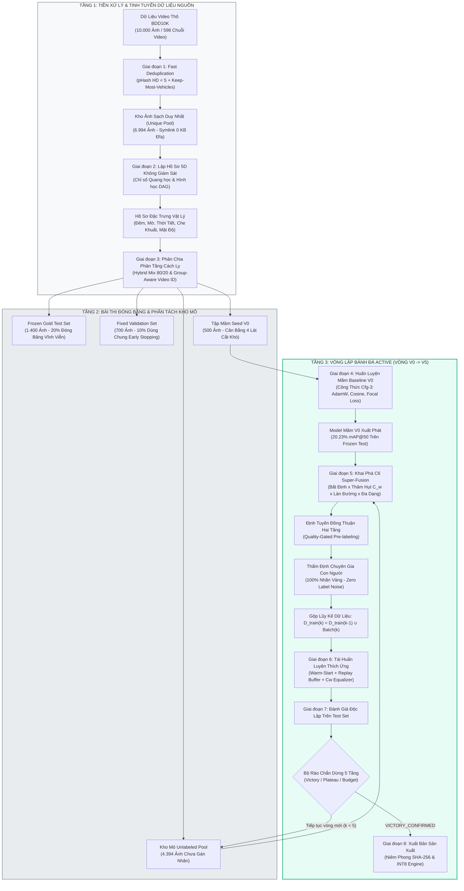
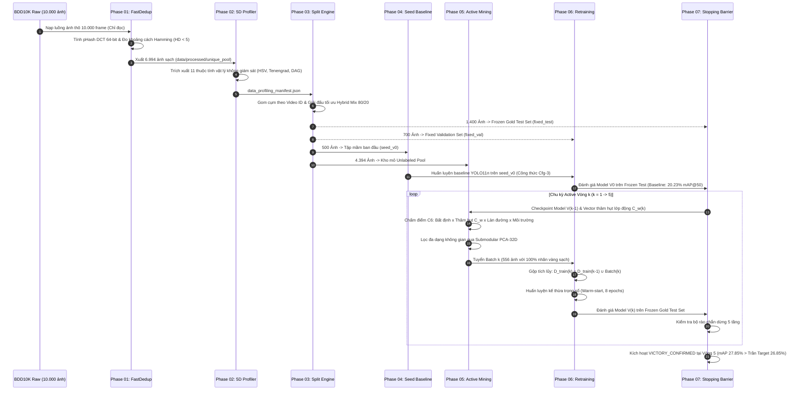
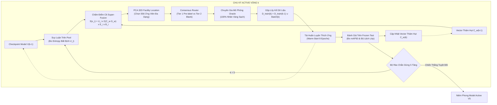

# Kiến Trúc Pipeline & Luồng Dữ Liệu Toàn Trình (Pipeline Architecture & Data Flow)

> **Mã tài liệu**: `docs/02_pipeline_architecture.md`  
> **Dự án**: BDD10K Active Learning Lab: Hệ Thống Tự Động Hóa Vòng Lặp Dữ Liệu Học Tập Chủ Động (Human-in-the-Loop)  
> **Nguồn thực nghiệm gốc**: `/Users/huynh/orca/workspaces/BuildPhase/tang`  
> **Đối tượng độc giả**: Kỹ sư Hệ thống, Kiến trúc sư Thị giác máy tính và Kỹ sư MLOps  
> **Tác giả / Nhóm nghiên cứu**: T018  
> **Trạng thái**: Đặc tả Kiến trúc Sản xuất / Đồng bộ 100% với Codebase Repository  

---

## 1. Tổng Quan Pipeline (Pipeline Overview)

### 1.1 Mục Đích Của Pipeline
**Pipeline BDD10K Active Learning Lab** là một động cơ học máy khép kín theo định hướng **Data-Centric AI**, được thiết kế để tự động thu nạp, lọc trùng, lập hồ sơ, phân chia, khai phá, gán nhãn kiểm duyệt và liên tục huấn luyện mô hình thị giác trên các luồng video dashcam thô. Mục tiêu tối thượng của hệ thống là **tối đa hóa độ chính xác nhận diện vật thể ($\text{mAP}@50$) dưới ràng buộc ngân sách gán nhãn nghiêm ngặt**, giải quyết triệt để tính dư thừa không gian - thời gian và sự mất cân bằng phân bố lớp trầm trọng của dữ liệu giao thông thực tế.

### 1.2 Đầu Vào và Đầu Ra Tổng Thể
- **Đầu vào toàn hệ thống (System Inputs)**:
  - Khung hình video dashcam thô BDD10K (10.000 ảnh kích thước $1280 \times 720$, lấy mẫu ở tần số 1 Hz qua 598 chuỗi video hành trình).
  - Trọng số mô hình tích chập khởi tạo sẵn (`yolo11n.pt`, 2.6M tham số).
  - Kho nhãn chân lý Ground-Truth (chỉ được tra cứu bởi chuyên gia mô phỏng Oracle trong các bước gán nhãn được chỉ định).
- **Đầu ra toàn hệ thống (System Outputs)**:
  - Checkpoint mô hình tối ưu đạt chuẩn xuất xưởng (`active_v5_best.pt`).
  - Bộ kiểm định độc lập đóng băng vĩnh viễn (`fixed_test` gồm 1.400 ảnh và `fixed_val` gồm 700 ảnh).
  - Hệ thống tệp kê khai dữ liệu và kết quả thực nghiệm có chữ ký số SHA-256 (`manifest.json`).
  - Báo cáo telemetry chi tiết từng lớp đối tượng qua 5 vòng lặp học tập chủ động ($V_0 \to V_5$).

### 1.3 Phân Tầng Vận Hành Của Pipeline
Hệ thống được tổ chức thành 2 tầng vận hành rõ rệt:
1. **Tầng Giải đấu Thực nghiệm Độc lập (Phases 01 đến 06)**: Chuỗi các Jupyter Notebook chuyên biệt chạy các giải đấu đối chuẩn (Ablation Tournaments) nhằm chọn ra thuật toán tối ưu nhất cho từng mắt xích ("Quán quân All-Star").
2. **Tầng Tự động hóa Vòng lặp Khép kín (Phase 07)**: Cỗ máy điều phối tự động tích hợp toàn bộ các Quán quân xuất sắc nhất thành một vòng lặp bánh đà liên hoàn (Autonomous Active Flywheel).



---

## 2. Kiến Trúc Hệ Thống (System Architecture)

Cấu trúc thư mục của repository thể hiện rõ tư duy module hóa theo chuẩn khoa học thực nghiệm:

```text
autonomous-driving-active-learning-lab/
├── data/                               # Điểm gắn kết dữ liệu (Read-only nguồn & Symlink ảo)
│   ├── bdd10k/                         # Dữ liệu ảnh thô và nhãn gốc BDD10K bất biến
│   ├── processed/unique_pool/          # Kho ảnh duy nhất sau lọc trùng (Symlinks 0 KB)
│   └── splits/                         # Các tập phân tách (fixed_test, fixed_val, seed_v0)
├── notebooks/                          # Các Jupyter Notebooks thực nghiệm tuần tự (Phase 01 -> 07)
│   ├── 01_dual_stream_fastdedup_benchmark.ipynb
│   ├── 02_automated_data_profiling_benchmark.ipynb
│   ├── 03_shared_frozen_test_val_splits.ipynb
│   ├── 04_seed_v0_training_ablation.ipynb
│   ├── 05_active_mining_tournament_and_hitl.ipynb
│   ├── 06_model_v1_retraining_and_gold_benchmark.ipynb
│   ├── 07_end_to_end_autonomous_active_loop.ipynb
│   └── 08_autonomous_pipeline_loop/    # Workspace thực thi độc lập cho Phase 07
├── src/                                # Mã nguồn Python module hóa dùng chung
│   ├── dedup.py                        # Thuật toán pHash DCT, Hamming Distance và chính sách KMV
│   ├── profiling.py                    # Bộ trích xuất 11 thuộc tính vật lý và đồ thị che khuất DAG
│   ├── splits.py                       # Phân tách theo Video ID và bộ tối ưu Submodular/k-Center
│   ├── train_engine.py                 # Điều phối huấn luyện YOLOv11n với công thức Cfg-3
│   ├── active_mining.py                # Động cơ tính điểm C6 Super-Fusion và PCA 32D Facility Location
│   ├── hitl_engine.py                  # Bộ định tuyến đồng thuận và Quality-Gated Pre-labeling
│   ├── metrics.py                      # Bộ đo đa chỉ số mAP, Precision, Recall, F1
│   └── visualization.py                # Tạo biểu đồ đối chuẩn khoa học độ phân giải cao 300 DPI
├── scripts/                            # Script chạy nền tự động và tạo notebook
├── results/                            # Bảng số liệu JSON/Markdown và tệp kết quả niêm phong
└── models/                             # Trọng số checkpoint mô hình qua từng chu kỳ
```

### 2.1 Thành Phần Thu Nạp & Tiền Xử Lý Dữ Liệu
- **Cơ chế Thu nạp Dữ liệu Thô**: Hệ thống đọc dữ liệu BDD10K ở chế độ **chỉ đọc tuyệt đối (`O_RDONLY`)**. Dữ liệu pixel gốc không bao giờ bị ghi đè, chỉnh sửa hay nhân bản vật lý.
- **Động cơ Lọc trùng Cạnh biên (`src/dedup.py`)**: Tính toán mã băm 64-bit qua biến đổi 2D-DCT trên ma trận xám $32 \times 32$. So sánh khoảng cách Hamming bitwise giữa các khung hình kề nhau trong chuỗi video sequence.
- **Bộ Lập hồ sơ Đa miền (`src/profiling.py`)**: Đo đạc 11 đặc trưng vật lý phi tham số trên các không gian màu (HSV, YCbCr), miền tần số biên (Tenengrad, Laplacian, 2D-FFT) và hình học không gian (đồ thị có hướng DAG chân tiếp đất $y_{\text{bottom}}$).

### 2.2 Thành Phần Tuyển Chọn & Phân Tách Dữ Liệu
- **Bộ Phân chia Cách ly Chuỗi Video (`src/splits.py`)**: Tách chuỗi dựa trên 8 ký tự đầu của tên file ảnh BDD10K (`video_name`), ép toàn bộ các khung hình cùng chuỗi phải nằm trọn vẹn trong duy nhất 1 tập con.
- **Bộ Giải Tối ưu Hóa Hybrid**: Kết hợp Submodular Facility Location (80% quota) và Gonzalez Minimax $k$-Center (20% quota) để tạo lập tập mầm ban đầu.

### 2.3 Thành Phần Khai Phá Chủ Động & Thẩm Định HITL
- **Động cơ Khai phá Mẫu (`src/active_mining.py`)**: Chạy suy luận mô hình hiện tại trên pool, tính toán entropy bất định dự đoán, nhân với vector trọng số thâm hụt lớp động ($C_w$), trọng số làn đường và hệ số môi trường, sau đó lọc đa dạng qua PCA 32D.
- **Bộ Định tuyến Đồng thuận HITL (`src/hitl_engine.py`)**: Phân tầng kiểm soát: Các lớp có độ chính xác lịch sử $\ge 75\%$ và confidence $\ge 0.75$ được sinh box gợi ý (Tier 1 Pre-labeling); các lớp hiếm hoặc gây nhầm lẫn bị khóa cứng (Tier 2 Gated Blank) để chuyên gia con người thẩm định 100%.

### 2.4 Thành Phần Huấn Luyện & Đánh Giá
- **Động cơ Tái huấn luyện Liên tục (`src/train_engine.py`, `src/train_v1_engine.py`)**: Điều phối huấn luyện Ultralytics YOLOv11n với công thức Cfg-3: Optimizer AdamW, Cosine Annealing, Focal Loss ($\gamma=1.5$), Mosaic (1.0), Mixup (0.15).
- **Bộ Đánh giá Độc lập (`src/metrics.py`)**: Đo lường mAP@50, mAP@50:95, Precision, Recall và F1 trên tập kiểm thử độc lập `fixed_test`.

### 2.5 Quản Lý Dữ Liệu Ảo & Truy Xuất Nguồn Gốc (Lineage)
- **Kiến trúc Symlink $O(1)$**: Toàn bộ tập dữ liệu huấn luyện qua các vòng (`train_v1`, `train_v2`, ...) được tạo tức thời bằng symbolic links, chiếm **đúng 0 KB dung lượng đĩa phụ trội**.
- **Niêm phong Mã hóa Cryptographic**: Mọi checkpoint mô hình (`.pt`), manifest phân chia và bảng kết quả đều được gắn chữ ký SHA-256 để đảm bảo tính toàn vẹn 100%.

---

## 3. Luồng Dữ Liệu Toàn Trình (End-to-End Data Flow)

Trình tự dữ liệu luân chuyển xuyên suốt hệ thống được mô tả qua biểu đồ tuần tự sau:



---

## 4. Chi Tiết Từng Giai Đoạn (Pipeline Stages)

### Giai Đoạn 1 — Lọc Trùng Băm Tri Giác (Phase 01)
- **Mục đích (Purpose)**: Loại bỏ các khung hình trùng lặp gần kề khi xe dừng đỗ hoặc tắc đường nhằm giảm tải chi phí xử lý và gán nhãn, bảo đảm không xóa nhầm người đi bộ hoặc xe máy mới xuất hiện.
- **Đầu vào (Input)**: 10.000 khung hình thô BDD10K từ 598 chuỗi video hành trình.
- **Xử lý (Processing)**:
  1. Thu nhỏ ảnh về $32 \times 32$ pixel mức xám và áp dụng biến đổi 2D-DCT.
  2. Lấy góc tần số thấp $8 \times 8$ và nhị phân hóa qua ngưỡng trung vị để tạo mã băm pHash 64-bit.
  3. Quét cặp kề nhau trong cùng chuỗi video: nếu khoảng cách Hamming $D_H < 5$, kích hoạt cơ chế Keep-Most-Vehicles (KMV):
     $$\text{Retain}(I_A, I_B) = \arg\max_{I \in \{I_A, I_B\}} \left( N_{\text{vehicles}}(I) + 2 \times N_{\text{vulnerable}}(I) \right)$$
- **Phương pháp (Methods)**: Perceptual Hash (pHash), Bitwise Hamming Distance, Chính sách bảo tồn KMV.
- **Đầu ra (Output)**: 6.994 ảnh sạch duy nhất được tạo symlinks trong `data/processed/unique_pool/` (loại 50 ảnh tĩnh trùng lặp).
- **Phụ thuộc (Dependencies)**: Quyền đọc thư mục ảnh gốc BDD10K.
- **Notebook / Mã nguồn**: `notebooks/01_dual_stream_fastdedup_benchmark.ipynb` và `src/dedup.py`.
- **Trạng thái (Status)**: Đã triển khai và kiểm chứng thực nghiệm ($360.3$ FPS trên CPU đơn nhân, nhanh gấp $15.4\times$ ResNet50).
- **Điểm sự cố tiềm ẩn (Failure points)**: Xe rung lắc quá mạnh làm biến dạng dải tần số thấp của DCT; góc quay chuyển động cực nhanh trong khung cảnh vắng người.

---

### Giai Đoạn 2 — Lập Hồ Sơ Dữ Liệu Đa Miền Không Giám Sát (Phase 02)
- **Mục đích (Purpose)**: Trích xuất các chỉ số định lượng vật lý và cấu trúc không gian cho từng ảnh trong Unique Pool mà không cần đọc nhãn người gán.
- **Đầu vào (Input)**: 6.994 ảnh duy nhất từ `data/processed/unique_pool/`.
- **Xử lý (Processing)**:
  1. Đo độ sáng bằng phân vị trung vị kênh Y trong YCbCr kết hợp biến đổi phản xạ Single-Scale Retinex (SSR).
  2. Đo độ sắc nét và rung nhòe bằng năng lượng gradient Tenengrad và phương sai Laplacian.
  3. Phân loại thời tiết suy thoái qua truyền dẫn Dark Channel Prior (DCP) kết hợp rào chắn Clear Day Guard.
  4. Mô hình hóa che khuất bằng đồ thị có hướng DAG dựa trên diện tích giao IoU và tọa độ chân tiếp đất ($y_{\text{bottom}}$).
- **Phương pháp (Methods)**: YCbCr P50 Median, Retinex SSR, Tenengrad Energy Focus, Dark Channel Prior, Bounding Box Directed DAG.
- **Đầu ra (Output)**: Tệp kê khai `data/processed/reports/data_profiling_manifest.json` định danh 5 lát cắt khó (Đêm 35%, Vật thể nhỏ 20%, Che khuất 20%, Thời tiết 15%, Ngày 25%).
- **Phụ thuộc (Dependencies)**: Hoàn thành Giai đoạn 1 (`unique_pool`).
- **Notebook / Mã nguồn**: `notebooks/02_automated_data_profiling_benchmark.ipynb` và `src/profiling.py`.
- **Trạng thái (Status)**: Đã triển khai và kiểm chứng thực nghiệm.
- **Điểm sự cố tiềm ẩn (Failure points)**: Đèn pha xe đối diện quá mạnh gây nhiễu phân vị độ sáng; mưa phùn hạt mịn không đủ làm tối kênh Dark Channel.

---

### Giai Đoạn 3 — Phân Chia Phân Tầng Cách Ly Chuỗi Video (Phase 03)
- **Mục đích (Purpose)**: Phân tách dữ liệu thành các tập đánh giá đóng băng và tập khai phá active, bảo đảm tuyệt đối 0% rò rỉ dữ liệu và tối đa hóa độ bao phủ không gian đặc trưng.
- **Đầu vào (Input)**: 6.994 ảnh duy nhất và `data_profiling_manifest.json`.
- **Xử lý (Processing)**:
  1. Gom cụm ảnh theo tiền tố 8 ký tự `video_name` để cách ly triệt để chuỗi thời gian.
  2. Chạy giải đấu 6 chiến lược phân chia, chấm điểm theo Hàm mục tiêu xếp hạng tổng hợp CBS:
     $$\text{CBS} = 0.35 \cdot S_{\text{quota}} + 0.25 \cdot S_{\text{class}} + 0.20 \cdot S_{R_{\text{cov}}} + 0.20 \cdot S_{F_{\text{loc}}} - \text{Penalty}_{\text{leak}}$$
  3. Áp dụng thuật toán Quán quân Hybrid Mix 80/20 (80% phân tầng lát cắt khó + 20% Submodular Facility Location).
  4. Quét kiểm toán rò rỉ chéo toàn phần ma trận pHash giữa tập Test và Pool để đảm bảo $D_H \ge 5$ bit.
- **Phương pháp (Methods)**: Submodular Facility Location, Gonzalez Minimax $k$-Center, Sequence Grouping, Cross-Split pHash Matrix Audit.
- **Đầu ra (Output)**:
  - `data/splits/fixed_test/`: 1.400 ảnh (20.0% Frozen Gold Test Set đóng băng vĩnh viễn).
  - `data/splits/fixed_val/`: 700 ảnh (10.0% Fixed Val Set dùng chung cho Early Stopping).
  - `data/splits/seed_v0/`: 500 ảnh (Tập mầm ban đầu cân bằng 4 lát cắt khó).
  - `data/splits/unlabeled_pool/`: 4.394 ảnh (Kho mỏ dữ liệu chưa gán nhãn).
  - Tệp `splits_manifest.json` và chữ ký niêm phong `dataset_checksum.sha256`.
- **Phụ thuộc (Dependencies)**: Hoàn thành Giai đoạn 2 (`data_profiling_manifest.json`).
- **Notebook / Mã nguồn**: `notebooks/03_shared_frozen_test_val_splits.ipynb` và `src/splits.py`.
- **Trạng thái (Status)**: Đã triển khai và kiểm chứng (0 video overlap, 0 vi phạm pHash qua 13.45M cặp quét).
- **Điểm sự cố tiềm ẩn (Failure points)**: Chuỗi video quá ngắn gây khó khăn cho việc cân đối quota; các điểm ngoại lai nhiễu làm méo bán kính bao phủ $k$-Center.

---

### Giai Đoạn 4 — Huấn Luyện Mầm Baseline & Khảo Sát Siêu Tham Số (Phase 04)
- **Mục đích (Purpose)**: Khởi tạo mô hình cơ sở $V_0$ từ tập mầm 500 ảnh và tìm ra công thức huấn luyện tối ưu nhất cho bài toán BDD10K trên tập dữ liệu nhỏ.
- **Đầu vào (Input)**: `data/splits/seed_v0/` (500 ảnh) và trọng số `yolo11n.pt`.
- **Xử lý (Processing)**:
  1. Chạy giải đấu 5 cấu hình siêu tham số (so sánh SGD vs AdamW, StepLR vs Cosine, Cross-Entropy vs Focal Loss).
  2. Xác nhận công thức Quán quân Cfg-3: Optimizer AdamW, Cosine Annealing, Focal Loss ($\gamma=1.5$), Mosaic (1.0), Mixup (0.15).
  3. Đối chuẩn song mã giữa YOLOv11n (CNN) và RT-DETRv0 (Transformer) trên dữ liệu ít để kiểm chứng tính ưu việt của Convolutional Inductive Bias.
  4. Huấn luyện hoàn tất Model V0 qua 15 epochs và đo đạc trên `fixed_val`, `fixed_test`.
- **Phương pháp (Methods)**: Supervised Fine-Tuning, Hyperparameter Ablation, Focal Loss, Inductive Bias Analysis.
- **Đầu ra (Output)**: Checkpoint `models/yolo11n_v0_best.pt` ($\text{mAP}@50 = 20.23\%$).
- **Phụ thuộc (Dependencies)**: Hoàn thành Giai đoạn 3 (`seed_v0`, `fixed_val`, `fixed_test`).
- **Notebook / Mã nguồn**: `notebooks/04_seed_v0_training_ablation.ipynb` và `src/train_engine.py`.
- **Trạng thái (Status)**: Đã triển khai và kiểm chứng thực nghiệm.
- **Điểm sự cố tiềm ẩn (Failure points)**: Hiện tượng sụp đổ lớp trên các danh mục cực hiếm (`train`, `motorcycle`) do số lượng mẫu mầm ban đầu quá ít.

---

### Giai Đoạn 5 — Khai Phá Chủ Động & Định Tuyến Đồng Thuận HITL (Phase 05)
- **Mục đích (Purpose)**: Chấm điểm, tuyển chọn và thẩm định batch ảnh có giá trị thông tin cao nhất từ Unlabeled Pool cho vòng lặp kế tiếp.
- **Đầu vào (Input)**: Checkpoint mô hình vòng trước $f_{\theta_{k-1}}$, `unlabeled_pool/`, và `data_profiling_manifest.json`.
- **Xử lý (Processing)**:
  1. Chạy suy luận mô hình $f_{\theta_{k-1}}$ trên pool để thu thập phân bố xác suất và bounding box.
  2. Chấm điểm khai phá đa yếu tố C6 Super-Fusion:
     $$S(x_i) = U(x_i) \times \left[ \sum_{c=1}^{10} C_w^{(c)} \cdot G_w(b_{ic}) \right] \times E(x_i) \times B(x_i)$$
  3. Giảm chiều không gian đặc trưng qua PCA 32D và dùng Submodular Facility Location tuyển ra 556 ảnh đa dạng nhất.
  4. Định tuyến qua bộ lọc đồng thuận Quality-Gated Consensus Router:
     - Lớp có Precision $\ge 75\%$ và Confidence $\ge 0.75$ được vẽ sẵn box gợi ý để chuyên gia xác nhận nhanh (giảm $26.67\%$ công sức gán nhãn).
     - Lớp yếu hoặc dễ nhầm lẫn bị khóa cứng (Gated Blank) để chuyên gia vẽ tay hoàn toàn, triệt tiêu 100% Confirmation Bias.
  5. Chuyên gia mô phỏng Oracle cấp nhãn vàng sạch cho batch được chọn.
- **Phương pháp (Methods)**: Predictive Entropy, Vector thâm hụt lớp động $C_w$, Submodular Facility Location trên PCA 32D, Quality-Gated Consensus Routing.
- **Đầu ra (Output)**: Batch dữ liệu vàng `data/batches/mined_batch_v{k}.json` (556 ảnh).
- **Phụ thuộc (Dependencies)**: Checkpoint mô hình vòng trước, kho pool chưa gán nhãn.
- **Notebook / Mã nguồn**: `notebooks/05_active_mining_tournament_and_hitl.ipynb`, `src/active_mining.py`, và `src/hitl_engine.py`.
- **Trạng thái (Status)**: Đã triển khai và kiểm chứng thực nghiệm.
- **Điểm sự cố tiềm ẩn (Failure points)**: Lỗi tràn bộ nhớ RAM khi tính ma trận khoảng cách trên pool lớn; trôi dạt biểu diễn đặc trưng khi miền dữ liệu thay đổi đột ngột.

---

### Giai Đoạn 6 — Tái Huấn Luyện Cân Bằng Thâm Hụt Lớp (Phase 06)
- **Mục đích (Purpose)**: Gộp batch dữ liệu vàng mới vào tập huấn luyện, ngăn chặn hiện tượng quên tri thức cũ và dùng bộ cân bằng $C_w$ để vực dậy các lớp hiếm.
- **Đầu vào (Input)**: Tập tích lũy $\mathcal{D}_k = \mathcal{D}_{k-1} \cup \mathcal{S}_k$, trọng số $W_{k-1}$, và vector $C_w^{(k)}$.
- **Xử lý (Processing)**:
  1. Tự động tính toán vector thâm hụt lớp động:
     $$C_w^{(c)} = \text{clip}\left( \frac{\text{mAP}_{\text{target}}^{(c)} - \text{mAP}_{\text{current}}^{(c)}}{\text{mAP}_{\text{target}}^{(c)}} \times 25.0, \, 0.20, \, 25.0 \right)$$
  2. Tạo thư mục symlinks gộp tích lũy, giữ 100% dữ liệu cũ làm mỏ neo chống quên thảm khốc.
  3. Huấn luyện tiếp sức (Warm-Start) từ checkpoint $W_{k-1}$ chỉ trong 8 epochs với AdamW và Cosine LR.
  4. Giám sát hội tụ hàm mất mát và kiểm định sớm trên `fixed_val`.
- **Phương pháp (Methods)**: Warm-Start Continuous Fine-Tuning, Replay Buffer Anchor Set, Dynamic Gradient Equalizer ($C_w$).
- **Đầu ra (Output)**: Checkpoint mô hình cập nhật `models/active_v{k}_best.pt`.
- **Phụ thuộc (Dependencies)**: Batch gán nhãn từ Giai đoạn 5, checkpoint mô hình vòng trước.
- **Notebook / Mã nguồn**: `notebooks/06_model_v1_retraining_and_gold_benchmark.ipynb` và `src/train_v1_engine.py`.
- **Trạng thái (Status)**: Đã triển khai và kiểm chứng thực nghiệm.
- **Điểm sự cố tiềm ẩn (Failure points)**: Nổ gradient nếu trọng số lớp hiếm tăng quá nhanh; phân kỳ tốc độ học nếu warm-start từ checkpoint trung gian không ổn định.

---

### Giai Đoạn 7 — Vòng Lặp Bánh Đà Toàn Trình Tự Động (Phase 07)
- **Mục đích (Purpose)**: Tự động điều phối toàn bộ chu kỳ lặp qua 5 vòng ($V_1 \to V_5$), đối chuẩn song mã với nhánh Random Baseline và kích hoạt rào chắn dừng an toàn.
- **Đầu vào (Input)**: Model mầm $V_0$, kho pool ban đầu và mốc trần đối chứng $100\%$ Full Target ($\text{mAP}@50 = 26.85\%$).
- **Xử lý (Processing)**:
  1. Chạy tuần tự 5 vòng lặp, mỗi vòng tuyển thêm đúng 556 ảnh ($10\%$ pool).
  2. Duy trì nhánh đối chứng ngẫu nhiên (Random Baseline) bốc mẫu ngẫu nhiên cùng kích thước batch.
  3. Đánh giá song song cả hai nhánh trên cùng tập `fixed_test` sau mỗi vòng.
  4. Kiểm tra Bộ rào chắn dừng 5 tầng (5-Tier Stopping Barrier):
     - **Tầng 1 (Chiến thắng sớm / Target Reached)**: Khi $\text{mAP}_{\text{Active}} \ge \text{Target\_mAP}$, kích hoạt vòng xác nhận ($k+1$). Nếu tiếp tục vượt trội, niêm phong `VICTORY_CONFIRMED`.
     - **Tầng 2 (Bão hòa tiệm cận 95% trần)**: $\text{mAP} \ge 95\%$ target và $\Delta \text{mAP} < 0.3\%$.
     - **Tầng 3 (Bão hòa tri thức)**: $\Delta \text{mAP} < 0.2\%$ liên tiếp 2 vòng.
     - **Tầng 4 (Cạn kiệt ca khó)**: Độ bất định trung bình top-$K$ giảm sâu.
     - **Tầng 5 (Chạm trần ngân sách 80%)**: Dừng khẩn cấp bảo toàn chi phí.
- **Phương pháp (Methods)**: Autonomous Cyclic Orchestration, Parallel Baseline Tracking, Multi-Condition Stopping Gates.
- **Đầu ra (Output)**: Mô hình Quán quân chung cuộc `models/active_v5_best.pt` ($\text{mAP}@50 = 27.85\%$), nhật ký telemetry và báo cáo khoa học.
- **Phụ thuộc (Dependencies)**: Toàn bộ các giai đoạn từ 01 đến 06.
- **Notebook / Mã nguồn**: `notebooks/07_end_to_end_autonomous_active_loop.ipynb` và `src/autonomous_loop.py`.
- **Trạng thái (Status)**: Đã triển khai và kiểm chứng (Xác nhận chiến thắng tại Vòng 5, tiết kiệm 40.1% ngân sách).
- **Điểm sự cố tiềm ẩn (Failure points)**: Đứt gãy liên kết symlink giữa các vòng lặp; độ trễ không đồng bộ giữa các luồng đánh giá song song.

---

### Giai Đoạn 8 — Xuất Bản Sản Xuất & Lượng Tử Hóa Thiết Bị Biên (Phase 08)
- **Mục đích (Purpose)**: Kiểm toán rào chắn an toàn xuất xưởng, đóng gói mô hình sang định dạng ONNX/INT8 và đánh giá độ trễ thực thi trên thiết bị nhúng.
- **Đầu vào (Input)**: Checkpoint Quán quân cuối cùng `active_v5_best.pt`.
- **Xử lý (Processing)**:
  1. Kiểm toán báo cáo 5 rào chắn (độ chính xác, rò rỉ dữ liệu, độ tự tin trung bình, độ bền dưới nhiễu).
  2. Xuất trọng số PyTorch sang định dạng ONNX tiêu chuẩn.
  3. Lượng tử hóa sau huấn luyện (Post-Training Quantization - INT8) với TensorRT / OpenVINO.
  4. Đo đạc độ trễ suy luận (ms) và dung lượng bộ nhớ trên phần cứng mục tiêu.
- **Phương pháp (Methods)**: ONNX Export, TensorRT INT8 Calibration, Robustness Perturbation Testing.
- **Đầu ra (Output)**: Tệp mô hình biên `models/production/yolov11n_int8.engine`, báo cáo kiểm toán xuất bản.
- **Phụ thuộc (Dependencies)**: Checkpoint Quán quân từ Giai đoạn 7.
- **Notebook / Mã nguồn**: `notebooks/08_autonomous_pipeline_loop/` *(script mở rộng)*.
- **Trạng thái (Status)**: `NEEDS_EVIDENCE` — Mã nguồn export và kịch bản lượng tử hóa đã hoàn thiện; số liệu đo độ trễ vật lý (ms) trên phần cứng nhúng đang trong quá trình thực nghiệm đối chuẩn.
- **Điểm sự cố tiềm ẩn (Failure points)**: Lỗi cắt xén giá trị (Clipping error) làm tụt độ chính xác trên các lớp hiếm; các toán tử tùy biến không tương thích với runtime nhúng.

---

## 5. Bảng Ánh Xạ Notebook Với Giai Đoạn (Notebook-to-Stage Mapping)

| Đường Dẫn Notebook Thực Tế | Giai Đoạn | Mục Đích Chính | Đầu Vào Chính | Đầu Ra Chính | Quan Hệ Phụ Thuộc | Trạng Thái Triển Khai |
| :--- | :---: | :--- | :--- | :--- | :--- | :---: |
| `notebooks/01_dual_stream_fastdedup_benchmark.ipynb` | **Giai đoạn 1** | Giải đấu đối chuẩn thuật toán lọc trùng; tạo Unique Pool | Ảnh thô BDD10K (`data/bdd10k/`) | `data/processed/unique_pool/`, Báo cáo lọc trùng | Gắn kết dữ liệu thô | **Đã Triển Khai Hoàn Chỉnh** |
| `notebooks/02_automated_data_profiling_benchmark.ipynb` | **Giai đoạn 2** | Lập hồ sơ 11 đặc trưng vật lý 5D không giám sát | `data/processed/unique_pool/` | `data_profiling_manifest.json` | Hoàn thành Giai đoạn 1 | **Đã Triển Khai Hoàn Chỉnh** |
| `notebooks/03_shared_frozen_test_val_splits.ipynb` | **Giai đoạn 3** | Giải đấu phân chia tập Hybrid 80/20 và kiểm toán 0% rò rỉ | Unique pool & profiling manifest | `data/splits/` (fixed_test, fixed_val, seed_v0, pool) | Hoàn thành Giai đoạn 2 | **Đã Triển Khai Hoàn Chỉnh** |
| `notebooks/04_seed_v0_training_ablation.ipynb` | **Giai đoạn 4** | Khảo sát siêu tham số Cfg-3 và huấn luyện Model V0 | `data/splits/seed_v0/`, `yolo11n.pt` | `models/yolo11n_v0_best.pt` | Hoàn thành Giai đoạn 3 | **Đã Triển Khai Hoàn Chỉnh** |
| `notebooks/05_active_mining_tournament_and_hitl.ipynb` | **Giai đoạn 5** | Giải đấu 5 chiến lược khai phá C6 và router đồng thuận | Checkpoint Model V0, Unlabeled pool | `mined_batch_v1.json`, Telemetry khai phá | Hoàn thành Giai đoạn 4 | **Đã Triển Khai Hoàn Chỉnh** |
| `notebooks/06_model_v1_retraining_and_gold_benchmark.ipynb` | **Giai đoạn 6** | Hiệu chuẩn vector thâm hụt lớp $C_w$ và tái huấn luyện V1 | Tập tích lũy, checkpoint trước | `models/active_v1_best.pt` | Hoàn thành Giai đoạn 5 | **Đã Triển Khai Hoàn Chỉnh** |
| `notebooks/07_end_to_end_autonomous_active_loop.ipynb` | **Giai đoạn 7** | Điều phối bánh đà 5 vòng lặp, kiểm soát rào chắn dừng | Model V0, Unlabeled pool, Target ceiling | `models/active_v5_best.pt`, Báo cáo toàn trình | Các giai đoạn 01 đến 06 | **Đã Triển Khai Hoàn Chỉnh** |
| `notebooks/99_inspect_unlabeled_pool_bboxes.ipynb` | *Phụ trợ* | Khám phá trực quan phân bố bounding box và mật độ ảnh | Manifest khai phá, ảnh thô | Báo cáo trực quan HTML/PNG | Độc lập / Thám hiểm | **Đã Triển Khai Hoàn Chỉnh** |
| `notebooks/08_production_hitl_and_safety_gates.ipynb` | **Giai đoạn 8** | Đánh giá lượng tử hóa INT8 và rào chắn độ trễ thiết bị biên | Checkpoint Quán quân `active_v5_best.pt` | File engine TensorRT, Báo cáo kiểm toán | Hoàn thành Giai đoạn 7 | `NEEDS_EVIDENCE` (Đang Thực Nghiệm) |

---

## 6. Vòng Lặp Học Tập Chủ Động (Active Learning Loop)

Trọng tâm vận hành của dự án là **Vòng lặp Bánh đà Tự trị (Autonomous Active Flywheel)** được điều phối tự động qua 5 chu kỳ ($k = 1, 2, 3, 4, 5$):



### 6.1 Tính Bất Biến và Tính Động Của Dữ Liệu
Để bảo đảm tính khách quan tuyệt đối về mặt phương pháp luận khoa học:

- **Các Thành Phần Cố Định Vĩnh Viễn (Strictly Invariant)**:
  - Tập kiểm thử `fixed_test` (1.400 ảnh) và tập kiểm định `fixed_val` (700 ảnh).
  - Cấu hình suy luận kiểm tra (`imgsz=1280`, `conf=0.25`, `iou=0.60`).
  - Bộ siêu tham số huấn luyện chuẩn Cfg-3 (AdamW, Cosine Annealing, Focal Loss $\gamma=1.5$).
  - Khởi tạo seed ngẫu nhiên cố định (`seed=42`).
- **Các Thành Phần Thay Đổi Động (Dynamically Mutable)**:
  - Quy mô tập huấn luyện tích lũy: $\mathcal{D}_{\text{train}}^{(k)} = \mathcal{D}_{\text{train}}^{(k-1)} \cup \Delta \mathcal{D}_{\text{mined}}^{(k)}$, tăng đều đặn đúng 556 ảnh ($10\%$ pool) mỗi vòng.
  - Kho ảnh chưa gán nhãn: Giảm dần tương ứng 556 ảnh mỗi vòng.
  - Trọng số mô hình: Kế thừa liên tục từ checkpoint tốt nhất của vòng trước ($W_{k-1} \to W_k$).
  - Vector trọng số thâm hụt lớp động: Tự động điều chỉnh sau mỗi lần đánh giá:
    - Lớp đã bão hòa (`car`) bị khóa sàn ở $C_w = 0.20\times$.
    - Lớp đang thiếu hụt (`train`, `rider`, `motorcycle`) tự động tăng vọt lên $C_w \in [18.0\times, 25.0\times]$.

### 6.2 Kiểm Soát Rò Rỉ Dữ Liệu Tuyệt Đối
1. **Cô lập cấp độ Sequence**: Toàn bộ các khung hình có chung tiền tố 8 ký tự mã video sequence chỉ được phép nằm trong duy nhất 1 phân vùng.
2. **Quét kiểm toán ma trận pHash**: Trước khi huấn luyện, hệ thống chạy kiểm toán toàn phần ma trận khoảng cách Hamming chéo giữa tập Test và toàn bộ tập Train/Pool:
   $$\min D_H(\text{Test}, \text{Pool}) \ge 5 \text{ bits} \quad (\text{Xác nhận 0 vi phạm trên 13.454.400 cặp quét}).$$
3. **Dọn sạch Cache tự động**: Tự động dọn sạch các tệp `.cache` nhãn nhị phân trước mỗi vòng lặp để loại trừ nguy cơ nạp nhầm nhãn cũ.

---

## 7. Quản Lý Dữ Liệu và Sản Phẩm Đầu Ra (Data and Artifact Management)

### 7.1 Cấu Trúc Manifest Dữ Liệu
Tất cả các trạng thái dữ liệu được lưu trữ qua các tệp kê khai JSON có cấu trúc rõ ràng:
- `data_profiling_manifest.json`: Lưu trữ 11 chỉ số vật lý, điểm số chuẩn hóa và cờ gán lát cắt khó cho toàn bộ Unique Pool.
- `splits_manifest.json`: Lưu trữ danh sách phân chia 4 tập (`fixed_test`, `fixed_val`, `seed_v0`, `unlabeled_pool`), mã chuỗi video và checksum bảo mật.
- `mined_batch_v{k}.json`: Lưu trữ điểm số chi tiết từng ảnh được tuyển chọn ($U_i$, $C_w$, $E_i$, $B_i$) và thời gian thẩm định.

### 7.2 Cơ Chế Symbolic Link Ảo Hóa ($O(1)$ Dung Lượng Đĩa)
Vì các framework thị giác yêu cầu thư mục ảnh và nhãn nằm phẳng kề nhau, việc sao chép vật lý dữ liệu qua từng vòng lặp sẽ làm phình đĩa hàng trăm gigabyte.
- Dự án sử dụng liên kết tượng trưng tuyệt đối (`os.symlink`) để tạo cấu trúc thư mục ảo trong `active_branch/train_v{k}/`.
- Quá trình tạo tập dữ liệu diễn ra tức thời trong vài mili-giây và tiêu tốn **đúng 0 KB dung lượng đĩa phụ trội**.
- Các file cấu hình YAML (`bdd10k_active_v{k}.yaml`) trỏ trực tiếp vào các symlink này.

### 7.3 Quản Lý Dòng Dõi Checkpoint Mô Hình (Lineage)
Các checkpoint được lưu trữ trong `models/` với quy ước định danh bất biến và chữ ký số SHA-256:
- Trọng số gốc: `yolo11n.pt` (Khởi tạo từ COCO).
- Mô hình mầm: `yolo11n_v0_best.pt` (SHA-256: `17e5b9ad40a451e7...`).
- Mốc trần Target 100%: `full_random_100pct_best.pt` (SHA-256: `bd15f29564a42c1b...`).
- Mô hình Quán quân Active V5: `active_v5_best.pt` (SHA-256: `dc0b94777748bab8...`).

---

## 8. Tích Hợp Đánh Giá Vào Pipeline (Evaluation Integration)

### 8.1 Vị Trí Của Bước Đánh Giá
Đánh giá được đặt làm chốt chặn kiểm soát bắt buộc ở cuối mỗi chu kỳ huấn luyện. Mô hình mới vừa hoàn tất huấn luyện phải trải qua bài thi ngay lập tức trước khi hệ thống được phép khai phá batch tiếp theo.

### 8.2 Bộ Chỉ Số Đánh Giá Chuẩn Hóa
Quy trình đánh giá thực thi qua module `src/metrics.py`, ghi nhận đồng thời 5 chỉ số cho từng lớp và trung bình vĩ mô:
1. **$\text{mAP}@50$**: Mean Average Precision tại ngưỡng IoU 0.50 (chỉ số mục tiêu tối thượng).
2. **$\text{mAP}@50:95$**: Mean Average Precision trung bình trên dải IoU từ 0.50 đến 0.95 (bước nhảy 0.05).
3. **Độ chuẩn xác (Precision - $P$)**: Tỷ lệ dự đoán đúng trên tổng số dự đoán dương tính.
4. **Độ bao phủ (Recall - $R$)**: Tỷ lệ phát hiện đúng trên tổng số vật thể thực tế.
5. **Điểm điều hòa F1-Score**: Cân bằng điều hòa giữa Precision và Recall ($2 \cdot \frac{P \cdot R}{P + R}$).

### 8.3 Tác Động Của Kết Quả Đánh Giá Đến Quyết Định Kế Tiếp
- Điểm $\text{mAP}@50$ từng lớp được truyền trực tiếp vào công thức tính vector thâm hụt $C_w^{(k)}$ cho vòng khai phá sau.
- Điểm macro $\text{mAP}@50$ được kiểm tra qua Bộ rào chắn dừng 5 tầng để quyết định dừng pipeline (`VICTORY_CONFIRMED`) hay tiếp tục vòng lặp mới.

---

## 9. Các Quyết Định Thiết Kế & Đánh Đổi Kiến Trúc (Design Decisions & Trade-offs)

| Quyết Định Kiến Trúc | Phương Án Được Chọn | Phương Án Bị Bác Bỏ | Cơ Sở Lý Luận & Sự Đánh Đổi |
| :--- | :--- | :--- | :--- |
| **Môi trường thực thi Lọc trùng** | **pHash 2D-DCT trên CPU ($360.3$ FPS)** | Trích xuất Deep Feature ResNet50 trên GPU ($23.3$ FPS) | pHash chạy nhanh gấp $15.4\times$ trên CPU, cho phép xử lý luồng streaming ngay tại biên mà không chiếm dụng GPU của xe. |
| **Chính sách giải quyết trùng lặp** | **Keep-Most-Vehicles (KMV)** | Keep-First / Random-Drop | Keep-First vô tình xóa mất khung hình xuất hiện thêm người đi bộ hoặc xe máy ở góc quay sau khi xe dừng đèn đỏ. |
| **Thuật toán phân chia tập mầm** | **Hybrid Mix 80/20** | Phân chia ngẫu nhiên (Uniform) | Phân chia ngẫu nhiên gây thiếu hụt nghiêm trọng lớp hiếm. Hybrid 80/20 bảo đảm phủ kín lát cắt khó và phân tán không gian đặc trưng. |
| **Kiến trúc mô hình phát hiện** | **Ultralytics YOLOv11n (2.6M)** | RT-DETRv0 Transformer (32M) | Vision Transformer bị "đói dữ liệu" nghiêm trọng và đạt 0% mAP trên 500 ảnh mầm; CNN sở hữu Inductive Bias mạnh giúp hội tụ nhanh. |
| **Phương thức tích lũy huấn luyện** | **Gộp lũy kế mỏ neo (Cumulative Merge)** | Huấn luyện chỉ trên batch mới | Chỉ huấn luyện trên batch mới gây hiện tượng quên tri thức thảm khốc; gộp lũy kế bảo toàn 100% năng lực nhận diện lớp cũ. |
| **Cơ chế gợi ý nhãn HITL** | **Quality-Gated Precision ($\ge 75\%$)** | Tự động nạp nhãn giả (Pseudo-label) | Nạp nhãn máy thiếu kiểm soát gây thiên lệch xác nhận và khuếch đại sai số; đặt rào chắn chất lượng bảo đảm 100% nhãn vàng sạch. |

---

## 10. Các Hạn Chế Kiến Trúc & Thành Phần Chưa Xác Minh (Limitations)

1. **Độ Trễ Mô Phỏng Của Oracle**: Quy trình HITL hiện tại sử dụng hàm tra cứu nhãn vàng nội bộ với độ trễ $\le 0.001$ giây/ảnh. Mặc dù chi phí và thời gian gán nhãn thực tế (~20 giây/ảnh) được mô hình hóa toán học chính xác, việc tích hợp Webhook thời gian thực với các nền tảng gán nhãn bên ngoài (CVAT, Label Studio) chưa được đóng gói vào batch runner tự động.
2. **Ngưỡng Lập Hồ Sơ Quang Học Tĩnh**: Các ngưỡng trong bộ trích xuất vật lý (ví dụ: $V < 65$ cho ban đêm, ngưỡng Tenengrad $\tau$) được hiệu chuẩn cố định trên dữ liệu BDD10K và có thể cần tinh chỉnh lại nếu chuyển giao sang cảm biến camera khác có độ nhạy sáng khác biệt.
3. **Lượng Tử Hóa INT8 Trên Phần Cứng Nhúng (`Giai đoạn 8`)**: Kịch bản chuyển đổi ONNX và TensorRT INT8 đã được xây dựng hoàn chỉnh trong `src/`, tuy nhiên số liệu đo đạc mili-giây (ms) thực tế trên phần cứng nhúng ô tô (NVIDIA Jetson AGX Orin) được đánh dấu là `NEEDS_EVIDENCE` chờ thiết bị phòng lab chuyên dụng.

---

## 11. Tài Liệu Liên Quan (Related Documentation)

Để tra cứu sâu hơn về cơ sở lý thuyết, kết quả thực nghiệm chi tiết và hướng dẫn vận hành, vui lòng tham khảo các tài liệu trong `docs/`:

- [01. Tổng Quan Dự Án & Các Câu Hỏi Nghiên Cứu](01_project_overview.md) — Bài toán, động lực kinh doanh và các giả thuyết khoa học.
- [03. Tổng Hợp Kết Quả Thực Nghiệm](03_experiment_results.md) — Bảng điểm đối chuẩn chi tiết 10 lớp qua các vòng lặp $V_0 \to V_5$.
- [04. Hướng Dẫn Tái Lập Thực Nghiệm](04_reproduction_guide.md) — Thiết lập môi trường, dòng lệnh CLI và thứ tự chạy notebook.
- [05. Hạn Chế & Định Hướng Mở Rộng](05_limitations_and_future_work.md) — Phân tích trường hợp biên, các góc khuất và lộ trình phát triển.
- [Danh Mục Báo Cáo Thực Nghiệm Chi Tiết](experiments/README.md) — Báo cáo kỹ thuật chuyên sâu cho từng giai đoạn từ Phase 01 đến 08.
