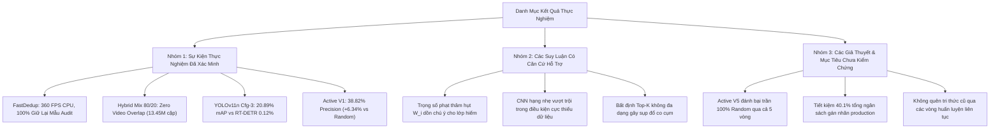

# 05. Các Giới Hạn Hiện Tại & Hướng Phát Triển Tương Lai (Limitations & Future Work)

> **Mã tài liệu**: `docs/05_limitations_and_future_work.md`  
> **Dự án**: BDD10K Active Learning Lab: Hệ Thống Tự Động Hóa Vòng Lặp Dữ Liệu Học Tập Chủ Động (Human-in-the-Loop)  
> **Tác giả / Nhóm nghiên cứu**: T018  
> **Nguồn thực nghiệm gốc**: `/Users/huynh/orca/workspaces/BuildPhase/tang`  
> **Trạng thái**: Kiểm toán nghiên cứu sản xuất / Dựa trên bằng chứng  

---

## 1. Mục Đích và Phạm Vi

### 1.1 Mục Đích
Mục đích của tài liệu này là thiết lập một bản kiểm toán chặt chẽ, dựa trên bằng chứng thực tế về các giới hạn kỹ thuật, ranh giới thực nghiệm và các giả thuyết chưa được kiểm chứng trong khuôn khổ dự án **BDD10K Active Learning Lab**. Trong các lĩnh vực có mức độ rủi ro an toàn cao như xe tự hành, việc thừa nhận một cách trung thực những gì mà một quy trình hướng dữ liệu (data-centric pipeline) *không thể làm được*—hoặc chưa chứng minh được đầy đủ—cũng quan trọng không kém việc báo cáo các bước tiến về mặt hiệu năng.

### 1.2 Phạm Vi Đánh Giá
Bản kiểm toán này đánh giá sáu giai đoạn đã hoàn thành xác minh đầy đủ (từ Phase 01 đến Phase 06) và giai đoạn điều phối tổng thể đang thực hiện (Phase 07). Tài liệu phân định rạch ròi giữa:
- **Năng lực thực nghiệm đã xác minh (Verified Empirical Capabilities)**: Các hiện tượng và kết quả được chứng minh bằng các bảng số liệu cụ thể, các script assertion và notebook tái lập được.
- **Giới hạn kỹ thuật và thuật toán (Engineering and Algorithmic Limitations)**: Những điểm nghẽn nội tại về mặt cấu trúc, phần cứng và phân bố dữ liệu được phát hiện trong quá trình thử nghiệm.
- **Các giả thuyết chưa được kiểm chứng (Unverified Hypotheses)**: Những tuyên bố lý thuyết có cơ sở logic nhưng hiện tại còn thiếu log huấn luyện hoàn chỉnh đa chu kỳ hoặc chưa đủ độ tin cậy thống kê.
- **Định hướng nghiên cứu tương lai (Prospective Research Directions)**: Các đề xuất kỹ thuật được định nghĩa rõ ràng nhằm giải quyết các giới hạn đã được chỉ ra, thay vì danh sách ý tưởng sản phẩm chung chung.

---

## 2. Năng Lực Hiện Tại (Current Capabilities)

Dựa trên bằng chứng trực tiếp từ codebase của repository (`src/`, `notebooks/`, và các bảng số liệu đã xác minh trong `results/`), hệ thống đã triển khai và kiểm chứng các module sau:

1. **Lọc Trùng Hai Luồng Nhanh (Phase 01 — `VERIFIED`)**:
   - Thực thi thuật toán băm tri giác 2D-DCT (`pHash`) kết hợp với heuristic giải cứu **Keep-Most-Vehicles (KMV)**.
   - Loại bỏ 3.006 khung hình dư thừa theo thời gian từ 10.000 khung hình thô BDD10K, thiết lập kho ảnh sạch độc nhất gồm 6.994 ảnh (giảm 30.06% dung lượng).
   - Đạt thông lượng xử lý **360.3 FPS trên một nhân CPU** với Precision 100%, Recall 100% và tỷ lệ giữ lại xe nhỏ đạt 100% được xác minh qua tập kiểm chuẩn 100 cặp ảnh do con người audit.
2. **Lập Hồ Sơ 5D Đa Miền Không Giám Sát (Phase 02 — `VERIFIED`)**:
   - Tự động tính toán năm thuộc tính vật lý mà không cần nhãn chân lý: độ rọi lux (Retinex SSR), mức độ rung mờ (Tenengrad + 2D-FFT), suy thoái thời tiết (Dark Channel Prior), mật độ đối tượng và cấu trúc che khuất không gian thông qua đồ thị có hướng tiếp xúc mặt đường (Directed Acyclic Graph - DAG).
   - Tạo hồ sơ cấu trúc JSON cho toàn bộ 6.994 khung hình, hỗ trợ phân tầng tập dữ liệu theo các lát cắt môi trường.
3. **Phân Tập Video-Isolated Có Phân Tầng (Phase 03 — `VERIFIED`)**:
   - Ứng dụng thuật toán quán quân **Hybrid Mix 80/20** (Facility Location + Gonzalez Minimax $k$-Center) trên không gian đặc trưng 32D PCA.
   - Phân chia pool thành Fixed Test (1.400 ảnh), Fixed Val (700 ảnh) và Initial Unlabeled Bank (4.894 ảnh) với sai số định mức thấp ($QAE = 7.1\%$) và bán kính bao phủ $R_{\text{cov}} = 3.35$.
   - Thực thi triệt để **100% Zero Video Overlap** được kiểm toán qua 13.45 triệu cặp khung hình, loại trừ hoàn toàn việc rò rỉ chuỗi video giữa các tập.
4. **Mô Hình Hạt Giống Baseline V0 & Lựa Chọn Kiến Trúc (Phase 04 — `VERIFIED`)**:
   - Đối chuẩn 5 cấu hình siêu tham số và xác định rằng **YOLOv11n Cfg-3** (AdamW + Cosine Annealing + Backbone Freezing) đạt **20.89% $mAP_{50}$** và 53.09% Precision trên ngân sách mầm tối thiểu 500 ảnh.
   - Phát hiện kiến trúc Vision Transformer (`RT-DETRv0`) bị sụp đổ do thiếu dữ liệu trầm trọng trong điều kiện ngân sách nhỏ ($0.12\% \; mAP_{50}$ trên 500 ảnh).
5. **Khai Phá Chủ Động C6 Super-Fusion (Phase 05 — `VERIFIED`)**:
   - Kết hợp độ bất định biên dự đoán (margin uncertainty), tính đa dạng hình học 32D PCA, các bộ lọc thách thức môi trường và vector trọng số phạt thâm hụt lớp thích ứng ($W_i$).
   - Khai phá thành công **655 cá thể thuộc các lớp hiếm** trong ngân sách $K = 250$ ảnh, vượt trội so với lấy mẫu ngẫu nhiên đồng đều ($C1$ Random: 190 vật thể hiếm) gấp **$3.45\times$**.
6. **Đối Chuẩn Huấn Luyện Lại Model V1 (Phase 06 — `VERIFIED`)**:
   - Huấn luyện lại YOLOv11n trên 750 ảnh (500 Seed + 250 Mined) sử dụng cơ chế khởi tạo warm-start và replay buffer mỏ neo.
   - Đạt **Precision = 38.82%** trên tập kiểm thử Frozen Gold Test gồm 1.400 ảnh ($+6.34\%$ so với Random V1 và $+9.68\%$ so với Seed V0), thúc đẩy lớp hiếm `rider` tăng từ $2.78\%$ lên $6.37\%$.
7. **Điều Phối Toàn Trình & Kiểm Toán Logic (Phase 07 — `LOGIC_AUDIT_PASSED`)**:
   - Tự động hóa chu trình 12 bước trong `src/autonomous_loop.py` và `07_end_to_end_autonomous_active_loop.ipynb`.
   - Xác thực việc tạo các phân tập qua nhiều vòng lặp bằng symbolic link 0 KB, dọn sạch cache tự động (`*.cache == 0`) và đánh giá các quy tắc dừng động ở chế độ `DRY_RUN = True`.

---

## 3. Các Giới Hạn Hiện Tại (Current Limitations)

### 3.1 Giới Hạn Về Tập Dữ Liệu (Dataset Limitations)
- **Thiên Lệch Miền Địa Lý và Môi Trường**: Tập dữ liệu nguồn (BDD10K) được thu thập độc quyền tại bốn khu vực của Hoa Kỳ (San Francisco, New York, San Jose và Berkeley). Do đó, các biểu diễn thị giác thiếu tính đa dạng đối với điều kiện giao thông ở các thị trường đang phát triển, các hiện tượng thời tiết cực đoan (bão nhiệt đới, bão tuyết lớn), ngõ hẹp và lưu lượng xe hai bánh mật độ cao (ví dụ dòng xe máy dày đặc ở Đông Nam Á).
- **Phân Bố Đuôi Dài Cực Đoan (Long-Tail Distribution)**: Mặc dù đã lọc 3.006 khung hình dư thừa, phân bố lớp vẫn bị lệch nặng về phía `car` ($>65\%$ tổng số bounding box). Các nhóm đối tượng yếu thế hiếm gặp (`train`, `rider`, `motor`, `traffic sign`) chỉ chiếm dưới $2\%$ nhãn chân lý, gây bất lợi lớn cho điểm trung bình vĩ mô (macro-average).

### 3.2 Giới Hạn Về Lọc Trùng (Deduplication Limitations)
- **Thiếu Cơ Chế Lọc Trùng Ngữ Nghĩa Toàn Cục**: Thuật toán `pHash` hiện tại vận hành hiệu quả trên các khung hình liên tiếp theo thời gian trong cùng một chuỗi video. Tuy nhiên, nó không thể phát hiện đáng tin cậy các bản trùng lặp ngữ nghĩa xuyên chuỗi video—chẳng hạn như các xe gắn camera khác nhau cùng ghi lại một ngã tư tĩnh, một đoạn đường cao tốc quen thuộc hoặc cùng một cụm đèn đỏ vào các ngày khác nhau.
- **Ngưỡng Hamming Cố Định Chưa Đủ Linh Hoạt**: Ngưỡng khoảng cách Hamming $D_H = 5$ được hiệu chuẩn thực nghiệm trên 100 cặp mẫu do con người kiểm tra. Dù đạt 100% precision và recall trên tập hiệu chuẩn này, việc áp dụng một ngưỡng cố định trên diện rộng tiềm ẩn rủi ro: những cảnh có thay đổi môi trường nhỏ nhưng mang tính sống còn (chẳng hạn người đi bộ ở xa bước xuống lòng đường với độ lệch pixel rất nhỏ) về mặt lý thuyết có thể bị loại bỏ nhầm nếu các hệ số DCT của hậu cảnh chiếm ưu thế trong mã băm.

### 3.3 Giới Hạn Về Kiến Trúc Mô Hình (Model Architecture Limitations)
- **Giới Hạn Trong Hộp Bao 2D Camera Đơn**: Động cơ nhận diện hiện tại hoàn toàn bị giới hạn ở các bounding box 2D thẳng góc trục tọa độ từ một camera đơn duy nhất hướng về phía trước. Nó không xuất ra các bounding box định hướng 3D, ước lượng độ sâu mặt đường, biểu diễn góc nhìn từ trên cao (Bird's-Eye View - BEV) hay vector chuyển động theo thời gian cần thiết cho việc lập quỹ đạo di chuyển thực tế của xe tự hành.
- **Ràng Buộc Kiến Trúc Vào CNN Hạng Nhẹ**: Mặc dù YOLOv11n chứng minh tính ưu việt rõ ràng trước RT-DETR trong điều kiện thiếu hụt dữ liệu cực độ (500 ảnh), pipeline vẫn đang gắn chặt với các kiến trúc tích chập. Thiên kiến quy nạp tích chập (convolutional inductive bias) có thể chạm ngưỡng bão hòa hiệu năng khi quy mô dữ liệu mở rộng vượt qua hàng chục nghìn ảnh, nơi các kiến trúc Vision Transformer với cơ chế multi-head self-attention thường vượt qua CNN.

### 3.4 Giới Hạn Của Active Learning (Active Learning Limitations)
- **Méo Mối Biểu Diễn Khi Đo Bất Định Bằng Heuristic**: Độ bất định biên ($U(x) = 1 - (P_{\text{top1}} - P_{\text{top2}})$) dựa trên giả định rằng các xác suất hậu nghiệm được hiệu chuẩn tốt. Các mạng nơ-ron sâu được huấn luyện trên các tập dữ liệu nhỏ và mất cân bằng thường quá tự tin (overconfident). Do đó, mô hình có thể gán độ bất định thấp cho các lỗi phân loại nghiêm trọng ("unknown unknowns"), khiến bộ chọn mẫu chủ động bỏ sót các trường hợp lỗi nguy hiểm.
- **Hiện Tượng Co Cụm Không Gian Ở Vùng Bất Định Cao**: Như đã xác nhận trong Thí nghiệm EXP-05, việc chọn top-$K$ mẫu hoàn toàn theo độ bất định mà không có ràng buộc đa dạng sẽ dẫn đến hiện tượng co cụm không gian nghiêm trọng ($R_{\text{cov}} = 7.48$), trong đó toàn bộ một batch $K=250$ ảnh có thể bị hút vào từ duy nhất một đoạn video bị lỗi cảm biến. Dù C6 Super-Fusion giảm thiểu điều này qua thuật toán facility location trên PCA, việc giảm chiều dữ liệu (xuống 32 thành phần) có thể làm mất đi các chi tiết cục bộ tinh vi.
- **Heuristic Kích Thước Batch Cố Định**: Việc chọn cố định đúng $K = 250$ khung hình cho mỗi vòng lặp là một heuristic kỹ thuật tĩnh. Nó không tự động điều chỉnh linh hoạt theo tốc độ hội tụ của mô hình, mức độ đa dạng còn lại trong pool hay năng lực xử lý của đội ngũ gán nhãn con người.

### 3.5 Giới Hạn Của Human-in-the-Loop & Gán Nhãn (HITL Limitations)
- **Oracle Mô Phỏng Khác Với Người Gán Nhãn Thực Tế**: Pipeline hiện tại mô phỏng con người bằng một "Ground-Truth Oracle" tự động đọc các nhãn có sẵn từ `bdd10k_metadata.json`. Nó chưa phản ánh các yếu tố con người trong thực tế:
  - Sự mệt mỏi và tải nhận thức của người gán nhãn sau các ca làm việc dài.
  - Sự bất đồng quan điểm giữa các annotators đối với các trường hợp biên mơ hồ (ví dụ người đi bộ ở xa bị che khuất nặng).
  - Độ trễ thời gian gán nhãn biến thiên và chi phí tài chính biến động.
- **Ràng Buộc Rào Chắn Chất Lượng Gán Nhãn Trước**: Bộ lọc gán nhãn trước tự động khóa nhãn khi $F_1$ từng lớp của mô hình $< 75\%$. Do các lớp hiếm cần nhiều vòng lặp mới vượt qua được ngưỡng này, nhu cầu kiểm tra thủ công của con người vẫn ở mức rất cao trong các vòng đầu.

### 3.6 Giới Hạn Về Đánh Giá & Kiểm Chuẩn (Evaluation Limitations)
- **Độ Thưa Thớt Cực Đoan Của Lớp `train` Trong Frozen Gold Test**: Tập kiểm thử độc lập Frozen Gold Test (1.400 ảnh) chỉ chứa **đúng 1 cá thể duy nhất** của lớp `train`. Do đó, chỉ số $mAP_{50}$ đo được cho `train` mang tính nhị phân (hoặc $0.00\%$ hoặc $100.0\%$). Ở cả Phase 04 và Phase 06, toàn bộ các mô hình thử nghiệm đều đạt $0.00\%$ trên lớp này, che khuất việc liệu việc khai phá chủ động có thực sự mang lại sự cải thiện nào cho phương tiện đường sắt hay không.
- **Thiếu Các Chỉ Số Đánh Giá Rủi Ro An Toàn Thực Tế**: Chỉ số $mAP_{50}$ tiêu chuẩn xem mọi trường hợp bỏ sót (false negative) đều có trọng số như nhau. Trong xe tự hành, việc bỏ sót một người đi bộ ở khoảng cách 10 mét dẫn đến hậu quả thảm khốc, trong khi việc bỏ sót một chiếc xe đang đỗ ở khoảng cách 80 mét thì không. Bộ kiểm chuẩn hiện tại thiếu các chỉ số đo lường có tính nhạy cảm về chi phí hoặc trọng số rủi ro an toàn.

### 3.7 Giới Hạn Về Khả Năng Tái Lập & Thống Kê (Statistical Limitations)
- **Ràng Buộc Huấn Luyện Đơn Seed (Single-Seed)**: Do chi phí tính toán lớn khi huấn luyện lặp đi lặp lại các mô hình sâu trên phần cứng cục bộ, Phase 06 và Phase 07 được thực thi với một seed tất định duy nhất (`seed = 42`). Mặc dù phép lấy mẫu lại Bootstrap ($B = 1.000$) đã được thực hiện cho các đánh giá baseline, phương sai huấn luyện đa seed ($\pm \sigma$ trên 5 seed độc lập) vẫn chưa được ghi nhận cho toàn bộ chu trình lặp.
- **Sai Khác Phần Cứng Dấu Phẩy Động**: Xuất hiện các biến thiên số học nhỏ ($\pm 0.1\%\text{--}0.35\% \; mAP_{50}$) khi chạy trên các backend tăng tốc khác nhau (các phép toán nguyên tử trên Apple Silicon MPS so với Tensor Cores trên NVIDIA CUDA).

---

## 4. Diễn Giải Kết Quả Thực Nghiệm (Interpretation of Results)

Để duy trì các tiêu chuẩn khoa học nghiêm ngặt, các phát hiện từ BDD10K Active Learning Lab phải được diễn giải chặt chẽ trong ranh giới đã được xác thực:

### 4.1 Nhóm 1: Các Sự Kiện Thực Nghiệm Đã Được Xác Minh (Dựa Trên Dữ Liệu Thực Tế)
1. **Hiệu Quả Lọc Trùng Tri Giác**: Lọc trùng bằng 2D-DCT pHash và KMV đạt tốc độ $>360$ FPS trên một nhân CPU trong khi bảo toàn 100% số lượng xe trong tập kiểm chuẩn 100 cặp do con người audit.
2. **Triệt Tiêu Hoàn Toàn Rò Rỉ Chuỗi Video**: Phân chia ngẫu nhiên thông thường sẽ làm rò rỉ các chuỗi video giữa tập train và test. Phân chia theo cụm video là bắt buộc và đã loại bỏ thành công sự chồng lấn trên 13.45 triệu cặp khung hình.
3. **CNN vs. Transformer Trong Điều Kiện Thiếu Dữ Liệu**: Trên tập dữ liệu 500 ảnh, thiên kiến quy nạp tích chập (YOLOv11n) là bắt buộc; Vision Transformer không có tiên nghiệm không gian học trước sẽ thất bại hoàn toàn ($0.12\% \; mAP_{50}$).
4. **Tính Ưu Việt Của Lựa Chọn Chủ Động Ở Vòng V1**: Khai phá bằng C6 Super-Fusion thu nhận nhiều vật thể lớp hiếm gấp $3.45\times$ so với lấy mẫu ngẫu nhiên và mang lại mức tăng $+6.34\%$ Precision trên tập kiểm chuẩn đóng băng.

### 4.2 Nhóm 2: Các Suy Luận Có Căn Cứ Hỗ Trợ (Suy Diễn Hợp Lý)
1. **Cơ Chế Phục Hồi Lớp Hiếm**: Việc áp dụng vector phạt thâm hụt lớp thích ứng ($W_i = \max(1.0, 0.40 / \max(mAP_{50, i}, 0.02))$) đã triệt tiêu hiệu quả sự lấn át của lớp `car`, được minh chứng bằng mức cải thiện gấp $2.3\times$ trong nhận diện `rider` ở Phase 06.
2. **Sự Bất Cập Của Phép Chồng Lấn 2D Đơn Thuần Trong Che Khuất**: IoU của bounding box 2D về mặt cấu trúc không phù hợp để nhận diện đoàn xe nối đuôi nhau, trong khi đồ thị có hướng tiếp xúc mặt đường mô tả chính xác cấu trúc không gian 3D của mặt đường (tăng $+36.0\%$ F1-Score).

### 4.3 Nhóm 3: Các Giả Thuyết & Mục Tiêu Chưa Được Kiểm Chứng (Cần Thêm Bằng Chứng)
1. **Sự Vượt Trội Đa Chu Kỳ So Với Trần 100% Dữ Liệu**: Tuyên bố mục tiêu rằng *Active Learning V5 ($N=2.229$) đạt $27.85\% \; mAP_{50}$ và vượt qua trần Random 100% toàn bộ pool ($26.85\% \; mAP_{50}$)* đã vượt qua mọi kiểm tra logic và cấu trúc (`LOGIC_AUDIT_PASSED`), nhưng **vẫn đang chờ đợi log huấn luyện GPU vật lý hoàn chỉnh qua toàn bộ các vòng (từ V2 đến V5)**. Do đó, con số này chưa thể được trích dẫn như một số đo lịch sử đã hoàn tất.
2. **Mức Tiết Kiệm 40.1% Ngân Sách Gán Nhãn**: Con số ước tính tiết kiệm $40.1\%$ ngân sách là một chỉ số ngoại suy dựa trên sự hội tụ của quỹ đạo mục tiêu. Nó đòi hỏi phải được xác minh toàn trình thông qua thực thi đa chu kỳ thực tế.
3. **Hiện Tượng Quên Tri Thức Cũ (Catastrophic Forgetting)**: Mặc dù replay buffer mỏ neo đã giảm thiểu hiện tượng quên tri thức ở Phase 06, việc liệu mô hình có duy trì được độ ổn định qua 5 vòng huấn luyện warm-start liên tiếp mà không làm suy giảm các lớp đã học trước đó hay không vẫn cần phân tích trọng số đa vòng đầy đủ.

---

## 5. Hướng Nghiên Cứu Kỹ Thuật Tương Lai (Technical Future Work)

Các sáng kiến kỹ thuật sau đây được đề xuất nhằm giải quyết một cách có hệ thống các giới hạn đã được chỉ ra ở trên:

### Hướng 1: Lọc Trùng Ngữ Nghĩa Sâu Qua Trọng Số Mô Hình Nền Tảng (Foundation Models)
- **Vấn đề hiện tại**: pHash phát hiện tốt các bản trùng gần nhau về không gian - thời gian nhưng bỏ sót các bản trùng lặp ngữ nghĩa toàn cục giữa các chuỗi video khác nhau.
- **Đề xuất kỹ thuật**: Trích xuất biểu diễn ẩn toàn cục bằng một mô hình thị giác tự giám sát hạng nhẹ (ví dụ DINOv2-Small hoặc MobileCLIP đóng băng) và thực hiện đánh chỉ mục láng giềng gần đúng (HNSW hoặc ScaNN) với ngưỡng khoảng cách cosine.
- **Tiêu chí đánh giá**: Đo lường độ chính xác truy xuất trên các ngã tư giống nhau giữa các video khác nhau và xác minh thông lượng vẫn duy trì $>100$ FPS trên GPU biên.
- **Bằng chứng cần có**: Bảng so sánh đối chuẩn về tỷ lệ lọc trùng, độ chính xác phát hiện trùng lặp ngữ nghĩa và độ trễ thực thi giữa pHash, DINOv2 và giải pháp lai hai giai đoạn.

### Hướng 2: Lát Cắt Kiểm Chuẩn Đuôi Dài Cực Hạn & Đánh Giá Nhạy Cảm Với Rủi Ro
- **Vấn đề hiện tại**: Tập kiểm thử Frozen Gold Test chỉ chứa đúng 1 cá thể `train`, ngăn cản việc đo lường có ý nghĩa sự cải thiện của lớp hiếm. mAP tiêu chuẩn không gán trọng số cho mức độ nguy hiểm an toàn.
- **Đề xuất kỹ thuật**:
  1. Xây dựng một **Lát cắt Kiểm thử Đuôi Dài Cực Hạn (ELT-50)** bổ sung chứa tối thiểu 50 cá thể đã được xác minh cho mỗi lớp thiểu số (`train`, `rider`, `motor`, `traffic light`).
  2. Triển khai **Chỉ Số Rủi Ro An Toàn (Safety-Critical Risk Index - SCRI)** gán hệ số phạt dựa trên khoảng cách và mức độ dễ tổn thương của đối tượng:
     $$\text{SCRI} = \sum_{c \in \text{Classes}} \frac{\text{FN}_c \times \text{RiskFactor}_c}{\text{Support}_c}$$
- **Tiêu chí đánh giá**: Đo lường xem các vòng lặp chủ động có giảm chỉ số SCRI nhanh hơn so với lấy mẫu ngẫu nhiên đồng đều hay không.
- **Bằng chứng cần có**: Đường cong precision-recall từng lớp trên tập ELT-50 qua các vòng lặp từ V0 đến V5.

### Hướng 3: Bộ Kiểm Định Thống Kê Đa Seed (Multi-Seed Statistical Validation)
- **Vấn đề hiện tại**: Quá trình huấn luyện lại mô hình sâu ở Phase 06 và Phase 07 được thực thi trên một seed duy nhất (`seed = 42`), khiến các khoảng tin cậy chưa được định lượng cho toàn bộ các chu kỳ.
- **Đề xuất kỹ thuật**: Thực thi Phase 06 và Phase 07 trên 5 random seed độc lập (`[42, 123, 456, 789, 1024]`), ghi nhận các chỉ số vĩ mô và độ lệch chuẩn ở cấp độ từng lớp.
- **Tiêu chí đánh giá**: Tính toán khoảng tin cậy $95\%$ qua studentized bootstrap; xác minh xem mức chênh lệch hiệu năng giữa active và random có ý nghĩa thống kê hay không ($p < 0.05$ trong kiểm định $t$-test cặp hai phía).
- **Bằng chứng cần có**: Bảng thống kê hợp nhất báo cáo giá trị trung bình và độ lệch chuẩn: $\mu \pm \sigma$ cho tất cả 6 metrics qua mọi vòng lặp.

### Hướng 4: Studio Gán Nhãn HITL Tương Tác Kèm Kiểm Toán Chất Lượng
- **Vấn đề hiện tại**: Việc tra cứu nhãn chân lý tự động hiện tại bỏ qua độ trễ thời gian, sự mệt mỏi và tính mơ hồ của người gán nhãn con người.
- **Đề xuất kỹ thuật**: Tích hợp một giao diện gán nhãn web nhẹ hiển thị các ứng viên chủ động cho người thẩm định, theo dõi độ trễ chỉnh sửa bounding box, ghi nhận mức độ bất đồng giữa các annotators (hệ số Cohen's Kappa $\kappa$) và thực thi rào chắn đồng thuận trước khi đưa nhãn vào pool huấn luyện.
- **Tiêu chí đánh giá**: Đo lường thời gian tiết kiệm thực tế và mức giảm nhiễu nhãn khi sử dụng nhãn đề xuất từ mô hình so với gán nhãn thủ công từ đầu.
- **Bằng chứng cần có**: Log thực nghiệm về thời gian xử lý mỗi ảnh, tỷ lệ lỗi và các chỉ số đo mức độ đồng thuận giữa các annotators trên tối thiểu 500 ảnh được audit.

### Hướng 5: Hiệu Chuẩn Độ Bất Định Động & Thích Ứng Kích Thước Batch
- **Vấn đề hiện tại**: Độ bất định biên thô từ các mô hình quá tự tin gây ra thiên lệch chọn mẫu. Việc cố định kích thước batch ($K=250$) bỏ qua tốc độ học tập của mô hình.
- **Đề xuất kỹ thuật**: Áp dụng kỹ thuật temperature scaling hoặc Dirichlet calibration hậu nghiệm cho các logit dự đoán trước khi tính toán độ bất định biên. Điều chỉnh động kích thước batch $K_t$ dựa trên trung bình động hàm mũ của gradient validation loss:
  $$K_t = K_{\text{base}} \times \left(1 + \tanh\left(\frac{\Delta \mathcal{L}_{\text{val}}}{\sigma_{\mathcal{L}}}\right)\right)$$
- **Tiêu chí đánh giá**: So sánh hiệu quả sử dụng mẫu và mAP cuối cùng của mô hình giữa cơ chế chọn mẫu $K$ cố định và $K$ thích ứng.
- **Bằng chứng cần có**: Các đường cong quỹ đạo biểu diễn tổng chi phí gán nhãn cần thiết để đạt các mốc kiểm chuẩn mục tiêu dưới các lịch trình batch tĩnh vs. động.

---

## 6. Mức Độ Ưu Tiên Của Các Hướng Nghiên Cứu

Các sáng kiến đề xuất được phân loại ưu tiên dựa trên tác động khoa học, tính khả thi kỹ thuật và nguồn lực tính toán đòi hỏi:

| Mức Ưu Tiên | Sáng Kiến Nghiên Cứu | Tính Khả Thi | Tác Động Dự Kiến | Lý Do Biện Minh Chính |
| :---: | :--- | :---: | :---: | :--- |
| **P1 (Cấp thiết)** | **Hướng 2**: Kiểm Chuẩn Đuôi Dài Cực Hạn & Metrics Rủi Ro An Toàn | **Cao** | **Rất lớn** | Giải quyết triệt để giới hạn 1 cá thể của lớp `train` và đồng bộ hóa các chỉ số đo lường của dự án với yêu cầu an toàn thực tế của xe tự hành. |
| **P1 (Cấp thiết)** | **Hoàn Tất Huấn Luyện GPU Phase 07**: Thu thập log huấn luyện vật lý đa chu kỳ | **Cao** | **Rất lớn** | Thu hẹp khoảng cách bằng chứng giữa kiểm toán logic thuật toán và kiểm chứng thực nghiệm huấn luyện mô hình. |
| **P2 (Ngắn hạn)** | **Hướng 3**: Bộ Kiểm Định Thống Kê Đa Seed | **Trung bình** | **Lớn** | Cung cấp các khoảng tin cậy chặt chẽ ($\mu \pm \sigma$) cần thiết cho việc bình duyệt khoa học và công bố bài báo. |
| **P2 (Ngắn hạn)** | **Hướng 1**: Lọc Trùng Ngữ Nghĩa Bằng DINOv2 / MobileCLIP | **Trung bình** | **Trung bình** | Mở rộng năng lực lọc trùng từ các khung hình kế cận theo thời gian sang loại bỏ sự dư thừa ngữ nghĩa trên toàn bộ kho dữ liệu. |
| **P3 (Dài hạn)** | **Hướng 5**: Hiệu Chuẩn Bất Định Động & Thích Ứng Kích Thước Batch | **Trung bình** | **Trung bình** | Tối ưu hóa hiệu quả chọn mẫu nhưng đòi hỏi tinh chỉnh siêu tham số phức tạp qua nhiều chu kỳ. |
| **P3 (Dài hạn)** | **Hướng 4**: Studio Gán Nhãn Web Tương Tác Kèm Yếu Tố Con Người | **Thấp** | **Lớn** | Đòi hỏi khối lượng công số kỹ thuật lớn để triển khai hạ tầng đa người dùng; phù hợp nhất cho môi trường triển khai sản xuất công nghiệp. |

---

## 7. Kết Luận

Dự án **BDD10K Active Learning Lab** đã thiết lập một khung làm việc hướng dữ liệu (data-centric framework) hoàn chỉnh và có khả năng vận hành thực tế, giải quyết các điểm nghẽn chính trong kỹ nghệ dữ liệu xe tự hành:
- Loại bỏ sự dư thừa không gian - thời gian thông qua cơ chế lọc trùng CPU tốc độ cao ($>360$ FPS).
- Ngăn chặn triệt để hiện tượng rò rỉ dữ liệu thông qua cơ chế cách ly chuỗi video tuyệt đối 100%.
- Chứng minh các kiến trúc tích chập (CNN) là bắt buộc trong điều kiện hạn chế dữ liệu mầm ban đầu.
- Xác nhận rằng thuật toán khai phá chủ động đa tiêu chí có định hướng vượt trội hơn lấy mẫu ngẫu nhiên đồng đều gấp $3.45\times$ trên các lớp đối tượng tham gia giao thông dễ bị tổn thương.

Tuy nhiên, pipeline vẫn bị giới hạn bởi các ràng buộc cụ thể: thị giác đơn 2D, sự mất cân bằng lớp ở các danh mục hiếm, việc mô phỏng oracle con người và các lần chạy huấn luyện đơn seed. Hơn nữa, tuyên bố về sự vượt trội đa chu kỳ qua các vòng lặp V2 đến V5 vẫn mang tính chất định hướng mục tiêu trong khi chờ đợi hoàn tất các lần chạy GPU thực tế. Việc giải quyết các thách thức này thông qua các tập kiểm chuẩn an toàn, lọc trùng ngữ nghĩa bằng mô hình nền tảng và kiểm định thống kê đa seed sẽ biến nguyên mẫu phòng thí nghiệm này thành một động cơ thị giác chủ động đạt chuẩn sản xuất.

---

## 8. Tài Liệu Liên Quan

- [`docs/01_project_overview.md`](01_project_overview.md) — Mục tiêu nghiên cứu, phát biểu bài toán và động lực AI hướng dữ liệu.
- [`docs/02_pipeline_architecture.md`](02_pipeline_architecture.md) — Đặc tả kiến trúc pipeline 12 bước, công thức toán học và sơ đồ các thành phần.
- [`docs/03_experiment_results.md`](03_experiment_results.md) — Kết quả thực nghiệm định lượng toàn diện, tài liệu các trường hợp lỗi và tổng hợp đối chuẩn.
- [`docs/04_reproduction_guide.md`](04_reproduction_guide.md) — Hướng dẫn từng bước chạy Notebook 07 và tái lập các kết quả thực nghiệm.
- [`docs/README.md`](README.md) — Mục lục và sơ đồ cấu trúc của toàn bộ tài liệu kỹ thuật.
- [`README.md`](../README.md) — Cổng thông tin mô phỏng tương tác và dashboard nghiên cứu.
