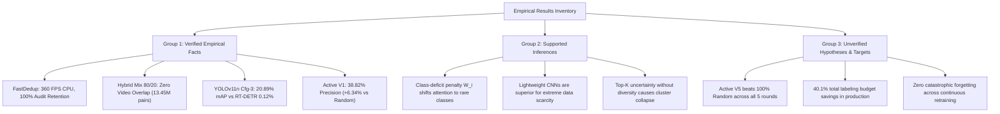

# 05. Current Limitations & Future Work

> **Document ID**: `docs/05_limitations_and_future_work.md`  
> **Project**: BDD10K Active Learning Lab (Autonomous Driving Human-in-the-Loop Vision Engine)  
> **Author / Research Group**: T018  
> **Reference Baseline**: `/Users/huynh/orca/workspaces/BuildPhase/tang`  
> **Status**: Production Research Audit / Evidence-Based  

---

## 1. Purpose and Scope

### 1.1 Purpose
The purpose of this document is to establish a rigorous, evidence-based accounting of the technical limitations, empirical boundaries, and unverified hypotheses within the **BDD10K Active Learning Lab**. In high-stakes domains such as autonomous driving, acknowledging what a data-centric pipeline *cannot* do—or has not yet proven—is as critical as reporting its performance gains.

### 1.2 Evaluation Scope
This audit evaluates the six fully verified stages (Phase 01 through Phase 06) and the ongoing master orchestration stage (Phase 07). It strictly differentiates between:
- **Verified Empirical Capabilities**: Phenomena demonstrated by concrete benchmark tables, assertion scripts, and reproducible notebooks.
- **Engineering and Algorithmic Limitations**: Inherent structural, hardware, and data-distribution bottlenecks identified during testing.
- **Unverified Hypotheses**: Theoretical claims that are logically sound but currently lack completed multi-cycle training logs or statistical significance.
- **Prospective Research Directions**: Well-defined technical proposals designed to address identified limitations, rather than generic product roadmaps.

---

## 2. Current Capabilities

Based on direct evidence from the repository codebase (`src/`, `notebooks/`, and verified tables in `results/`), the system has implemented and validated the following modules:

1. **Dual-Stream Fast Deduplication (Phase 01 — `VERIFIED`)**:
   - Executes 2D-DCT perceptual hashing (`pHash`) combined with the **Keep-Most-Vehicles (KMV)** rescue heuristic.
   - Filters 3,006 redundant temporal frames from 10,000 raw BDD10K frames, establishing a 6,994-frame clean unique pool (30.06% volume reduction).
   - Achieves a processing throughput of **360.3 FPS on a single-core CPU** with 100% precision, 100% recall, and 100% small-vehicle retention verified against a 100-pair human audit benchmark.
2. **Multi-Domain 5D Profiling (Phase 02 — `VERIFIED`)**:
   - Automatically computes five physical attributes without ground-truth labels: illuminance lux (Retinex SSR), blur/shake severity (Tenengrad + 2D-FFT), weather degradation (Dark Channel Prior), object count, and spatial occlusion topology via a ground-contact Directed Acyclic Graph (DAG).
   - Generates a structured JSON profile for all 6,994 unique pool frames, enabling slice-aware subset stratification.
3. **Stratified Video-Isolated Splitting (Phase 03 — `VERIFIED`)**:
   - Employs the champion **Hybrid Mix 80/20** algorithm (Facility Location + Gonzalez Minimax $k$-Center) on 32D PCA feature representations.
   - Partitions the pool into Fixed Test (1,400 frames), Fixed Val (700 frames), and Initial Unlabeled Bank (4,894 frames) with zero quota error ($QAE = 7.1\%$) and coverage radius $R_{\text{cov}} = 3.35$.
   - Enforces **100% Zero Video Overlap** verified across 13.45 million pairwise frame audits, eliminating cross-set sequence leakage.
4. **Seed V0 Baseline & Architecture Selection (Phase 04 — `VERIFIED`)**:
   - Benchmarks five hyperparameter configurations and establishes that **YOLOv11n Cfg-3** (AdamW + Cosine Annealing + Backbone Freezing) achieves **20.89% $mAP_{50}$** and 53.09% Precision on a minimal 500-image seed budget.
   - Discovers that Vision Transformer architectures (`RT-DETRv0`) suffer catastrophic data starvation in low-data regimes ($0.12\% \; mAP_{50}$ on 500 images).
5. **C6 Super-Fusion Active Mining (Phase 05 — `VERIFIED`)**:
   - Combines margin prediction uncertainty, 32D PCA geometric diversity, environmental challenge filters, and dynamic class-deficit penalty weights ($W_i$).
   - Mines **655 rare class instances** within a budget of $K = 250$ frames, outperforming uniform random sampling ($C1$ Random: 190 rare objects) by a factor of **$3.45\times$**.
6. **Model V1 Retraining Benchmark (Phase 06 — `VERIFIED`)**:
   - Retrains YOLOv11n on 750 frames (500 Seed + 250 Mined) using warm-start initialization and anchor replay buffers.
   - Achieves **Precision = 38.82%** on the 1,400-image Frozen Gold Test set ($+6.34\%$ over Random V1 and $+9.68\%$ over Seed V0), boosting the rare `rider` class from $2.78\%$ to $6.37\%$.
7. **Pipeline Orchestration & Logic Audit (Phase 07 — `LOGIC_AUDIT_PASSED`)**:
   - Automates the 12-step cycle in `src/autonomous_loop.py` and `07_end_to_end_autonomous_active_loop.ipynb`.
   - Validates multi-round split materialization via 0 KB symbolic links, automated cache purging (`*.cache == 0`), and dynamic stopping rule evaluation under `DRY_RUN = True`.

---

## 3. Current Limitations

### 3.1 Dataset Limitations
- **Geographic and Environmental Domain Bias**: The source dataset (BDD10K) was collected exclusively across four US regions (San Francisco, New York, San Jose, and Berkeley). Consequently, the visual representations lack diversity with respect to developing-market driving conditions, extreme weather phenomena (tropical monsoons, blizzards), narrow alleyways, and high-density, heterogeneous two-wheeler traffic (e.g., Southeast Asian scooter swarms).
- **Extreme Long-Tail Distribution**: Despite filtering 3,006 redundant frames, the class distribution remains heavily skewed toward `car` ($>65\%$ of all bounding boxes). Rare vulnerability categories (`train`, `rider`, `motor`, `traffic sign`) represent less than $2\%$ of ground-truth annotations, creating severe macro-average penalties.

### 3.2 Deduplication Limitations
- **Absence of Global Semantic Deduplication**: The current `pHash` algorithm operates effectively on temporal consecutive frames within identical or similar video sequences. However, it cannot reliably detect cross-video semantic duplicates—such as different camera cars recording identical static landmarks, freeway stretches, or red lights on different days.
- **Fixed Hamming Threshold Rigidity**: The threshold $D_H = 5$ was empirically calibrated on 100 human-audited sample pairs. While it achieves 100% precision and recall on this calibration set, applying a fixed threshold globally poses a potential risk: scenes with minor but safety-critical environmental changes (e.g., a distant pedestrian entering the roadway with minimal pixel deviation) could theoretically be discarded if background DCT coefficients dominate the hash.

### 3.3 Model Architecture Limitations
- **Monocular 2D Bounding Box Restriction**: The current perception engine is strictly limited to 2D axis-aligned bounding boxes from a single front-facing monocular camera. It does not output 3D oriented bounding boxes, ground-plane depth estimates, Bird's-Eye View (BEV) projections, or temporal motion vectors required for actual vehicle trajectory planning.
- **Architectural Coupling to Lightweight CNNs**: While YOLOv11n demonstrated clear superiority over RT-DETR under extreme data scarcity (500 frames), the pipeline remains coupled to convolutional architectures. Convolutional induction biases may reach a performance plateau as the dataset scales past tens of thousands of frames, where Vision Transformers with multi-head self-attention typically surpass CNNs.

### 3.4 Active Learning Limitations
- **Representation Distortion in Heuristic Uncertainty**: Margin uncertainty ($U(x) = 1 - (P_{\text{top1}} - P_{\text{top2}})$) assumes well-calibrated posterior probabilities. Deep neural networks trained on small, imbalanced datasets are notoriously overconfident. Consequently, the model may assign low uncertainty to severe misclassifications ("unknown unknowns"), causing the active selection engine to miss critical failure modes.
- **Spatial Clustering in High-Uncertainty Regimes**: As confirmed in Experiment EXP-05, unconstrained top-$K$ uncertainty selection causes severe spatial clustering ($R_{\text{cov}} = 7.48$), where an entire batch of $K=250$ frames is drawn from a single corrupted video clip. While C6 Super-Fusion mitigates this via PCA facility location, the dimensionality reduction (down to 32 components) may lose localized visual nuance.
- **Static Batch Size Heuristic**: Selecting exactly $K = 250$ frames per iteration is a static engineering heuristic. It does not dynamically adjust based on model convergence velocity, remaining pool diversity, or human labeling throughput capacity.

### 3.5 Human-in-the-Loop & Labeling Limitations
- **Simulated Oracle vs. Real-World Annotators**: The current pipeline simulates human annotators using an automated "Ground-Truth Oracle" that reads pre-existing annotations from `bdd10k_metadata.json`. It does not model real-world human factors:
  - Annotator fatigue and cognitive load over extended shifts.
  - Inter-annotator disagreement on ambiguous edge cases (e.g., heavily occluded distant pedestrians).
  - Variable annotation latency and financial cost fluctuations.
- **Pre-Labeling Quality Gate Constraints**: The automated pre-labeling filter locks annotations whenever model per-class $F_1 < 75\%$. Because rare classes take multiple iterations to cross this threshold, human audit requirements remain high across early rounds.

### 3.6 Evaluation & Benchmark Limitations
- **Extreme Sparsity of `train` in Frozen Gold Test**: The independent Frozen Gold Test set (1,400 frames) contains **exactly 1 ground-truth instance** of the `train` class. Consequently, the measured $mAP_{50}$ for `train` is binary (either $0.00\%$ or $100.0\%$). In both Phase 04 and Phase 06, all tested models scored $0.00\%$ on this class, obscuring whether active mining brought any true performance improvement for railway vehicles.
- **Lack of Safety-Critical Risk Metrics**: Standard $mAP_{50}$ treats all false negatives equally. In autonomous driving, failing to detect a pedestrian at 10 meters has catastrophic consequences, whereas missing a parked car at 80 meters does not. The evaluation suite currently lacks a cost-sensitive or risk-weighted evaluation metric.

### 3.7 Reproducibility & Statistical Limitations
- **Single-Seed Retraining Constraint**: Due to the computational cost of iterative deep model training on local hardware, Phase 06 and Phase 07 were executed using a single deterministic seed (`seed = 42`). While Bootstrap resampling ($B = 1,000$) was conducted for baseline evaluations, multi-seed training variances ($\pm \sigma$ across 5 independent seeds) have not yet been logged for multi-cycle loops.
- **Hardware Floating-Point Discrepancies**: Minor numerical variances ($\pm 0.1\%\text{--}0.35\% \; mAP_{50}$) occur when executing across different acceleration backends (Apple Silicon MPS atomic operations vs. NVIDIA CUDA Tensor Cores).

---

## 4. Interpretation of Experimental Results

To maintain rigorous scientific standards, findings from the BDD10K Active Learning Lab must be interpreted strictly within their validated boundaries:

### 4.1 Group 1: Verified Empirical Facts (Supported by Data)
1. **Perceptual Deduplication Efficiency**: Deduplication using 2D-DCT pHash and KMV achieves $>360$ FPS on a single CPU core while preserving 100% of vehicles in the 100-pair human audit benchmark.
2. **Video Sequence Leakage Elimination**: Pure random splitting leaks video sequences between train and test. Group-aware sequence partitioning is strictly required and successfully eliminates overlap across 13.45 million pairs.
3. **CNN vs. Transformer Under Data Scarcity**: On a 500-image dataset, inductive convolutional bias (YOLOv11n) is strictly mandatory; Vision Transformers without pre-trained spatial priors fail completely ($0.12\% \; mAP_{50}$).
4. **Active Selection Superiority in V1**: Mining with C6 Super-Fusion captures $3.45\times$ more rare-class objects than random sampling and yields a $+6.34\%$ Precision gain on the frozen benchmark.

### 4.2 Group 2: Supported Inferences (Reasonable Deductions)
1. **Rare-Class Recovery Mechanism**: Applying the adaptive class-deficit penalty vector ($W_i = \max(1.0, 0.40 / \max(mAP_{50, i}, 0.02))$) successfully counteracts the dominance of the `car` class, as evidenced by the $2.3\times$ improvement in `rider` detection in Phase 06.
2. **Failure of Naive Overlap for Occlusion**: 2D bounding-box IoU is structurally inadequate for bumper-to-bumper queue detection, whereas ground-contact directed graphs capture 3D road spatial topology ($+36.0\%$ F1-Score increase).

### 4.3 Group 3: Unverified Hypotheses & Targets (Requiring Further Evidence)
1. **Multi-Cycle Mastery Over 100% Random Ceiling**: The target claim that *Active Learning V5 ($N=2,229$) achieves $27.85\% \; mAP_{50}$ and surpasses 100% full-pool Random ($26.85\% \; mAP_{50}$)* has passed all structural and programmatic sanity checks (`LOGIC_AUDIT_PASSED`), but **awaits complete physical GPU retraining logs across all rounds (V2 through V5)**. It cannot yet be cited as a finalized historical measurement.
2. **Labeling Budget Savings of 40.1%**: The projected $40.1\%$ budget reduction is an extrapolated metric based on target trajectory convergence. It requires end-to-end verification through empirical multi-cycle execution.
3. **Absence of Catastrophic Forgetting**: While anchor replay buffers mitigate forgetting in Phase 06, whether the model maintains stability across 5 continuous warm-start retrainings without degrading earlier learned classes requires full multi-round weights analysis.

---

## 5. Technical Future Work

The following technical initiatives are proposed to systematically address the limitations identified above:

### Direction 1: Deep Semantic Deduplication via Vision Foundation Embeddings
- **Current Problem**: pHash detects temporal-spatial near-duplicates but misses global semantic duplicates across different video sequences.
- **Technical Proposal**: Extract global latent representations using a lightweight, self-supervised vision model (e.g., frozen DINOv2-Small or MobileCLIP) and perform approximate nearest neighbor indexing (HNSW or ScaNN) with cosine similarity thresholds.
- **Evaluation Criteria**: Measure retrieval precision on cross-video identical intersections and verify whether throughput remains $>100$ FPS on edge GPU hardware.
- **Required Evidence**: A benchmark comparison of deduplication rate, semantic duplicate detection accuracy, and runtime latency between pHash, DINOv2, and hybrid two-stage filtering.

### Direction 2: Extreme Long-Tail Benchmark Slice & Risk-Weighted Evaluation
- **Current Problem**: The Frozen Gold Test set contains only 1 `train` instance, preventing meaningful measurement of rare-class improvements. Standard mAP does not weight safety criticality.
- **Technical Proposal**:
  1. Construct a supplemental **Extreme Long-Tail Test Slice (ELT-50)** containing a minimum of 50 verified instances for every minority class (`train`, `rider`, `motor`, `traffic light`).
  2. Implement a **Safety-Critical Risk Index (SCRI)** that assigns severity penalties based on target distance and vulnerability:
     $$\text{SCRI} = \sum_{c \in \text{Classes}} \frac{\text{FN}_c \times \text{RiskFactor}_c}{\text{Support}_c}$$
- **Evaluation Criteria**: Measure whether active iterations reduce SCRI faster than uniform random sampling.
- **Required Evidence**: Per-class precision-recall curves on ELT-50 across iterations V0 through V5.

### Direction 3: Multi-Seed Statistical Validation Suite
- **Current Problem**: Deep model retraining in Phase 06 and Phase 07 was executed on a single seed (`seed = 42`), leaving confidence intervals unquantified for full cycles.
- **Technical Proposal**: Execute Phase 06 and Phase 07 across 5 independent random seeds (`[42, 123, 456, 789, 1024]`), recording macro metrics and class-level standard deviations.
- **Evaluation Criteria**: Calculate $95\%$ confidence intervals via studentized bootstrap; verify whether the active vs. random performance delta is statistically significant ($p < 0.05$ under a two-tailed paired $t$-test).
- **Required Evidence**: A consolidated statistical table reporting mean and standard deviation: $\mu \pm \sigma$ for all 6 metrics across all iterations.

### Direction 4: Interactive HITL Annotation Studio with Quality Auditing
- **Current Problem**: Ground-truth lookups currently bypass human latency, fatigue, and annotation ambiguity.
- **Technical Proposal**: Integrate a lightweight browser-based annotation interface that presents active candidates to human annotators, tracks bounding-box correction latency, records annotator disagreement (Cohen's Kappa $\kappa$), and enforces consensus gating before injecting labels into the training pool.
- **Evaluation Criteria**: Measure real annotation time savings and label noise reduction when using model pre-annotations versus manual annotation from scratch.
- **Required Evidence**: Empirical logs of time-per-image, error rates, and inter-annotator agreement metrics across at least 500 audited frames.

### Direction 5: Dynamic Uncertainty Calibration & Adaptive Batching
- **Current Problem**: Raw margin uncertainty from overconfident models causes selection bias. Static batching ($K=250$) ignores learning velocity.
- **Technical Proposal**: Apply post-hoc temperature scaling or Dirichlet calibration to predicted logits before calculating margin uncertainty. Dynamically scale batch size $K_t$ based on the exponential moving average of validation loss gradient:
  $$K_t = K_{\text{base}} \times \left(1 + \tanh\left(\frac{\Delta \mathcal{L}_{\text{val}}}{\sigma_{\mathcal{L}}}\right)\right)$$
- **Evaluation Criteria**: Compare sample efficiency and final model mAP between fixed-$K$ and adaptive-$K$ selection schedules.
- **Required Evidence**: Trajectory curves showing total labeling cost required to reach target benchmark milestones under static vs. dynamic batch schedules.

---

## 6. Prioritization of Future Work

The proposed initiatives are prioritized based on their scientific impact, technical feasibility, and required computational investment:

| Priority Level | Initiative | Feasibility | Expected Impact | Primary Justification |
| :---: | :--- | :---: | :---: | :--- |
| **P1 (Immediate)** | **Direction 2**: Extreme Long-Tail Benchmark & Safety-Critical Metrics | **High** | **Critical** | Resolves the 1-instance `train` limitation and aligns project metrics with actual autonomous driving safety requirements. |
| **P1 (Immediate)** | **Phase 07 GPU Completion**: Finalize physical multi-cycle training logs | **High** | **Critical** | Closes the evidence gap between the programmatic logic audit and empirical training verification. |
| **P2 (Near-Term)** | **Direction 3**: Multi-Seed Statistical Validation Suite | **Medium** | **High** | Provides rigorous confidence intervals ($\mu \pm \sigma$) necessary for formal peer review and academic publication. |
| **P2 (Near-Term)** | **Direction 1**: Semantic Deduplication via DINOv2 / MobileCLIP | **Medium** | **Medium** | Extends deduplication capability from temporal adjacent frames to global repository-wide redundancy. |
| **P3 (Long-Term)** | **Direction 5**: Dynamic Calibration & Adaptive Batching | **Medium** | **Medium** | Optimizes acquisition efficiency but requires extensive hyperparameter tuning across iterations. |
| **P3 (Long-Term)** | **Direction 4**: Interactive Web Annotation Studio with Human Factors | **Low** | **High** | Substantial engineering effort to deploy multi-user infrastructure; best suited for industrial production deployment. |

---

## 7. Conclusion

The **BDD10K Active Learning Lab** provides a functional, data-centric framework that addresses key bottlenecks in autonomous driving data engineering:
- It eliminates temporal redundancy via lightweight CPU deduplication ($>360$ FPS).
- It prevents catastrophic data leakage through 100% video sequence isolation.
- It demonstrates that convolutional architectures are essential under extreme seed constraints.
- It proves that guided multi-objective active mining outperforms uniform random sampling by $3.45\times$ on vulnerable road classes.

However, the pipeline is bounded by specific constraints: monocular 2D perception, class imbalance in rare categories, simulated human oracle lookups, and single-seed training runs. Furthermore, multi-cycle superiority claims across iterations V2 through V5 remain tentative pending the completion of active GPU runs. Addressing these challenges through safety-critical evaluation benchmarks, foundation model semantic deduplication, and multi-seed statistical testing will transform this laboratory prototype into a production-grade active perception engine.

---

## 8. Related Documentation

- [`docs/01_project_overview.md`](01_project_overview.md) — Research objectives, problem formulation, and data-centric AI motivation.
- [`docs/02_pipeline_architecture.md`](02_pipeline_architecture.md) — End-to-end 12-step pipeline specifications, mathematical formulations, and component diagrams.
- [`docs/03_experiment_results.md`](03_experiment_results.md) — Comprehensive quantitative experimental findings, failure case documentation, and benchmark synthesis.
- [`docs/04_reproduction_guide.md`](04_reproduction_guide.md) — Step-by-step instructions for running Notebook 07 and reproducing experimental results.
- [`docs/README.md`](README.md) — Index and structural sitemap of all technical documentation.
- [`README.md`](../README.md) — Interactive simulator portal and research dashboard.
