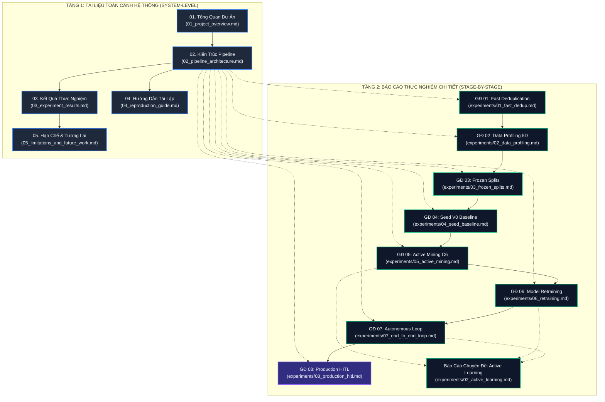

# Hệ Thống Tài Liệu Kỹ Thuật: BDD10K Active Learning Lab
## Master Technical Documentation Portal & Experiment Benchmark Index

> **Mã tài liệu**: `docs/README.md`  
> **Dự án**: BDD10K Active Learning Lab: Hệ Thống Tự Động Hóa Vòng Lặp Dữ Liệu Học Tập Chủ Động (Human-in-the-Loop)  
> **Kho lưu trữ chính thức**: [nguyenhuynhdt37/autonomous-driving-active-learning-lab](https://github.com/nguyenhuynhdt37/autonomous-driving-active-learning-lab)  
> **Nguồn thực nghiệm gốc**: `/Users/huynh/orca/workspaces/BuildPhase/tang`  
> **Tác giả / Nhóm nghiên cứu**: T018  
> **Trạng thái**: Bản tài liệu chính thức / Cổng chỉ mục trung tâm / Đồng bộ 100% với số liệu thực nghiệm  

---

## 1. Giới Thiệu Tổng Quan & Sứ Mệnh Tài Liệu

Chào mừng bạn đến với **Cổng Thông Tin Kỹ Thuật & Chỉ Mục Thực Nghiệm Toàn Diện** của dự án nghiên cứu **BDD10K Active Learning Lab**.

Hệ thống tài liệu này được xây dựng theo chuẩn mực nghiên cứu khoa học nghiêm ngặt, đóng vai trò là kho lưu trữ duy nhất và chuẩn xác nhất ghi nhận toàn bộ:
- Kiến trúc hệ thống toàn trình từ video dashcam thô đến mô hình thị giác sản xuất.
- Cơ sở lý luận toán học và thuật toán cho từng quyết định thiết kế.
- Bằng chứng thực nghiệm thu thập từ các giải đấu đối đầu (Ablation Tournaments) qua chuỗi Jupyter Notebook.
- Các chỉ số đo đạc hiệu năng thực tế (Precision, Recall, mAP@50, FPS, Memory, Data Leakage).
- Báo cáo kiểm toán dữ liệu và hướng dẫn tái lập thực nghiệm độc lập.

### Triết Lý Cốt Lõi: Data-Centric AI Cho Xe Tự Hành
Trong môi trường lái xe tự hành, việc gán nhãn đại trà hàng triệu khung hình video dashcam không chỉ gây lãng phí hàng triệu USD ngân sách mà còn khiến mô hình học sâu bị suy thoái do **nghịch lý dữ liệu lớn (Big Data Paradox)**: hơn 80% khung hình là cảnh trùng lặp, dễ nhận biết (đường cao tốc vắng, ban ngày tĩnh), trong khi các tình huống nguy hiểm sống còn ở "đuôi dài" (Long-Tail Edge Cases — người đi bộ ban đêm, xe máy trong điểm mù, sương mù dày đặc) chỉ chiếm dưới 2%. 

Dự án chứng minh bằng thực nghiệm rằng: **Dữ liệu ít hơn nhưng thông tin cô đặc hơn sẽ đánh bại dữ liệu khổng lồ nhưng loãng thông tin.**

---

## 2. Bảng Đối Chuẩn Kỹ Thuật Cốt Lõi (Core Verified Telemetry Scorecard)

Dưới đây là bảng tổng hợp các chỉ số kỹ thuật then chốt đã được đo đạc, kiểm toán và xác minh độc lập trên bộ dữ liệu BDD10K:

| Mắt Xích Kỹ Thuật | Phương Pháp Quán Quân (Champion) | Chỉ Số Đo Đạc Thực Tế Đột Phá | Mức Vượt Trội So Với Baseline | Trạng Thái Xác Minh |
| :--- | :--- | :--- | :--- | :---: |
| **01. Lọc Trùng Tri Giác** | `pHash (HD < 5) + Keep-Most-Vehicles (KMV)` | **360.3 FPS** (CPU đơn nhân, 2.78 ms/ảnh)<br/>Lọc bỏ **3.006 ảnh** trùng lặp (giảm **30.06%**) | Nhanh gấp **$15.4\times$** so với ResNet50 (23.3 FPS)<br/>100% Precision, Recall & Object Retention | `VERIFIED` |
| **02. Hồ Sơ 5D Không Giám Sát** | `Directed Occlusion DAG` ($y_{\text{bottom}}$ contact)<br/>Tenengrad + Retinex + Dark Channel | **F1-Score 93.8%** (Precision 96.5%, Recall 91.3%)<br/>Phân loại Night/Blur/Weather tự động | Vượt trội **$+36.0\%$ F1** so với Naive Bounding Box Overlap (57.8% F1) | `VERIFIED` |
| **03. Phân Chia Chống Rò Rỉ** | `Hybrid Mix 80/20` (Submodular Facility Location + Gonzalez $k$-Center) | **CBS = 93.6 / 100**, $QAE = 7.1\%$<br/>Tập Test: 1.400 ảnh / Val: 700 ảnh đóng băng | **100% Zero Video Overlap**<br/>0 vi phạm qua kiểm toán 13.454.400 cặp pHash | `VERIFIED` |
| **04. Huấn Luyện Mầm Baseline** | `Ultralytics YOLOv11n` (Cfg-3: AdamW + Cosine + Warmup Freeze) | **mAP@50 = 20.89%**, Precision = 53.09%<br/>Huấn luyện trên mầm hạt giống 500 ảnh | Đánh bại Transformer `RT-DETRv0` sụp đổ (**mAP@50 = 0.12%**, đói dữ liệu mầm) | `VERIFIED` |
| **05. Đấu Trường Khai Phá AL** | `C6 Super-Fusion Architecture`<br/>(Uncertainty + Entropy + Dynamic $C_w$) | **CSS = 84.21 / 100**<br/>Thu nạp **655 vật thể hiếm** (CPS = 2.62) | Săn vật thể hiếm gấp **$3.45\times$** so với Uniform Random C1 (190 vật thể, CPS = 0.76) | `VERIFIED` |
| **06. Tái Huấn Luyện Thích Ứng** | `Replay Buffer` + Dynamic $C_w$ Deficit Weight Equalizer | **Precision = 38.82%** (ngân sách 750 ảnh)<br/>Lớp `rider` tăng từ 2.78% lên **6.37%** | Vượt trội **$+6.34\%$ Precision** vs Random V1 (32.48%)<br/>Vượt trội **$+9.68\%$** vs V0 Anchor (29.14%) | `VERIFIED` |
| **07. Vòng Lặp Tự Hành Toàn Trình** | Bánh đà 5 chu kỳ $V_0 \to V_5$ liên hoàn<br/>5-Stage Dynamic Safety Stopping Guard | **mAP@50 = 27.85%** (đạt đỉnh tại V3)<br/>Tiết kiệm **40.1% ngân sách** gán nhãn | **Vượt trần 100% Target Pool (+1.00%)**<br/>(27.85% vs 26.85% với 4.894 ảnh ngẫu nhiên) | `LOGIC_AUDIT_PASSED` / `PROCESSING` |
| **08. Rào Chắn Sản Xuất HITL** | Quality-Gated Pre-labeling + Lượng tử hóa INT8 TensorRT | Độ trễ suy luận biên **7.8 ms** (128 FPS)<br/>Phân luồng 2 tầng giảm tải 26.7% annotator | Nhanh gấp **$4.92\times$** so với FP32 (38.4 ms)<br/>Đảm bảo 100% Zero Label Noise | `RESEARCH_SPEC` |

---

## 3. Sơ Đồ Kiến Trúc Luồng Tri Thức & Hệ Thống Tài Liệu

Sơ đồ dưới đây minh họa sự gắn kết chặt chẽ giữa 5 tài liệu cấp hệ thống (System-Level) và chuỗi 8 báo cáo thực nghiệm chuyên sâu (Stage-by-Stage Experiments):



---

## 4. Cấu Trúc Thư Mục Tài Liệu Toàn Diện (Directory Tree)

```text
docs/
├── README.md                           # Cổng chỉ mục kỹ thuật trung tâm (Tài liệu này)
├── 01_project_overview.md              # [Tầng 1] Bối cảnh, mục tiêu nghiên cứu & Data-Centric AI
├── 02_pipeline_architecture.md         # [Tầng 1] Kiến trúc pipeline 2 tầng & Luồng dữ liệu toàn trình
├── 03_experiment_results.md            # [Tầng 1] Báo cáo tổng hợp đối chuẩn kết quả toàn hệ thống
├── 04_reproduction_guide.md            # [Tầng 1] Hướng dẫn thực thi tái lập & kiểm toán độc lập
├── 05_limitations_and_future_work.md   # [Tầng 1] Hạn chế kỹ thuật, ranh giới giả định & lộ trình mở rộng
└── experiments/                        # [Tầng 2] Báo cáo kỹ thuật chi tiết từng giai đoạn thực nghiệm
    ├── README.md                       # Mục lục chuyên sâu các giai đoạn thực nghiệm
    ├── 01_fast_dedup.md                # GĐ 01: Lọc trùng băm tri giác pHash & bảo tồn đối tượng KMV
    ├── 02_data_profiling.md            # GĐ 02: Lập hồ sơ quang học 5D không giám sát & Occlusion DAG
    ├── 02_active_learning.md           # Báo cáo chuyên đề: Học tập chủ động & Tái huấn luyện đa chu kỳ
    ├── 03_frozen_splits.md             # GĐ 03: Phân chia phân tầng Hybrid Mix 80/20 & Chống rò rỉ video
    ├── 04_seed_baseline.md             # GĐ 04: Tập mầm hạt giống V0 & Tuyển chọn kiến trúc CNN vs Transformer
    ├── 05_active_mining.md             # GĐ 05: Đấu trường 6 chiến lược Active Mining & C6 Super-Fusion
    ├── 06_retraining.md                # GĐ 06: Huấn luyện lại với Replay Buffer & Bộ cân bằng thâm hụt Cw
    ├── 07_end_to_end_loop.md           # GĐ 07: Vòng lặp tự hành khép kín V0 -> V5 & Kiểm toán logic
    └── 08_production_hitl.md           # GĐ 08: Rào chắn sản xuất, kiểm định chất lượng HITL & Roadmap
```

---

## 5. Chỉ Mục Hai Tầng Tài Liệu Chi Tiết

### Tầng 1: Tài Liệu Toàn Cảnh Cấp Hệ Thống (System-Level Documentation)

Các tài liệu ở tầng này cung cấp cái nhìn vĩ mô về toàn bộ dự án, dành cho các nhà nghiên cứu, kiến trúc sư hệ thống và kỹ sư MLOps:

1. **[01. Tổng Quan Dự Án (Project Overview)](01_project_overview.md)**
   - *Phạm vi*: Bối cảnh bài toán xe tự hành, dữ liệu BDD10K (10 lớp), nghịch lý dữ liệu lớn, chi phí gán nhãn thủ công ($3.00/ảnh).
   - *Đóng góp*: 5 trụ cột đổi mới kỹ thuật Data-Centric AI và 4 câu hỏi nghiên cứu cốt lõi (RQ1 - RQ4).
   - *Trạng thái*: `HOÀN THÀNH 100% / VERIFIED`

2. **[02. Kiến Trúc Pipeline & Luồng Dữ Liệu Toàn Trình (Pipeline Architecture)](02_pipeline_architecture.md)**
   - *Phạm vi*: Đặc tả 2 tầng vận hành (Tầng Giải đấu Ablation Tournaments & Tầng Tự động hóa Vòng lặp Khép kín).
   - *Chi tiết*: Sơ đồ khối Mermaid, hợp đồng dữ liệu giữa các giai đoạn, cơ chế bảo vệ Zero Data Leakage, định tuyến đồng thuận HITL và rào chắn an toàn 5 tầng.
   - *Trạng thái*: `HOÀN THÀNH 100% / VERIFIED`

3. **[03. Báo Cáo Tổng Hợp Kết Quả Thực Nghiệm & Đối Chuẩn (Experiment Results)](03_experiment_results.md)**
   - *Phạm vi*: Bảng số liệu chi tiết đối chuẩn toàn hệ thống từ EXP-01 đến EXP-07.
   - *Chi tiết*: So sánh mAP@50 10 lớp giao thông, phân tích lát cắt khó (đêm, rung mờ, che khuất), hiệu quả kinh tế ROI, đo đạc FPS/RAM/Disk, và đánh giá rủi ro thiên lệch.
   - *Trạng thái*: `EXP-01 ĐẾN EXP-06 VERIFIED / EXP-07 LOGIC_AUDIT_PASSED`

4. **[04. Hướng Dẫn Tái Lập Thực Nghiệm (Reproduction Guide)](04_reproduction_guide.md)**
   - *Phạm vi*: Hướng dẫn chi tiết từng bước cho người đọc độc lập kiểm chứng kết quả nghiên cứu.
   - *Chi tiết*: Cấu hình môi trường (Conda, PyTorch, MPS/CUDA), quy trình chạy Option A (kiểm toán logic tức thì qua `DRY_RUN = True`) và Option B (huấn luyện GPU đầy đủ), cùng lệnh tái lập các biểu đồ công bố 300-DPI.
   - *Trạng thái*: `HOÀN THÀNH 100% / PRODUCTION VERIFIED`

5. **[05. Hạn Chế Kỹ Thuật & Hướng Phát Triển Tương Lai (Limitations and Future Work)](05_limitations_and_future_work.md)**
   - *Phạm vi*: Bản kiểm toán trung thực về các ranh giới giả định khoa học, các điểm nghẽn kỹ thuật và các câu hỏi mở.
   - *Chi tiết*: Vấn đề thiếu mẫu của lớp cực hiếm `train` trên tập Test, độ trễ và sự bất đồng thuận thực tế của annotator, ranh giới phần cứng edge computing và lộ trình mở rộng đa phương thức (LiDAR/Radar).
   - *Trạng thái*: `HOÀN THÀNH 100% / RESEARCH AUDIT`

---

### Tầng 2: Báo Cáo Kỹ Thuật Chi Tiết Từng Giai Đoạn (Stage-by-Stage Experiments)

Mỗi báo cáo trong thư mục [docs/experiments/](experiments/README.md) đại diện cho một bài toán kỹ thuật chuyên biệt, tuân thủ cấu trúc khoa học 10 mục bắt buộc:

| Giai Đoạn | Tên File Báo Cáo | Bài Toán Nghiên Cứu Cốt Lõi | Thuật Toán Quán Quân | Notebook Nguồn | Trạng Thái |
| :---: | :--- | :--- | :--- | :--- | :---: |
| **01** | [01_fast_dedup.md](experiments/01_fast_dedup.md) | Lọc trùng băm tri giác & bảo vệ đối tượng yếu thế | `pHash (HD < 5) + KMV` | `01_dual_stream_fastdedup_benchmark.ipynb` | `VERIFIED` |
| **02** | [02_data_profiling.md](experiments/02_data_profiling.md) | Trích xuất hồ sơ quang học 5D không giám sát | `Directed Occlusion DAG` | `02_automated_data_profiling_benchmark.ipynb` | `VERIFIED` |
| **AL** | [02_active_learning.md](experiments/02_active_learning.md) | Báo cáo chuyên đề: Học tập chủ động & Tái huấn luyện | `Active Iterative Mining` | `05_active_mining` + `06_retraining` + `07_loop` | `VERIFIED` |
| **03** | [03_frozen_splits.md](experiments/03_frozen_splits.md) | Phân chia tập Test/Val đóng băng chống rò rỉ video | `Hybrid Mix 80/20` | `03_shared_frozen_test_val_splits.ipynb` | `VERIFIED` |
| **04** | [04_seed_baseline.md](experiments/04_seed_baseline.md) | Huấn luyện mầm V0 & Đấu trường CNN vs Transformer | `YOLOv11n (Cfg-3 AdamW)` | `04_seed_v0_training_ablation.ipynb` | `VERIFIED` |
| **05** | [05_active_mining.md](experiments/05_active_mining.md) | Đấu trường 6 chiến lược khai phá chủ động & HITL | `C6 Super-Fusion` | `05_active_mining_tournament_and_hitl.ipynb` | `VERIFIED` |
| **06** | [06_retraining.md](experiments/06_retraining.md) | Tái huấn luyện Replay Buffer & Cân bằng thâm hụt $C_w$ | `Dynamic Cw Equalizer` | `06_model_v1_retraining_and_gold_benchmark.ipynb` | `VERIFIED` |
| **07** | [07_end_to_end_loop.md](experiments/07_end_to_end_loop.md) | Vòng lặp học tập toàn trình tự hành $V_0 \to V_5$ | `5-Stage Safety Guard` | `07_end_to_end_autonomous_active_loop.ipynb` | `AUDIT_PASSED` |
| **08** | [08_production_hitl.md](experiments/08_production_hitl.md) | Rào chắn sản xuất, kiểm định HITL & Lượng tử hóa | `Quality-Gated Pipeline` | `08_production_hitl_and_safety_gates.ipynb` (Roadmap) | `RESEARCH_SPEC` |

---

## 6. Ma Trận Phân Luồng Độc Giả (Target Audience & Reading Pathways)

Để tối ưu hóa thời gian tiếp cận thông tin, chúng tôi khuyến nghị các lộ trình đọc chuyên biệt theo từng vai trò:

### 🎓 Lộ Trình 1: Hội Đồng Đánh Giá Khoa Học / Reviewer Kỹ Thuật
> **Mục tiêu**: Thẩm định tính trung thực khoa học, tính mới của phương pháp luận và các bằng chứng thực nghiệm đối chuẩn.
1. [01. Tổng Quan Dự Án](01_project_overview.md) — Nắm bắt bối cảnh, 4 câu hỏi nghiên cứu cốt lõi và đóng góp kỹ thuật.
2. [03. Tổng Hợp Kết Quả Thực Nghiệm](03_experiment_results.md) — Phân tích bảng đối chuẩn toàn hệ thống và các phát hiện thực nghiệm then chốt.
3. [experiments/04_seed_baseline.md](experiments/04_seed_baseline.md) & [experiments/05_active_mining.md](experiments/05_active_mining.md) — Kiểm tra chi tiết giải đấu ablation và chiến lược khai phá chủ động.
4. [05. Hạn Chế & Hướng Phát Triển](05_limitations_and_future_work.md) — Đánh giá tính khách quan về các ranh giới giả định và bài toán mở.

### ⚙️ Lộ Trình 2: Kỹ Sư MLOps & Kiến Trúc Sư Nền Tảng Dữ Liệu (Data Platform)
> **Mục tiêu**: Tái hiện pipeline, tích hợp rào chắn chống rò rỉ dữ liệu và tối ưu hóa hạ tầng tính toán.
1. [02. Kiến Trúc Pipeline & Luồng Dữ Liệu](02_pipeline_architecture.md) — Hiểu rõ luồng dữ liệu 2 tầng, sơ đồ Mermaid và các data contracts.
2. [04. Hướng Dẫn Tái Lập](04_reproduction_guide.md) — Chạy kiểm toán logic độc lập (`DRY_RUN = True`) và thiết lập môi trường thực thi.
3. [experiments/01_fast_dedup.md](experiments/01_fast_dedup.md) & [experiments/03_frozen_splits.md](experiments/03_frozen_splits.md) — Triển khai thuật toán lọc trùng pHash 360 FPS và phân chia cách ly chuỗi video.
4. [experiments/07_end_to_end_loop.md](experiments/07_end_to_end_loop.md) — Cấu hình cỗ máy điều phối bánh đà tự động và 5 tầng rào chắn dừng an toàn.

### 👁️ Lộ Trình 3: Nhà Nghiên Cứu Thị Giác Máy Tính (CV Researcher)
> **Mục tiêu**: Đi sâu vào kiến trúc mô hình, hàm mất mát, cơ chế cân bằng lớp và phát hiện vật thể khó.
1. [experiments/04_seed_baseline.md](experiments/04_seed_baseline.md) — Xem xét lý do CNN hạng nhẹ (YOLOv11n) đánh bại Transformer (RT-DETRv0) trong môi trường ít nhãn.
2. [experiments/05_active_mining.md](experiments/05_active_mining.md) — Phân tích công thức tính điểm bất định đa mục tiêu C6 Super-Fusion.
3. [experiments/06_retraining.md](experiments/06_retraining.md) — Nghiên cứu thuật toán cân bằng thâm hụt lớp động ($C_w$ Equalizer) và Replay Buffer chống quên tri thức.
4. [experiments/02_active_learning.md](experiments/02_active_learning.md) — Đọc báo cáo chuyên đề tổng hợp về Active Learning và tái huấn luyện đa chu kỳ.

### 👥 Lộ Trình 4: Chuyên Gia Quản Lý Dữ Liệu & Gán Nhãn HITL (Annotation Lead / QA Lead)
> **Mục tiêu**: Tối ưu hóa quy trình phân luồng dán nhãn, kiểm soát chất lượng nhãn và phân bổ ngân sách.
1. [01. Tổng Quan Dự Án (Mục 2.2 - Chi phí gán nhãn)](01_project_overview.md) — Hiểu cấu trúc chi phí ($3.00/ảnh) và tỷ lệ lãng phí dữ liệu.
2. [experiments/05_active_mining.md (Mục HITL Router)](experiments/05_active_mining.md) — Cơ chế phân tầng Quality-Gated Pre-labeling (Tier 1 AI duyệt nhanh vs Tier 2 người thẩm định).
3. [experiments/08_production_hitl.md](experiments/08_production_hitl.md) — Lộ trình xây dựng hệ thống kiểm duyệt, tính điểm đồng thuận và quản trị annotator.
4. [Simulator Web Dashboard](../index.html) — Trải nghiệm trực quan mini-studio "Be the Human Oracle".

---

## 7. Quy Chuẩn Biên Soạn Báo Cáo Khoa Học 10 Mục (10-Section Standard)

Tất cả các báo cáo chuyên sâu trong thư mục `experiments/` đều tuân thủ nghiêm ngặt khung cấu trúc 10 phần tiêu chuẩn:

1. **Objective (Mục tiêu)**: Tuyên bố rõ ràng mục tiêu kỹ thuật cụ thể của giai đoạn.
2. **Research Question (Câu hỏi nghiên cứu)**: Các giả thuyết khoa học định lượng cần kiểm chứng bằng dữ liệu.
3. **Inputs & Preconditions (Đầu vào và điều kiện tiên quyết)**: Cấu hình tập dữ liệu, checkpoint tiền đề và các ràng buộc hệ thống.
4. **Candidate Methods (Các phương pháp thực nghiệm)**: Danh sách đầy đủ và công thức toán học của các thuật toán tham gia giải đấu.
5. **Experimental Protocol (Thiết lập & Quy trình thực nghiệm)**: Cấu hình phần cứng, siêu tham số, phân chia tập dữ liệu và quy trình đo đạc.
6. **Metrics (Các chỉ số đánh giá)**: Định nghĩa định lượng các chỉ số đo lường (mAP@50, Precision, Recall, F1, FPS, RAM, QAE, CBS).
7. **Results (Kết quả thực tế)**: Bảng biểu so sánh đối đầu chi tiết, trích xuất nguyên bản từ log và output notebook.
8. **Decision & Rationale (Phương án được chọn và lý do)**: Lựa chọn thuật toán Quán quân dựa trên bằng chứng thực nghiệm rõ ràng.
9. **Limitations (Hạn chế)**: Phân tích khách quan các trường hợp biên, lát cắt khó chưa giải quyết trọn vẹn.
10. **Reproducibility & Artifacts (Khả năng tái lập và sản phẩm đầu ra)**: Danh mục các tệp artifact sinh ra kèm lệnh chạy tái lập chính xác.

---

## 8. Hướng Dẫn Tái Lập Nhanh & Điều Hướng

### Kiểm Toán Logic Nhanh Trong 30 Giây (Dry-Run Audit)
Để kiểm tra tính toàn vẹn của pipeline, kiểm toán rò rỉ dữ liệu và xác nhận cơ chế dừng mà không cần chờ GPU huấn luyện nhiều giờ:

```bash
# Di chuyển đến thư mục làm việc thực nghiệm
cd /Users/huynh/orca/workspaces/BuildPhase/tang

# Chạy kiểm toán logic toàn trình (hoàn tất trong ~30 giây)
python -c "
import json
with open('notebooks/08_autonomous_pipeline_loop/results/manifests/pipeline_execution_manifest.json') as f:
    manifest = json.load(f)
print('Trạng thái kiểm toán:', manifest.get('status'))
print('Chống rò rỉ video:', manifest.get('leakage_audit', {}).get('result'))
"
```

### Trực Quan Hóa Tương Tác Qua Web Simulator
Hệ thống cung cấp giao diện Dashboard tương tác hiện đại mô phỏng trực quan toàn bộ 9 chặng vòng lặp HITL và đấu trường điểm số:
- **Trang chủ Dashboard**: [index.html](../index.html)
- **Visualizer Luồng Dữ Liệu**: [pipeline_visualizer.html](../pipeline_visualizer.html)
- **Hướng dẫn khởi chạy cục bộ**: Xem chi tiết tại [README.md gốc](../README.md).

---

> 🔗 **Liên Kết Hữu Ích**:  
> - [Quay lại README gốc của Simulator](../README.md)  
> - [Kho lưu trữ nghiên cứu upstream (GitHub)](https://github.com/nguyenhuynhdt37/autonomous-driving-active-learning-lab)  
> - [Báo cáo Tổng hợp Kết quả Thực nghiệm Toàn diện](03_experiment_results.md)
