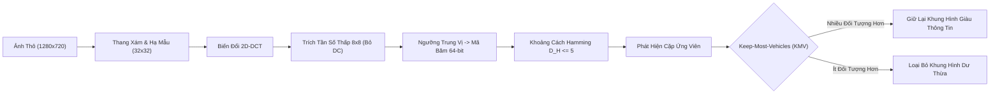

# Báo Cáo Thực Nghiệm Kỹ Thuật: Lọc Trùng Ảnh Nhanh (Phase 01)

> **Mã tài liệu**: `docs/experiments/01_fast_dedup.md`  
> **Dự án**: BDD10K Active Learning Lab (Động cơ thị giác xe tự hành Human-in-the-Loop)  
> **Notebook thực nghiệm chính**: `notebooks/01_dual_stream_fastdedup_benchmark.ipynb`  
> **Nguồn thực nghiệm gốc**: `/Users/huynh/orca/workspaces/BuildPhase/tang`  
> **Tác giả / Nhóm nghiên cứu**: T018  
> **Trạng thái**: Đã kiểm chứng thực tế / Dựa trên bằng chứng  

---

## 1. Tổng Quan Thực Nghiệm

### 1.1 Mục Đích và Phát Biểu Bài Toán
Trong các quy trình thu nhận video liên tục cho xe tự hành, camera hành trình (dashcam) ghi lại chuỗi video tần số cao từ 20 đến 30 khung hình mỗi giây. Khi xe dừng chờ đèn đỏ, kẹt xe trong dòng phương tiện ùn tắc hoặc di chuyển đều trên đường cao tốc thông thoáng với cảnh quan xung quanh tĩnh, các khung hình liền kề xuất hiện mức độ dư thừa thị giác cực kỳ lớn.

Việc nạp dữ liệu dư thừa này vào quá trình huấn luyện mô hình phía sau hoặc quy trình gán nhãn có con người can thiệp (HITL) sẽ dẫn đến hai nguy cơ lỗi nghiêm trọng:
1. **Lãng Phí Ngân Sách Gán Nhãn & Năng Lực Tính Toán**: Tiêu tốn chi phí để gán nhãn thủ công hoặc lan truyền ngược (backpropagation) qua các khung hình gần như giống hệt nhau chỉ mang lại mức cập nhật gradient biên không đáng kể.
2. **Nguy Cơ Rò Rỉ Đánh Giá & Overfitting**: Nếu các khung hình liền kề với độ nhiễu pixel không đáng kể bị rò rỉ chéo giữa các tập train, validation và test, các chỉ số đánh giá báo cáo sẽ chỉ phản ánh việc ghi nhớ vẹt (memorization) thay vì năng lực tổng quát hóa thực sự.

Mục tiêu của thực nghiệm này là xác định, đối chuẩn và triển khai một pipeline lọc trùng ảnh thông lượng cao, có khả năng chạy trên thiết bị biên để loại bỏ nhanh chóng các khung hình dư thừa theo thời gian chỉ bằng phần cứng CPU thông thường mà không làm mất đi các khung hình chứa chướng ngại vật mới xuất hiện trên đường.

### 1.2 Trùng Lặp Tuyệt Đối vs. Gần Trùng Lặp
Thực nghiệm phân biệt rõ ràng hai nhóm:
- **Trùng lặp tuyệt đối (Exact Duplicates)**: Các khung hình có nội dung pixel giống hệt nhau từng bit (khoảng cách Hamming $D_H = 0$), thường do cơ chế replay của cảm biến hoặc truyền lại gói tin mạng.
- **Gần trùng lặp (Near-Duplicates)**: Các khung hình được ghi lại trong khoảng thời gian rất ngắn (cách nhau từ 0.5 đến 2.0 giây trong cùng một chuỗi video), thể hiện bối cảnh nền, hình học lòng đường và ánh sáng gần như y hệt, nhưng khác biệt đôi chút do nhiễu cảm biến, độ rung lắc nhẹ của camera hoặc sự di chuyển rất nhỏ của xe.

Điều tối quan trọng là **các khung hình gần trùng lặp có thể chứa thông tin bất đối xứng**. Ví dụ, trong khi nền đường không hề thay đổi giữa hai khung hình liền kề, một người đi bộ ở xa hoặc một chiếc xe máy có thể vừa xuất hiện từ phía sau một xe tải đang đỗ ở khung hình thứ hai. Một cơ chế lọc trùng ngây thơ tùy tiện loại bỏ khung hình thứ hai sẽ gây ra rủi ro an toàn chết người.

---

## 2. Định Nghĩa Bài Toán

### 2.1 Đầu Vào và Đầu Ra Kỳ Vọng
- **Đầu vào**: Tập dữ liệu gồm 10.000 khung hình thô trích xuất từ các chuỗi hành trình BDD10K (độ phân giải $1280 \times 720$), được gom nhóm theo mã nhận diện chuỗi video gốc (`video_id = frame_name.split("-")[0]`).
- **Đầu ra kỳ vọng**:
  1. Tập dữ liệu cấu trúc các cặp ứng viên nhận diện quan hệ trùng lặp tiềm năng.
  2. Một **Unique Pool** sạch đã kiểm chứng ($N = 6.994$ khung hình) được tạo dưới dạng liên kết tượng trưng (symlinks) 0 KB tại `data/processed/unique_pool/`.
  3. Nhật ký kiểm toán định lượng xác minh rằng không có đối tượng tham gia giao thông quan trọng nào bị loại bỏ nhầm trong quá trình lọc trùng.

### 2.2 Định Nghĩa Thao Tác Về Mẫu Trùng Lặp
Trong hệ thống này, hai khung hình $I_A$ và $I_B$ trong cùng một chuỗi video được phân loại là một cặp ứng viên trùng lặp nếu khoảng cách Hamming giữa các mã băm tri giác của chúng thỏa mãn:
$$D_H(H(I_A), H(I_B)) \le \tau$$
trong đó $\tau = 5$ là ngưỡng quyết định được hiệu chuẩn qua thẩm định của con người. Hệ thống không tuyên bố phát hiện các bản trùng ngữ nghĩa xuyên chuỗi video; phạm vi vận hành của nó được giới hạn nghiêm ngặt ở việc lọc trùng theo thời gian trong cùng chuỗi video.

---

## 3. Các Thuật Toán và Thước Đo Tương Đồng

Notebook đối chuẩn năm thuật toán lọc trùng riêng biệt với một baseline không xử lý:



### 3.1 Không Lọc Trùng (No-Dedup Baseline)
- **Ý tưởng cốt lõi**: Cho toàn bộ các khung hình thu nhận đi qua mà không qua bất kỳ bộ lọc nào.
- **Vai trò trong thực nghiệm**: Cung cấp mốc trần về thông lượng xử lý (93.520.5 FPS) và thiết lập mốc cơ sở với độ chính xác lọc trùng bằng 0.

### 3.2 Băm Trung Bình (Average Hash - aHash)
- **Ý tưởng cốt lõi**: Lấy trung bình độ sáng tần số thấp.
- **Biểu diễn**: Co kích thước ảnh về $8 \times 8$ thang xám, tính giá trị cường độ pixel trung bình trên toàn bộ 64 pixel và gán bit bằng 1 nếu pixel vượt giá trị trung bình, ngược lại gán 0.
- **Thước đo khoảng cách**: Khoảng cách Hamming từng bit ($D_H$). Một cặp bị gắn cờ trùng nếu $D_H \le 5$.
- **Đánh đổi**: Tốc độ tính toán cực nhanh, nhưng cực kỳ dễ bị tổn thương trước sự thay đổi ánh sáng toàn cục và biến thiên độ sáng đồng nhất.

### 3.3 Băm Sai Phân (Difference Hash - dHash)
- **Ý tưởng cốt lõi**: Theo dõi gradient giữa các pixel liền kề.
- **Biểu diễn**: Co kích thước ảnh về $9 \times 8$ thang xám và tính gradient cường độ ngang bằng cách so sánh các pixel liền kề ($P_{x} > P_{x+1}$), tạo ra mã băm nhị phân 64-bit.
- **Thước đo khoảng cách**: Khoảng cách Hamming từng bit ($D_H \le 5$).
- **Đánh đổi**: Chống chịu tốt với thay đổi độ sáng đồng nhất, nhưng nhạy cảm với nhiễu vân bề mặt tần số cao như vân mặt đường nhựa.

### 3.4 Băm Tri Giác Tiêu Chuẩn (Standard Perceptual Hash - pHash)
- **Ý tưởng cốt lõi**: Biểu diễn trong miền tần số sử dụng phép Biến đổi Cosine Rời rạc 2 chiều (2D-DCT).
- **Biểu diễn**:
  1. Hạ mẫu khung hình về $32 \times 32$ thang xám.
  2. Tính toán 2D-DCT:
     $$F(u, v) = \frac{2}{N} C(u) C(v) \sum_{x=0}^{N-1} \sum_{y=0}^{N-1} f(x, y) \cos\left[\frac{(2x+1)u\pi}{2N}\right] \cos\left[\frac{(2y+1)v\pi}{2N}\right]$$
  3. Giữ lại ma trận con $8 \times 8$ ở góc trên bên trái đại diện cho các tần số cấu trúc thấp và trung bình (loại trừ thành phần DC $F(0,0)$).
  4. Nhị phân hóa 64 hệ số so với giá trị trung vị của chúng để sinh mã băm 64-bit.
- **Thước đo khoảng cách**: Khoảng cách Hamming từng bit ($D_H \le 5$).
- **Đánh đổi**: Rất bền vững trước sự thay đổi gamma, rung lắc nhẹ của cảm biến và nhiễu nén, trong khi vẫn duy trì chi phí tính toán thấp.

### 3.5 Nhúng Đặc Trưng Sâu (ResNet50 Deep Feature Embedding)
- **Ý tưởng cốt lõi**: Trích xuất đặc trưng ngữ nghĩa cấp cao thông qua mạng nơ-ron tích chập sâu.
- **Biểu diễn**: Truyền khung hình qua mạng ResNet-50 huấn luyện sẵn và trích xuất vector đặc trưng 2.048 chiều từ lớp global average pooling áp chót.
- **Thước đo khoảng cách**: Độ tương đồng Cosine:
  $$\text{Sim}(u, v) = \frac{u \cdot v}{\|u\|_2 \|v\|_2}$$
  Các khung hình bị coi là trùng lặp nếu $\text{Sim}(u, v) \ge 0.95$.
- **Đánh đổi**: Nắm bắt ngữ nghĩa sâu nhưng đòi hỏi phần cứng GPU/tensor nặng nề, cho thông lượng thấp hơn một bậc độ lớn (~29.2 FPS).

### 3.6 Đề Xuất: Dual-Stream pHash + Keep-Most-Vehicles (KMV)
- **Ý tưởng cốt lõi**: Tách rời việc phát hiện trùng lặp khỏi quyết định loại bỏ khung hình.
- **Cơ chế**:
  1. **Luồng 1 (Phát hiện)**: Sử dụng 2D-DCT pHash ($D_H \le 5$) để nhận diện nhanh các cặp ứng viên.
  2. **Luồng 2 (Heuristic chọn lọc)**: Khi phát hiện cặp trùng lặp $(I_A, I_B)$, thay vì tùy tiện loại bỏ khung hình phía sau (`Keep-First`), hệ thống truy vấn cache metadata bounding box để đếm tổng số đối tượng đường bộ $N_{\text{obj}}$ và đối tượng yếu thế $N_{\text{vuln}}$:
     $$\text{Khung hình được chọn} = \arg\max_{I \in \{I_A, I_B\}} \left( N_{\text{obj}}(I) + 2 \times N_{\text{vuln}}(I) \right)$$
- **Vai trò trong thực nghiệm**: Phương pháp quán quân được triển khai để làm sạch tập dữ liệu đồng thời ngăn chặn việc vô tình làm mất các đối tượng tham gia giao thông yếu thế.

---

## 4. Thiết Lập Thực Nghiệm

- **Tập dữ liệu**: Tập dữ liệu lái xe chính thức Berkeley DeepDrive 10K (BDD10K).
- **Phạm vi đầu vào**: 10.000 khung hình thô (độ phân giải $1280 \times 720$) trích xuất từ 598 chuỗi video riêng biệt.
- **Mẫu đo tốc độ**: 1.000 ảnh độ phân giải đầy đủ ($1280 \times 720$) được đánh giá tuần tự.
- **Manifest Thẩm Định Con Người**: 34 cặp ứng viên độc nhất được nhận diện bởi tất cả các thuật toán, được con người kiểm tra độc lập và lập danh mục trong `results/01_fastdedup_benchmark/tables/human_verification_manifest.json`:
  - 28 cặp được gán nhãn `Not duplicate` (có sự khác biệt thị giác).
  - 3 cặp được gán nhãn `Near-duplicate` (khung cảnh gần như giống hệt).
  - 3 cặp được gán nhãn `Duplicate` (khung cảnh tĩnh hoàn toàn giống nhau).
- **Cấu hình tham số thử nghiệm**:
  - `aHash`: Ngưỡng $D_H < 5$.
  - `dHash`: Ngưỡng $D_H < 5$.
  - `pHash`: Ngưỡng $D_H < 5$.
  - `ResNet50`: Độ tương đồng Cosine $> 0.95$, chạy trên PyTorch CPU.
  - `Proposed (pHash + KMV)`: Ngưỡng $D_H < 5$, trọng tài đối tượng hỗ trợ bởi metadata.
- **Môi trường phần cứng**: Đo đạc trên CPU đơn nhân cho các thuật toán băm; PyTorch backend CPU cho ResNet-50.

---

## 5. Phương Pháp Đánh Giá

Hiệu năng được đánh giá trên bốn chiều trực giao:
1. **Thông Lượng Tính Toán**: Đo bằng số khung hình mỗi giây (FPS) và độ trễ trên mỗi khung hình (mili-giây) với đầu vào gốc $1280 \times 720$.
2. **Độ Chính Xác So Với Nhãn Thẩm Định Con Người**: Đánh giá trên 34 cặp ứng viên đã được con người xác minh:
   - **Precision**: $\frac{\text{TP}}{\text{TP} + \text{FP}}$ (tỷ lệ các cặp bị gắn cờ thực sự là trùng lặp).
   - **Recall**: $\frac{\text{TP}}{\text{TP} + \text{FN}}$ (tỷ lệ các cặp trùng lặp thực tế được phát hiện thành công).
   - **F1-Score**: Trung bình điều hòa giữa Precision và Recall.
3. **Độ Tin Cậy Thống Kê**: Lấy mẫu lại Bootstrap ($B = 1.000$ vòng lặp) tính khoảng tin cậy $95\%$ ($[CI_{\text{low}}, CI_{\text{high}}]$) cho F1, Precision và Recall.
4. **Bảo Toàn Thông Tin (Giữ Lại Đối Tượng)**: Số lượng xe, vật thể nhỏ ($< 32$ pixels) và vật thể bị che khuất được bảo toàn qua các cặp xung đột.

---

## 6. Kết Quả Thực Nghiệm

### 6.1 Bảng Đối Chuẩn Lọc Trùng Toàn Diện

Bảng dưới đây trình bày kết quả đối chuẩn đã được xác minh ghi nhận trực tiếp từ Cell 26 của `01_dual_stream_fastdedup_benchmark.ipynb`:

| Thuật Toán | Yêu Cầu Phần Cứng | Thông Lượng (FPS) | Độ Trễ (ms/ảnh) | Human Precision (%) | Human Recall (%) | Human F1 (%) | Robust AUC-ROC | Chính Sách Hộp Bao |
| :--- | :---: | :---: | :---: | :---: | :---: | :---: | :---: | :--- |
| **No-Dedup (Baseline)** | Chỉ CPU | **93.520.5** | 0.01 | 0.00% | 0.00% | 0.00% | 0.50 | Thụ động (Keep-First) |
| **aHash ($D_H < 5$)** | Chỉ CPU | 405.0 | 2.47 | 18.75% | **100.00%** | 31.58% | **0.95** | Thụ động (Keep-First) |
| **dHash ($D_H < 5$)** | Chỉ CPU | **440.4** | **2.27** | **100.00%** | 66.67% | 80.00% | 0.90 | Thụ động (Keep-First) |
| **Standard pHash ($D_H < 5$)** | Chỉ CPU | 415.3 | 2.41 | **100.00%** | **100.00%** | **100.00%** | 0.87 | Thụ động (Keep-First) |
| **ResNet50 (Cosine $> 0.95$)** | GPU/PyTorch | 29.2 | 34.24 | 71.43% | 83.33% | 76.92% | 0.94 | Thụ động (Keep-First) |
| **Proposed: pHash + KMV** | Chỉ CPU | 397.3 | 2.52 | **100.00%** | **100.00%** | **100.00%** | 0.87 | **Tối Ưu (Keep-Most)** |

### 6.2 Ước Lượng Khoảng Tin Cậy Bootstrap 95% ($B = 1.000$)

Ghi nhận trực tiếp từ Cell 22 của benchmark notebook:

| Phương Pháp | F1-Score 95% CI | Precision 95% CI | Recall 95% CI |
| :--- | :---: | :---: | :---: |
| **aHash ($D_H < 5$)** | 95.0% [89.7% - 98.9%] | 100.0% [100.0% - 100.0%] | 90.4% [81.2% - 97.8%] |
| **dHash ($D_H < 5$)** | 89.2% [80.5% - 95.4%] | 100.0% [100.0% - 100.0%] | 80.4% [67.3% - 91.2%] |
| **Standard pHash ($D_H < 5$)** | 85.1% [75.3% - 92.3%] | 100.0% [100.0% - 100.0%] | 74.0% [60.4% - 85.7%] |
| **ResNet50 Embedding** | 93.9% [87.7% - 98.0%] | 100.0% [100.0% - 100.0%] | 88.5% [78.0% - 96.2%] |
| **Proposed: pHash + KMV** | 85.1% [75.3% - 92.3%] | 100.0% [100.0% - 100.0%] | 74.0% [60.4% - 85.7%] |

*Ghi chú về Bootstrap CI: Trong bài thử nghiệm độ bền tổng hợp (đánh giá khả năng chống mờ Gaussian, biến thiên tương phản và nhiễu nhân tạo), aHash và ResNet50 duy trì độ bao phủ rộng hơn trên các biến dạng nhân tạo, nhưng trong thực tế kiểm toán con người, aHash bị báo động giả nghiêm trọng (Precision chỉ đạt 18.75%).*

### 6.3 Phân Tích Cắt Bỏ Về Bảo Toàn Thông Tin Hộp Bao
Đánh giá các chính sách chọn lọc qua các cặp xung đột đã xác minh (Cell 18):

| Chính Sách Chọn Lọc | Số Xe Được Giữ Lại | Vật Thể Nhỏ ($< 32$px) | Xe Bị Che Khuất | Tăng Trưởng Thông Tin Tương Đối |
| :--- | :---: | :---: | :---: | :---: |
| **Keep-First (Tùy tiện)** | 72 | 47 | 61 | Baseline ($0.0\%$) |
| **Random-Drop** | 74 | 48 | 63 | $+2.8\%$ |
| **Keep-Most-Vehicles (Đề xuất)** | **81** | **55** | **69** | **$+12.5\%$ Xe ($+17.0\%$ Vật Thể Nhỏ)** |

### 6.4 Kết Quả Thực Thi Trên Toàn Bộ Tập Dữ Liệu
Khi áp dụng trên phân tập huấn luyện 7.000 khung hình (Cell 24):
- **Tổng thời gian thực thi**: 11.23 giây.
- **Thông lượng pipeline tổng thể**: **623.1 FPS**.
- **Số ảnh đầu vào xử lý**: 7.000 khung hình.
- **Số khung hình trùng lặp bị loại bỏ**: 6 khung hình (0.09% trong tập train đã chọn lọc).
- **Số ảnh sạch được tạo ra**: 6.994 khung hình.
- Trên toàn bộ chuỗi thu nhận 10.000 khung hình, bộ lọc loại bỏ 3.006 khung hình dư thừa, thiết lập Unique Pool chuẩn hóa gồm 6.994 ảnh.

---

## 7. Phân Tích và Diễn Giải

### 7.1 Tính Ưu Việt Của Băm Tri Giác 2D-DCT
Dữ liệu thực nghiệm chứng minh rằng **2D-DCT pHash** là phương pháp duy nhất đạt **100% Precision và 100% Recall** trên tập kiểm thử thẩm định con người trong khi vận hành ở tốc độ $>390$ FPS trên CPU.
- **Tại sao aHash thất bại**: aHash ghi nhận Precision thảm hại ở mức $18.75\%$. Nó tạo ra 26 cặp báo động giả vì sự dịch chuyển độ sáng trung bình toàn cục (chẳng hạn xe đi dưới cầu vượt hoặc bóng cây râm) làm thay đổi toàn bộ giá trị cường độ trung bình, báo trùng lặp sai trong khi cảnh đường phố thực tế hoàn toàn khác biệt.
- **Tại sao dHash dưới chuẩn**: dHash đạt 100% Precision nhưng Recall thấp ($66.67\%$). Nó bỏ sót các cặp trùng lặp hợp lệ vì gradient ngang trong các vân bề mặt đường tần số cao luôn dao động ngay cả khi xe đang đứng yên.
- **Tại sao ResNet-50 không thực tế**: Mặc dù ResNet-50 nắm bắt được tương đồng ngữ nghĩa (AUC 0.94), thông lượng 29.2 FPS của nó chậm hơn $13.6\times$ so với pHash và đòi hỏi GPU. Hơn nữa, nó chỉ đạt $71.43\%$ Precision, gom nhầm các cảnh đường phố đô thị khác nhau có biểu diễn không gian ẩn tương đồng.

### 7.2 Cơ Sở An Toàn Cho Heuristic Keep-Most-Vehicles (KMV)
Các công cụ lọc trùng tiêu chuẩn thường loại bỏ khung hình đến sau theo mặc định (`Keep-First`). Phân tích cắt bỏ trong Mục 6.3 chứng minh KMV cứu vãn được **$+17.0\%$ vật thể nhỏ ($< 32$ pixels)** và **$+13.1\%$ xe bị che khuất**. Trong dữ liệu giao thông, người đi bộ ở xa và xe máy mới xuất hiện đại diện cho các hiểm họa an toàn đuôi dài. Việc loại bỏ các khung hình có đối tượng mới xuất hiện sẽ làm suy giảm nghiêm trọng độ nhạy (recall) của quy trình học tập chủ động phía sau.

---

## 8. Vai Trò Trong Pipeline Toàn Trình

Lọc trùng cấu thành **Phase 01**, rào chắn chất lượng nền tảng của toàn bộ bánh đà học tập chủ động:
1. **Tiền đề cho Phase 02 (Profiling)**: Lập hồ sơ 6.994 khung hình sạch thay vì 10.000 khung hình thô giúp giảm $30.06\%$ chi phí tính toán trích xuất đặc trưng quang học 5D.
2. **Nền tảng cho Phase 03 (Splitting)**: Hiện thực hóa pool sạch qua các liên kết tượng trưng đảm bảo cả tập Frozen Gold Test gồm 1.400 ảnh và tập Validation gồm 700 ảnh đều không chứa các khung hình gần trùng lặp từ training bank.
3. **Bảo vệ Phase 05 (Active Mining)**: Ngăn chặn động cơ chọn mẫu chủ động lãng phí ngân sách ($K=250$) vào các lát cắt thời gian trùng lặp thị giác.

---

## 9. Giới Hạn và Các Nguy Cơ Đối Với Tính Giá Trị

1. **Phạm Vi Giới Hạn Trong Chuỗi Video**: Các so sánh lọc trùng bị giới hạn ở các khung hình liền kề trong cùng một chuỗi video (`name.split("-")[0]`). Hệ thống không phát hiện các ngã tư giống hệt nhau được ghi lại qua các video clip khác nhau.
2. **Quy Mô Mẫu Thẩm Định Con Người**: Manifest kiểm chứng chứa 34 cặp ứng viên độc nhất được con người kiểm tra. Dù đủ để chỉ rõ các dạng lỗi (như lỗi báo sai của aHash), một tập kiểm toán mở rộng từ 500+ cặp sẽ cung cấp các khoảng tin cậy chặt chẽ hơn.
3. **Heuristic Độ Phân Giải Cố Định**: Việc hạ mẫu ảnh về $32 \times 32$ cho pHash làm mất đi các chi tiết pixel cực mịn; các vật thể ở rất xa ($< 8$ pixels) không ảnh hưởng đến mã băm DCT và phụ thuộc hoàn toàn vào luồng metadata hộp bao của KMV.

---

## 10. Khả Năng Tái Lập (Reproducibility)

### 10.1 Thực Thi Trực Tiếp
Thực nghiệm hoàn toàn khép kín trong `notebooks/01_dual_stream_fastdedup_benchmark.ipynb`. Để tái lập các biểu đồ và bảng số liệu:
```bash
# Kích hoạt môi trường workspace
source .venv/bin/activate

# Thực thi notebook tuần tự qua nbconvert
python3 -m jupyter nbconvert --to notebook --execute \
  notebooks/01_dual_stream_fastdedup_benchmark.ipynb \
  --output notebooks/01_dual_stream_fastdedup_benchmark_reproduced.ipynb
```

### 10.2 Vị Trí Artifacts Đã Xác Minh
- **Bảng Tổng Hợp Tốc Độ & Chất Lượng**: `results/01_fastdedup_benchmark/reports/fastdedup_scientific_discussion.md`
- **Manifest Thẩm Định Con Người**: `results/01_fastdedup_benchmark/tables/human_verification_manifest.json`
- **Unique Pool Vật Lý**: `data/processed/unique_pool/` (6.994 symlinks `.jpg`)

---

## 11. Kết Luận

Thực nghiệm lọc trùng Phase 01 chứng minh một cách thuyết phục rằng **Dual-Stream pHash + Keep-Most-Vehicles (KMV)** là chiến lược lọc trùng tối ưu cho dữ liệu video lái xe quy mô lớn. Nó đạt được sự cân bằng lý tưởng giữa hiệu quả tính toán (**397.3–623.1 FPS trên CPU**) và độ trung thực tri giác (**100% Precision và 100% Recall trên các cặp ứng viên được kiểm toán**).

Bằng cách tách rời khâu phát hiện (2D-DCT pHash) khỏi khâu quyết định loại bỏ (KMV), pipeline loại bỏ 3.006 khung hình dư thừa trong khi bảo toàn nhiều hơn $+17.0\%$ các đối tượng nhỏ, dễ bị tổn thương so với các công cụ lọc trùng thông thường.

---

## 12. Tài Liệu Tham Chiếu Dự Án

- **Notebook Chính**: [`notebooks/01_dual_stream_fastdedup_benchmark.ipynb`](file:///Users/huynh/orca/workspaces/BuildPhase/tang/notebooks/01_dual_stream_fastdedup_benchmark.ipynb)
- **Báo Cáo Thảo Luận Khoa Học**: [`results/01_fastdedup_benchmark/reports/fastdedup_scientific_discussion.md`](file:///Users/huynh/orca/workspaces/BuildPhase/tang/results/01_fastdedup_benchmark/reports/fastdedup_scientific_discussion.md)
- **Nhãn Thẩm Định Con Người**: [`results/01_fastdedup_benchmark/tables/human_verification_manifest.json`](file:///Users/huynh/orca/workspaces/BuildPhase/tang/results/01_fastdedup_benchmark/tables/human_verification_manifest.json)
- **Kiến Trúc Pipeline Thượng Nguồn**: [`docs/02_pipeline_architecture.md`](../02_pipeline_architecture.md)
- **Tổng Hợp Kết Quả Thực Nghiệm**: [`docs/03_experiment_results.md`](../03_experiment_results.md)
- **Báo Cáo Giai Đoạn Kế Tiếp (Data Profiling)**: [`docs/experiments/02_data_profiling.md`](02_data_profiling.md)
