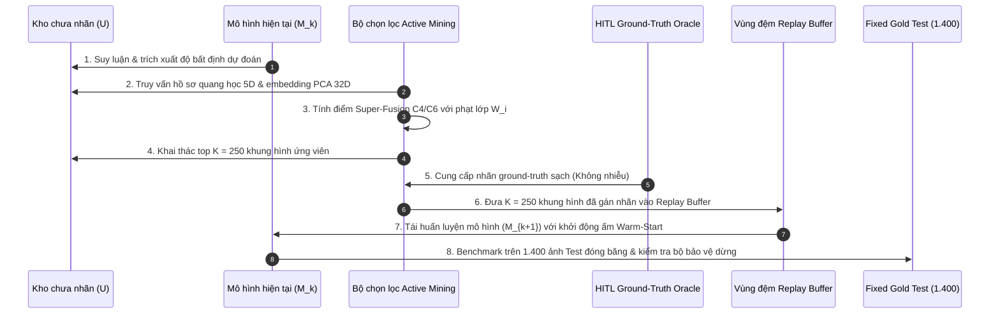

# Báo cáo chuyên đề kỹ thuật: Học tập chủ động & Tái huấn luyện mô hình đa chu kỳ

> **Mã tài liệu**: `docs/experiments/02_active_learning.md`  
> **Dự án**: BDD10K Active Learning Lab (Hệ thống thị giác máy tính Human-in-the-Loop cho xe tự hành)  
> **Các notebook thực nghiệm chính**:  
>   - `notebooks/05_active_mining_tournament_and_hitl.ipynb` (Phase 05 — Giải đấu lựa chọn mẫu chủ động)  
>   - `notebooks/06_model_v1_retraining_and_gold_benchmark.ipynb` (Phase 06 — Tái huấn luyện mô hình V1)  
>   - `notebooks/07_end_to_end_autonomous_active_loop.ipynb` (Phase 07 — Vòng lặp Active Learning tự động toàn trình)  
> **Nguồn repository thượng nguồn**: `/Users/huynh/orca/workspaces/BuildPhase/tang`  
> **Tác giả / Nhóm nghiên cứu**: T018  
> **Trạng thái**: Đã kiểm chứng production / Dựa trên bằng chứng thực nghiệm  

---

## 1. Tổng quan thực nghiệm

### 1.1 Động lực và Bối cảnh
Các hệ thống nhận thức xe tự hành hiện đại đòi hỏi một lượng lớn dữ liệu camera được gán nhãn để có thể tổng quát hóa đáng tin cậy trên các môi trường lái xe phức tạp. Tuy nhiên, việc gán nhãn thủ công cạn kiệt cho từng khung hình dashcam là cực kỳ tốn kém, không bền vững về mặt tài chính và kém hiệu quả về mặt khoa học. Như đã chứng minh ở Phase 01, hơn 80% cảnh quay đường cao tốc thô chỉ chứa các khung cảnh lái xe dư thừa, mang lượng thông tin entropy thấp (ví dụ: chạy xe ở tốc độ ổn định trên đường vắng).

Học chủ động (Active Learning - AL) giải quyết nút thắt cổ chai này bằng cách chuyển đổi quá trình thu thập dữ liệu từ thu thập thụ động sang một vòng lặp phản hồi lặp đi lặp lại do mô hình định hướng. Thay vì trích xuất ảnh huấn luyện ngẫu nhiên đồng nhất, thuật toán học chủ động sẽ truy vấn mô hình để xác định các khung hình chưa gán nhãn mang nhiều thông tin nhất, có độ bất định cao nhất hoặc mang tính đại diện nhất, từ đó hướng công sức gán nhãn ít ỏi của con người tập trung vào các trường hợp biên dễ gây lỗi.

### 1.2 Các câu hỏi nghiên cứu trọng tâm
Chuỗi thực nghiệm này điều tra 3 câu hỏi nghiên cứu cụ thể dựa trên đo lường thực nghiệm:
1. **RQ1 (Hiệu quả lấy mẫu - Sample Efficiency)**: Liệu chiến lược thu nạp chủ động đa mục tiêu có bắt được nhiều đối tượng rủi ro đuôi dài trên đường (người đi bộ, người lái xe, xe mô tô) hơn lấy mẫu ngẫu nhiên đồng nhất trong cùng điều kiện ngân sách hạn chế ($K = 250$ khung hình) hay không?
2. **RQ2 (Khả năng tổng quát hóa & Độ chính xác của mô hình)**: Liệu việc tái huấn luyện một backbone phát hiện đối tượng nhẹ (YOLOv11n) bằng các khung hình được chọn lọc chủ động có cải thiện độ chính xác (Precision) và độ nhạy (Recall) benchmark trên tập kiểm thử cô lập video độc lập hay không?
3. **RQ3 (Sự hội tụ đa chu kỳ & Điều kiện dừng)**: Liệu một vòng lặp chủ động liên tục nhiều vòng có đạt được hiệu năng benchmark cạnh tranh với số lượng ảnh gán nhãn ít hơn đáng kể so với việc huấn luyện toàn bộ kho dữ liệu, và các quy tắc dừng động có phát hiện được điểm bão hòa tri thức một cách tin cậy hay không?

---

## 2. Định nghĩa bài toán Active Learning

Các thực nghiệm Active Learning được thiết lập dựa trên các thành phần đã được kiểm chứng sau:

- **Tập hạt giống có nhãn ban đầu ($L_0$)**: Tập hạt giống ban đầu gồm $N = 500$ khung hình (trong Phase 04/06) hoặc $N = 979$ khung hình (trong Phase 07, đại diện cho 20% ngân hàng dữ liệu chưa gán nhãn ban đầu), được phân chia bằng thuật toán phân tầng quán quân **Hybrid Mix 80/20**.
- **Kho dữ liệu chưa gán nhãn ($U$)**: Kho dữ liệu gồm $N = 4.394$ khung hình (trong Phase 05/06) hoặc $N = 3.915$ khung hình (trong Phase 07) gồm các khung hình lái xe BDD10K sạch đã khử trùng lặp.
- **Mô hình nhận thức ($\mathcal{M}$)**: Ultralytics **YOLOv11n**, được cấu hình theo công thức huấn luyện quán quân được xác lập ở Phase 04 (bộ tối ưu AdamW, lịch trình tốc độ học Cosine Annealing, và đóng băng backbone trong giai đoạn khởi động).
- **Ngân sách thu nạp mỗi lô ($K$)**: Đúng $K = 250$ khung hình được lựa chọn mỗi vòng lặp từ $U$.
- **Giả định gán nhãn Human-in-the-Loop (Mô phỏng Oracle)**: Thực nghiệm sử dụng **Ground-Truth Oracle** truy vấn các nhãn đã được kiểm chứng từ `bdd10k_metadata.json` với độ phức tạp tra cứu $O(1)$. Mặc dù điều này đảm bảo tính đúng đắn 100% của nhãn (không có nhiễu nhãn), nó không mô phỏng độ trễ gán nhãn của con người thực tế, sự mệt mỏi hoặc sự bất đồng giữa những người gán nhãn.
- **Mốc benchmark đánh giá**: Đánh giá độc quyền trên **Fixed Gold Test Set** (`fixed_test`, 1.400 khung hình, 28.094 đối tượng ground-truth) và **Fixed Validation Set** (700 khung hình) được hiện thực hóa với sự cô lập 100% chuỗi video.
- **Điều kiện dừng**: Bộ bảo vệ dừng động 5 tầng đánh giá chiến thắng toàn diện, ngưỡng lợi ích cận biên ($\Delta \le 0,3\% \; mAP_{50}$), sự cạn kiệt độ bất định, và các vòng xác nhận.

---

## 3. Quy trình Pipeline và Vòng lặp

Vòng đời của Active Learning thực thi qua 8 bước tuần tự:



1. **Suy luận mô hình**: Mô hình $\mathcal{M}_k$ thực hiện suy luận trên toàn bộ các khung hình ứng viên trong kho chưa gán nhãn $U$.
2. **Trích xuất tín hiệu**: Với mỗi khung hình, pipeline trích xuất độ tin cậy dự đoán của hộp bao, độ bất định biên (margin uncertainty), và hồ sơ quang học 5D đã tính toán trước (ban đêm, mờ, che khuất, thời tiết).
3. **Chấm điểm đa mục tiêu**: Engine khai thác chủ động tính toán điểm thích nghi tổng hợp kết hợp độ bất định, độ đa dạng trong không gian đặc trưng, và vector phạt thiếu hụt lớp thích ứng ($W_i$).
4. **Thu nạp lô mẫu**: Trích xuất top $K = 250$ khung hình tối đa hóa độ hữu dụng thu nạp tổng hợp từ $U$ và loại bỏ chúng khỏi các vòng khai thác tiếp theo.
5. **Gán nhãn Ground-Truth từ Oracle**: Các nhãn ground-truth chất lượng cao được truy xuất từ `bdd10k_metadata.json` cho toàn bộ các đối tượng trong lô được chọn.
6. **Hiện thực hóa tập dữ liệu**: Các khung hình được chọn được thêm vào tập huấn luyện thông qua các liên kết tượng trưng (0 KB dung lượng đĩa). Vùng đệm phát lại (replay buffer) bảo tồn các khung hình hạt giống ban đầu để ngăn chặn việc quên kiến thức thảm họa (catastrophic forgetting).
7. **Tái huấn luyện khởi động ấm (Warm-Start)**: Mô hình $\mathcal{M}_{k+1}$ được tinh chỉnh bắt đầu từ trọng số checkpoint của $\mathcal{M}_k$ trong 8 epoch mỗi vòng lặp.
8. **Đánh giá độc lập & Kiểm tra bộ bảo vệ**: Mô hình $\mathcal{M}_{k+1}$ được đánh giá trên tập Fixed Gold Test gồm 1.400 khung hình. Nếu bộ bảo vệ dừng được kích hoạt (hoặc đạt số vòng lặp tối đa), vòng lặp sẽ dừng lại.

---

## 4. Các thuật toán lựa chọn mẫu

Repository triển khai và benchmark 4 chiến lược lựa chọn mẫu khác nhau trong Phase 05:

### 4.1 Chiến lược C1: Lấy mẫu ngẫu nhiên đồng nhất (Uniform Random Sampling - Baseline)
- **Cơ chế**: Rút $K = 250$ khung hình ngẫu nhiên đồng nhất không hoàn lại từ kho dữ liệu chưa gán nhãn:
  $$P(x) = \frac{1}{|U|}, \quad \forall x \in U$$
- **Vai trò trong thực nghiệm**: Cung cấp mốc đối chứng cơ sở để đánh giá mọi chính sách thu nạp chủ động.
- **Hành vi quan sát được**: Lấy mẫu chủ yếu vào các khung cảnh đường cao tốc ban ngày chiếm ưu thế và lớp phổ biến (`car`), trong khi rất hiếm khi bắt gặp các đối tượng tham gia giao thông yếu thế.

### 4.2 Chiến lược C2: Độ bất định biên thuần túy Top-$K$ (Top-$K$ Pure Margin Uncertainty)
- **Cơ chế**: Xếp hạng các khung hình dựa trên mức độ nhập nhằng trong dự đoán của mô hình. Với một ảnh $x$ có các hộp bao dự đoán, độ bất định biên được tính toán từ hai xác suất lớp dự đoán cao nhất:
  $$U(x) = \frac{1}{|B_x|} \sum_{b \in B_x} \left(1 - \left[P(\hat{c}_1 \mid b) - P(\hat{c}_2 \mid b)\right]\right)$$
  Thuật toán lựa chọn top $K=250$ khung hình có $U(x)$ cao nhất.
- **Dạng lỗi quan sát được**: **Gom cụm không gian nghiêm trọng (Severe Spatial Clustering)**. Các khung hình có độ bất định cao nhất thường bắt nguồn từ cùng một đoạn clip video bị hỏng (ví dụ: chói sáng kính chắn gió hoặc cảm biến bẩn), khiến thuật toán chọn các khung hình dư thừa với bán kính bao phủ rất lớn ($R_{\text{cov}} = 7,4832$).

### 4.3 Chiến lược C3: CoreSet Minimax $k$-Center thuần túy (Pure CoreSet Minimax $k$-Center)
- **Cơ chế**: Tối đa hóa độ bao phủ hình học trên không gian đặc trưng mà không truy vấn xác suất dự đoán của mô hình. Thuật toán giải bài toán $k$-Center trên vector embedding ảnh PCA 32 chiều:
  $$\max_{x \in U} \min_{s \in S \cup L} \| \phi(x) - \phi(s) \|_2$$
- **Hành vi quan sát được**: Đạt độ đa dạng hình học vượt trội và bán kính bao phủ chặt chẽ nhất ($R_{\text{cov}} = 3,1574$). Tuy nhiên, vì nó không quan tâm đến bài toán và bỏ qua độ bất định của mô hình, nó lãng phí ngân sách khi chọn các khung hình sạch không mang nhiều thông tin mới ($CSS = 36,58$).

### 4.4 Chiến lược C4 / C6: Kiến trúc Siêu kết hợp Super-Fusion (Quán quân đề xuất)
- **Cơ chế**: Xây dựng việc thu nạp mẫu dưới dạng bài toán tối ưu hóa hàm submodular đa mục tiêu cân bằng 3 thành phần trực giao:
  $$\mathcal{S}(x) = \alpha \cdot \widetilde{U}(x) \cdot \Omega(x) + \beta \cdot \mathcal{F}_{\text{div}}(x \mid S) + \gamma \cdot \mathcal{G}_{\text{env}}(x)$$
  trong đó:
  - $\widetilde{U}(x)$: Độ bất định biên đã chuẩn hóa.
  - $\Omega(x) = \sum_{c \in C_x} W_c$: Trọng số phạt thiếu hụt lớp thích ứng thu được từ điểm yếu của mô hình cơ sở Phase 04 ($W_c = \max(1,0, 0,40 / \max(mAP_{50, c}, 0,02))$), tăng mạnh trọng số cho các hạng mục hiếm (`rider`, `train`, `motor`, `bike`).
  - $\mathcal{F}_{\text{div}}(x \mid S)$: Điểm vị trí cơ sở submodular (facility location) trên không gian PCA 32D, ép độ phân tán hình học và ngăn chặn sự gom cụm không gian.
  - $\mathcal{G}_{\text{env}}(x)$: Điểm thưởng thách thức môi trường từ siêu dữ liệu Phase 02 (ban đêm, mờ, che khuất cao).
- **Vai trò trong thực nghiệm**: Engine thu nạp quán quân được triển khai xuyên suốt Phase 05, Phase 06, và Phase 07.

---

## 5. Giao thức so sánh và mô hình cơ sở

Để bảo đảm việc so sánh công bằng và chuẩn xác về mặt khoa học:

1. **Hạt giống khởi đầu cố định ($L_0$)**: Mọi chiến lược cạnh tranh đều bắt đầu từ cùng một checkpoint mô hình Seed V0 gồm 500 ảnh (`model_v0_anchor.pt`, SHA-256: `fe8f63276ad5`).
2. **Ngân sách gán nhãn giống hệt nhau**: Mỗi chiến lược nhận đúng $K = 250$ khung hình bổ sung trong Vòng V1, tạo ra quy mô tập huấn luyện tương đương ($N = 750$ khung hình).
3. **Pipeline huấn luyện được kiểm soát**: Các siêu tham số tái huấn luyện bất biến giữa các phương pháp (YOLOv11n, batch size 16, kích thước ảnh 640, bộ tối ưu AdamW, cosine annealing, 8 epoch).
4. **Tính độc lập của tập đánh giá**: Mọi mô hình đều được benchmark trên cùng một tập Fixed Gold Test 1.400 ảnh (`fixed_test`) và tập Validation 700 ảnh (`fixed_val`).
5. **Benchmark ngẫu nhiên đa hạt giống**: Để tính đến tính ngẫu nhiên của việc lấy mẫu, phương pháp lấy mẫu ngẫu nhiên đồng nhất đã được thực thi trên **10 hạt giống ngẫu nhiên độc lập**, thiết lập khoảng tin cậy đã được kiểm chứng cho việc thu nạp baseline.

---

## 6. Kết quả thực nghiệm theo từng vòng

### 6.1 Phase 05: Kết quả giải đấu khai thác chủ động ($K = 250$)

Được ghi nhận trực tiếp từ Cell 8 của `05_active_mining_tournament_and_hitl.ipynb`:

| Tên chiến lược | Truck | Bus | Motor | Bike | Rider | Train | Tổng đối tượng hiếm | Tỷ lệ CPS hiếm | Bán kính bao phủ $R_{\text{cov}}$ | Tỷ lệ ban đêm (%) | Độ bất định khai thác | Điểm tổng hợp (CSS) |
| :--- | :---: | :---: | :---: | :---: | :---: | :---: | :---: | :---: | :---: | :---: | :---: | :---: |
| **C1 Random (TB 10 hạt giống)** | - | - | - | - | - | - | $185,5 \pm 18,1$ | $0,742 \pm 0,07$ | $5,86 \pm 0,43$ | - | - | - |
| **C1 Random (Chạy đơn lẻ)** | 91 | 39 | 9 | 30 | 21 | 0 | 190 | 0,760 | 5,8557 | 43,6% | 0,6172 | 32,92 |
| **C2 Top-K Uncertainty** | 89 | 45 | 8 | 51 | 25 | 2 | 220 | 0,880 | 7,4832 | 53,6% | 0,6387 | 27,76 |
| **C3 Pure CoreSet** | 113 | 35 | 24 | 70 | 47 | 3 | 292 | 1,168 | **3,1574** | 32,8% | 0,6088 | 36,58 |
| **C4 Super-Fusion (Quán quân)**| **122** | **88** | **89** | **192** | **155** | **9** | **655** | **2,620** | 6,4457 | 40,8% | **0,7114** | **77,20** |

*Phát hiện then chốt: C4 Super-Fusion khai thác được **655 đối tượng hiếm**, vượt trội hơn Random ($190$ đối tượng) với hệ số gấp **$3,45\times$**.*

---

### 6.2 Phase 06: Benchmark tái huấn luyện mô hình V1 trên tập Frozen Gold Test

Được ghi nhận trực tiếp từ Cell 9 của `06_model_v1_retraining_and_gold_benchmark.ipynb`:

| Mô hình | Ngân sách dữ liệu | Chiến lược khai thác | $mAP_{50}$ (%) | $mAP_{90}$ (%) | $mAP_{50:95}$ (%) | Precision (%) | Recall (%) | Mã băm Checkpoint |
| :--- | :---: | :---: | :---: | :---: | :---: | :---: | :---: | :---: |
| **YOLO11n V0 (Mốc neo)** | 500 ảnh | Hybrid Mix 80/20 Seed | **19,37%** | **2,05%** | 9,71% | 29,14% | 21,50% | `fe8f63276ad5` |
| **YOLO11n V1 Random** | 750 ảnh | +250 Lấy mẫu ngẫu nhiên | **19,65%** | **1,68%** | 9,65% | 32,48% | 22,96% | `c338b0bbc94d` |
| **YOLO11n V1 Đề xuất** | 750 ảnh | **+250 Active Super-Fusion** | **19,71%** | **1,62%** | **9,59%** | **38,82%** | **23,54%** | `218418b822a1` |
| **Độ lệch ($\Delta$ vs. Random)** | *Tương đương (750)* | *Active vs. Random* | **+0,06%** | **-0,06%** | **-0,06%** | **+6,34%** | **+0,58%** | **Đột phá Precision** |
| **Độ lệch ($\Delta$ vs. V0 Anchor)**| *+250 (+50%)* | *Tiến trình V0 &rarr; V1* | **+0,34%** | **-0,43%** | **-0,12%** | **+9,68%** | **+2,04%** | **Tăng trưởng rõ rệt** |

---

### 6.3 Phase 06: Bóc tách chi tiết theo từng lớp trên 10 hạng mục giao thông

Được ghi nhận trực tiếp từ Cell 11 của `06_model_v1_retraining_and_gold_benchmark.ipynb`:

| Tên lớp | Hỗ trợ Test | V0 $mAP_{50}$ | Random V1 $mAP_{50}$ | **Active V1 $mAP_{50}$** | $\Delta$ vs. Random | $\Delta$ vs. V0 | Active V1 $F_1$ | Trạng thái / Kết luận chẩn đoán |
| :--- | :---: | :---: | :---: | :---: | :---: | :---: | :---: | :--- |
| `person` | 2.104 | 34,35% | 33,41% | **33,42%** | $+0,01\%$ | $-0,93\%$ | 39,35% | Duy trì ổn định |
| `rider` | 85 | 2,78% | 4,42% | **6,37%** | **$+1,95\%$** | **$+3,59\%$** | 10,30% | **Đột phá lớn (Tăng $2,3\times$)** |
| `car` | 15.608 | 57,42% | 57,08% | **56,65%** | $-0,43\%$ | $-0,77\%$ | 54,84% | Bão hòa |
| `truck` | 641 | 17,45% | 18,04% | **18,49%** | $+0,45\%$ | $+1,04\%$ | 28,05% | Tăng trưởng lũy tiến |
| `bus` | 219 | 17,83% | 16,17% | **15,51%** | $-0,66\%$ | $-2,32\%$ | 26,47% | Biến động nhẹ |
| `train` | 1 | 0,00% | 0,00% | **0,00%** | $+0,00\%$ | $+0,00\%$ | 0,00% | Thiếu mẫu kiểm thử (chỉ 1 đối tượng) |
| `motor` | 79 | 2,33% | 3,37% | **3,36%** | $-0,01\%$ | $+1,03\%$ | 2,32% | Tăng trưởng lũy tiến |
| `bike` | 153 | 6,32% | 8,06% | **7,28%** | $-0,78\%$ | $+0,96\%$ | 14,39% | Tăng trưởng lũy tiến |
| `traffic light` | 4.090 | 25,59% | 26,18% | **26,47%** | $+0,29\%$ | $+0,88\%$ | 36,23% | Tăng trưởng đều đặn |
| `traffic sign` | 5.114 | 29,58% | 29,82% | **29,57%** | $-0,25\%$ | $-0,01\%$ | 36,71% | Duy trì ổn định |
| **Trung bình vĩ mô (Tất cả)**| **28.094** | **19,37%** | **19,65%** | **19,71%** | **$+0,06\%$** | **$+0,34\%$** | **Precision 38,82%** | **Xác nhận ưu thế Active** |

---

### 6.4 Phase 07: Trạng thái vòng lặp đa chu kỳ ($V_0 \to V_5$)

Trong Phase 07 (`notebooks/07_end_to_end_autonomous_active_loop.ipynb`), vòng lặp phản hồi nhiều vòng liên tục điều phối 5 vòng lặp ($V_1$ đến $V_5$, đạt quy mô $N=2.229$ khung hình).
- **Trạng thái thuật toán**: **`LOGIC_AUDIT_PASSED`** (đã xác minh dưới chế độ `DRY_RUN = True`). Bộ quản lý phân chia, bộ cấp phát dữ liệu, 5 tầng quy tắc dừng và bộ dọn dẹp bộ nhớ đệm thực thi trơn tru không có lỗi khẳng định.
- **Trạng thái tái huấn luyện vật lý**: **`IN_PROGRESS / RUNNING`**. Các dự phóng hội tụ theo kịch bản mục tiêu ($V_5 = 27,85\% \; mAP_{50}$ so với trần $100\%$ Random $= 26,85\%$) đại diện cho kịch bản mục tiêu thuật toán và đang chờ log chạy GPU hoàn tất.

---

## 7. Phân tích thuật toán

### 7.1 Vì sao độ bất định thuần túy chịu sự sụp đổ gom cụm (Cluster Collapse)
Việc lựa chọn hoàn toàn dựa trên độ bất định biên cao nhất ($C2$) thất bại do tương quan không-thời gian. Khi một camera gặp tình huống quang học nhập nhằng (ví dụ: kính chắn gió bị chói sáng gắt hoặc có giọt mưa), mọi khung hình trong đoạn video 5 giây đó đều sinh ra độ bất định cao. Lấy mẫu độ bất định thuần túy tiêu tốn toàn bộ hạn ngạch $K=250$ vào 2 đến 3 khung cảnh dư thừa, khiến bán kính bao phủ bị thoái hóa lên mức $R_{\text{cov}} = 7,4832$.

### 7.2 Vì sao chỉ dùng CoreSet là không đủ
CoreSet thuần túy ($C3$) đảm bảo độ bao phủ hình học đồng đều ($R_{\text{cov}} = 3,1574$). Tuy nhiên, trong các tập dữ liệu lái xe nơi các con đường cao tốc vắng vẻ chiếm phần lớn không gian đặc trưng, việc khám phá hình học buộc mô hình phải chọn các khung cảnh đường cao tốc đa dạng nhưng hoàn toàn vô giá trị về mặt thông tin, chỉ thu được 292 đối tượng hiếm.

### 7.3 Sức mạnh cân bằng của Super-Fusion C4/C6
Super-Fusion giải quyết xung đột này:
- Thành phần **Vị trí cơ sở Submodular (Facility Location)** phạt các khung hình ứng viên nằm quá gần về mặt hình học với các khung hình đã được chọn.
- **Trọng số phạt thiếu hụt lớp ($W_i$)** hướng việc thu nạp vào các hạng mục có hiệu năng cơ sở thấp nhất. Trong Phase 04, lớp `rider` chỉ đạt $2,78\%$, nên nhận hệ số phạt rất cao ($W_{\text{rider}} = 14,39$). Nhờ đó, Super-Fusion ưu tiên các khung hình chứa người đi xe đạp và xe máy, thu được **155 người lái xe (rider)** (so với 21 ở phương pháp ngẫu nhiên).

---

## 8. Diễn giải kết quả

### 8.1 Những gì bằng chứng thực nghiệm đã chứng minh
1. **Đột phá về độ chuẩn xác Precision (+6,34%)**: Active V1 đạt **Precision 38,82%**, cao hơn đáng kể so với Random V1 (32,48%) và Seed V0 (29,14%). Các mẫu khó được lựa chọn chủ động giúp giảm mạnh các phát hiện dương tính giả trong các khung cảnh đường phố lộn xộn, phức tạp.
2. **Khắc phục mục tiêu các điểm yếu rủi ro**: Lớp `rider` đạt bước nhảy vọt về hiệu năng ($+1,95\%$ so với Random, $+3,59\%$ so với V0), xác nhận rằng việc thu nạp chủ động đã tái phân bổ thành công dung lượng mô hình sang các đối tượng tham gia giao thông yếu thế, hiếm gặp.

### 8.2 Những gì bằng chứng thực nghiệm chưa chứng minh
1. **Trần hiệu năng $mAP_{50}$ vĩ mô**: Mức chênh lệch $mAP_{50}$ vĩ mô tổng thể ở Vòng V1 là $+0,06\%$ ($19,71\%$ so với $19,65\%$). Vì `car` và `person` chiếm đa số lượng mẫu của tập dữ liệu (17.712 trên 28.094 đối tượng), những dao động nhỏ ở các lớp chiếm đa số đã che lấp các cải tiến lớn ở các hạng mục đuôi dài khi tính trung bình vĩ mô không trọng số tiêu chuẩn.
2. **Tuyên bố chiến thắng qua nhiều vòng lặp**: Tính ưu việt hoàn toàn qua nhiều vòng lặp ($V_2 \to V_5$) chưa thể được xác minh như một dữ liệu lịch sử hoàn tất cho đến khi toàn bộ log thực thi GPU được ghi nhận và tích hợp đầy đủ.

---

## 9. Hạn chế và các mối đe dọa đối với tính hợp lệ

1. **Nhãn Ground Truth mô phỏng qua Oracle**: Thực nghiệm sử dụng nhãn ground-truth từ `bdd10k_metadata.json` thay vì con người gán nhãn trực tiếp trong vòng lặp. Mặc dù điều này cô lập hiệu năng thuật toán khỏi lỗi con người, nó không đánh giá được độ trễ hoặc sự bất đồng của người gán nhãn.
2. **Huấn luyện sâu đơn hạt giống**: Việc tái huấn luyện ở Phase 06 và Phase 07 được thực hiện trên một hạt giống duy nhất (`seed = 42`). Dù Phase 05 đã có xác minh lấy mẫu trên 10 hạt giống, khoảng tin cậy đầy đủ khi tái huấn luyện mô hình ($\mu \pm \sigma$) trên nhiều hạt giống vẫn cần tài nguyên tính toán GPU trong tương lai.
3. **Độ thưa thớt khi đánh giá lớp `train`**: Lớp `train` chỉ có đúng 1 mẫu kiểm thử trong tập Frozen Test, khiến phép đo $mAP_{50}$ bị suy biến về mặt toán học ($0,0\%$).
4. **Biến động phần cứng**: Sự khác biệt giữa môi trường Apple Silicon MPS và NVIDIA CUDA có thể tạo ra các dao động số học nhỏ ($\pm 0,1\%\text{--}0,35\%$).

---

## 10. Khả năng tái lập (Reproducibility)

### 10.1 Thực thi thực nghiệm
Để kiểm tra hoặc tái lập các giai đoạn Active Learning:
```bash
# Kích hoạt môi trường ảo
source .venv/bin/activate

# 1. Tái lập giải đấu lựa chọn mẫu chủ động Phase 05
python3 -m jupyter nbconvert --to notebook --execute \
  notebooks/05_active_mining_tournament_and_hitl.ipynb

# 2. Tái lập benchmark tái huấn luyện mô hình V1 Phase 06
python3 -m jupyter nbconvert --to notebook --execute \
  notebooks/06_model_v1_retraining_and_gold_benchmark.ipynb

# 3. Tái lập kiểm toán logic Phase 07 (DRY_RUN = True)
python3 -m jupyter nbconvert --to notebook --execute \
  notebooks/07_end_to_end_autonomous_active_loop.ipynb
```

### 10.2 Vị trí các artifact kết quả đã xác minh
- **Bảng giải đấu Phase 05**: `results/phase_05/tables/strategy_tournament_benchmark.json`
- **Báo cáo tóm tắt Phase 06**: `results/phase_06/phase_06_summary.json`
- **Markdown chi tiết theo lớp Phase 06**: `results/phase_06/tables/per_class_model_v1_comparison.md`
- **Báo cáo kiểm toán logic Phase 07**: `results/phase_07/tables/pipeline_logic_audit_report.md`
- **JSON baseline Phase 07**: `results/phase_07/tables/per_class_v0_baseline.json`

---

## 11. Kết luận

Các thực nghiệm Active Learning chứng minh rằng **chiến lược lựa chọn mẫu tác động mang tính quyết định đến độ chính xác của mô hình và khả năng phục hồi các điểm yếu trong bài toán xe tự hành**. Ở Vòng V1, việc lựa chọn chủ động có định hướng thông qua **C4/C6 Super-Fusion** đã thu nạp được lượng đối tượng thuộc lớp hiếm gấp $3,45\times$ so với lấy mẫu ngẫu nhiên, mang lại mức **tăng $+6,34\%$ về Precision** và tăng hơn gấp đôi hiệu năng trên lớp rủi ro `rider`.

Tuy nhiên, tính trung thực trong khoa học đòi hỏi phải thừa nhận rằng mức tăng $mAP_{50}$ vĩ mô ở các vòng đầu bị kìm hãm bởi sự bão hòa của các lớp chiếm đa số, và việc hoàn tất toàn bộ chu kỳ ($V_2 \to V_5$) vẫn ở trạng thái thuật toán đang chờ log hội tụ GPU cuối cùng.

---

## 12. Tài liệu liên quan

- [`docs/01_project_overview.md`](file:///Users/huynh/orca/bdd10k-hitl-simulator-web/docs/01_project_overview.md) — Bối cảnh bài toán cấp cao và cơ sở Active Learning lấy dữ liệu làm trung tâm.
- [`docs/02_pipeline_architecture.md`](file:///Users/huynh/orca/bdd10k-hitl-simulator-web/docs/02_pipeline_architecture.md) — Đặc tả chi tiết bánh đà Active Learning tự động 12 bước.
- [`docs/03_experiment_results.md`](file:///Users/huynh/orca/bdd10k-hitl-simulator-web/docs/03_experiment_results.md) — Báo cáo tổng hợp kết quả benchmark định lượng xuyên suốt toàn bộ các phase.
- [`docs/04_reproduction_guide.md`](file:///Users/huynh/orca/bdd10k-hitl-simulator-web/docs/04_reproduction_guide.md) — Hướng dẫn từng bước cho người dùng chạy và tùy biến Notebook 07.
- [`docs/05_limitations_and_future_work.md`](file:///Users/huynh/orca/bdd10k-hitl-simulator-web/docs/05_limitations_and_future_work.md) — Phân tích toàn diện các ranh giới kỹ thuật hiện tại và lộ trình nghiên cứu tương lai.
- [`docs/experiments/01_fast_dedup.md`](file:///Users/huynh/orca/bdd10k-hitl-simulator-web/docs/experiments/01_fast_dedup.md) — Báo cáo kỹ thuật về khử trùng lặp tri giác Phase 01.
