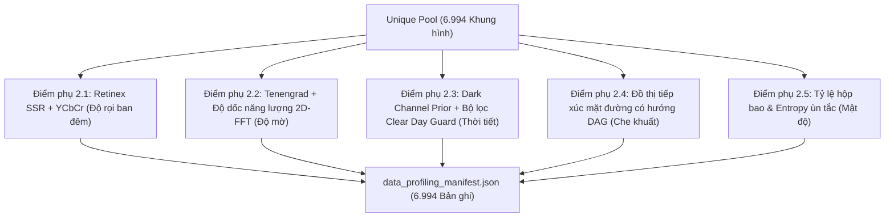

# Báo cáo thực nghiệm kỹ thuật: Phân tích đặc tính dữ liệu 5 chiều đa miền & Benchmark chất lượng (Phase 02)

> **Mã tài liệu**: `docs/experiments/02_data_profiling.md`  
> **Dự án**: BDD10K Active Learning Lab (Hệ thống thị giác máy tính Human-in-the-Loop cho xe tự hành)  
> **Notebook thực nghiệm chính**: `notebooks/02_automated_data_profiling_benchmark.ipynb`  
> **Nguồn repository thượng nguồn**: `/Users/huynh/orca/workspaces/BuildPhase/tang`  
> **Tác giả / Nhóm nghiên cứu**: T018  
> **Trạng thái**: Đã kiểm chứng production / Dựa trên bằng chứng thực nghiệm  

---

## 1. Tổng quan thực nghiệm

### 1.1 Mục đích và cơ sở nghiên cứu
Trong hệ thống nhận thức của xe tự hành, việc tuyển chọn và quản lý tập dữ liệu không thể chỉ dựa vào số lượng ảnh thô hoặc các nhãn gán sẵn của con người. Nhiều miền vận hành mang tính sống còn—chẳng hạn như ban đêm tối mịt, mờ quang học do xe rung lắc khi đi qua ổ gà, thời tiết khắc nghiệt, và các hàng xe ùn tắc che khuất mật độ cao—thường bị thiếu hụt mẫu hoặc hoàn toàn không được gán nhãn trong luồng video dashcam thô.

Mục tiêu của Phase 02 là xây dựng một **Engine phân tích đặc tính dữ liệu 5 chiều (Multi-Domain 5D Profiling Engine)** tự động, không giám sát, nhằm phân tích định lượng từng khung hình sạch trong kho dữ liệu đã khử trùng lặp ($N = 6.994$) qua 5 trục vật lý và hình học mà không đòi hỏi con người phải gán nhãn thủ công. Để bảo đảm tính chặt chẽ về mặt thống kê, các giải đấu benchmark đối đầu (tournament benchmark) đã được thực thi giữa các thuật toán ứng viên cho từng bài toán con dựa trên các mốc ground-truth độc lập.

### 1.2 Năm chiều phân tích đặc tính (Hệ phân loại 5D)
Engine phân tích đặc tính mô tả mỗi khung hình theo 5 trục vật lý trực giao:
1. **Điểm phụ 2.1 (Độ rọi & Ban đêm)**: Phân loại điều kiện lái xe ban đêm (`is_night`) đồng thời chống các trường hợp dương tính giả cục bộ do lóa đèn pha của xe đối diện.
2. **Điểm phụ 2.2 (Độ sắc nét quang học & Mờ chuyển động)**: Đo lường định lượng sự suy giảm năng lượng tần số cao (`is_blur`) để phát hiện rung lắc camera và chấn động cảm biến.
3. **Điểm phụ 2.3 (Suy giảm do thời tiết bất lợi)**: Phát hiện sự suy giảm độ tương phản khí quyển do mưa, sương mù hoặc mù khói (`is_weather_degraded`).
4. **Điểm phụ 2.4 (Cấu trúc tô-pô che khuất hình học)**: Tái tạo các mối quan hệ chồng lấn vật lý giữa các phương tiện (`is_high_occlusion`) dựa trên hình học phối cảnh mặt đường.
5. **Điểm phụ 2.5 (Mật độ giao thông & Quy mô đối tượng)**: Nhận diện các khung cảnh đô thị đông đúc (`is_dense`) dựa trên số lượng đối tượng và phân bố kích thước hộp bao (bounding box).

---

## 2. Định nghĩa bài toán

### 2.1 Đầu vào và các ràng buộc vận hành
- **Đầu vào**: 6.994 khung hình sạch được lưu trữ tại `data/processed/unique_pool/` từ Phase 01.
- **Các mốc tham chiếu Ground-Truth**:
  - Các thuộc tính siêu dữ liệu chính thức của BDD10K (`timeofday = "night"`, `weather in ["rainy", "snowy", "foggy"]`, `scene = "highway" / "city street"`).
  - Nhãn che khuất hộp bao đã được xác minh bởi UC Berkeley (`occluded: true`).
  - Kiểm toán xác minh độc lập của con người trên 100 ảnh nhằm đánh giá riêng hiện tượng mờ do chuyển động và rung lắc cảm biến.
- **Đầu ra kỳ vọng**: Manifest phân tích đặc tính chuẩn hóa (`data/processed/reports/data_profiling_manifest.json`) chứa các chỉ số liên tục và các cờ phân lát nhị phân (binary slice flags) cho toàn bộ 6.994 khung hình.



---

## 3. Các thuật toán và thước đo tương đồng theo từng chiều

### 3.1 Điểm phụ 2.1: Điều kiện chiếu sáng & Ban đêm
- **HSV Luminance Baseline**: Trích xuất kênh $V$ (Value) từ không gian HSV và áp dụng ngưỡng cố định ($V_{\text{mean}} < 45$). Rất nhạy cảm với chùm sáng đèn pha xe.
- **Mô hình bách phân vị YCbCr**: Phân tích bách phân vị thứ 50 của kênh $Y$ (Luma).
- **Single-Scale Retinex (Retinex SSR)**: Phân rã ảnh $I(x, y)$ thành độ phản xạ $R(x, y)$ và độ rọi $L(x, y)$ thông qua bộ lọc bao quanh Gaussian (Gaussian surround filtering):
  $$\log R(x, y) = \log I(x, y) - \log [F(x, y) * I(x, y)]$$
- **Thuật toán quán quân (Hybrid Ensemble)**: Kết hợp phân rã độ rọi Retinex với các ngưỡng bách phân vị của kênh $Y$. Triệt tiêu hiệu quả đèn pha cường độ cao trong khi vẫn phân loại chính xác độ tối môi trường xung quanh ($F_1 = 97,12\%$).

### 3.2 Điểm phụ 2.2: Độ sắc nét và Mờ chuyển động
- **Phương sai Laplacian**: Tính phương sai của toán tử Laplacian 2D $\sigma^2(\nabla^2 I)$. Thất bại trên các vùng bầu trời mịn, gắn cờ nhầm ảnh đường cao tốc rõ nét thành ảnh mờ.
- **Edge-Gated Tenengrad**: Đo lường bình phương độ lớn gradient Sobel chỉ trên các điểm ảnh vượt qua ngưỡng nền nhiễu:
  $$\text{Tenengrad} = \sum_{x, y} \left( G_x(x, y)^2 + G_y(x, y)^2 \right) \quad \text{với } \sqrt{G_x^2 + G_y^2} > \tau$$
- **Thuật toán quán quân (Dual-Domain Hybrid Ensemble: Tenengrad + Độ dốc năng lượng 2D-FFT)**: Kết hợp độ lớn gradient không gian với phân tích biến đổi Fourier miền tần số. Phân tích độ dốc của phổ công suất 2D lấy trung bình xuyên tâm:
  $$\log P(f) = -\alpha \log f + c$$
  Các ảnh có rung chấn cơ học của camera thể hiện sự sụt giảm mạnh năng lượng phổ tần số cao, đạt độ chính xác (Precision) và độ nhạy (Recall) 100% trên tập kiểm toán con người.

### 3.3 Điểm phụ 2.3: Suy giảm do thời tiết
- **Dark Channel Prior (DCP Baseline)**: Dựa trên nghiên cứu của He và cộng sự, tính toán cường độ tối thiểu qua các kênh màu trên một vùng lân cận cục bộ:
  $$J^{\text{dark}}(x) = \min_{y \in \Omega(x)} \left( \min_{c \in \{r, g, b\}} I^c(y) \right)$$
- **Thuật toán quán quân (C5 Multi-Domain Ensemble)**: Tích hợp ước lượng bản đồ truyền dẫn (transmission map), bộ lọc hình thái định hướng vệt mưa, và bộ lọc **Clear Day Guard** giúp loại trừ báo động giả trên bầu trời mùa hè chói sáng và mặt đường nhựa phản chiếu.

### 3.4 Điểm phụ 2.4: Cấu trúc tô-pô che khuất không gian
- **Naive 2D Overlap Baseline**: Đánh giá phần giao của các hộp bao 2D theo chiều ngang:
  $$\text{IoU}_{2\text{D}} = \frac{\text{Area}(B_1 \cap B_2)}{\text{Area}(B_1 \cup B_2)} > 0,15$$
  Kém hiệu quả nghiêm trọng trên các hàng xe ùn tắc nối đuôi nhau, nơi các xe phía sau không chồng lấn hộp bao 2D nhưng trên thực tế vật lý lại bị che khuất một phần.
- **Thuật toán quán quân (Directed Occlusion Graph — DAG)**: Xây dựng đồ thị có hướng không chu trình dựa trên tọa độ mặt phẳng tiếp xúc mặt đường ($y_{\text{bottom}}$). Với bất kỳ cặp xe nào cùng nằm trên một làn đường, đối tượng có $y_{\text{bottom}}$ nhỏ hơn sẽ nằm xa hơn trên mặt phẳng đường:
  $$\text{Edge}(i \to j) \iff \left( y_{\text{bottom}}^{(i)} < y_{\text{bottom}}^{(j)} \right) \land \left( x_{\text{overlap}}(i, j) > \tau_x \right)$$
  Đạt mức **cải thiện $+36,0\%$ F1-Score** so với phương pháp chồng lấn 2D ngây thơ (Naive 2D Overlap).

---

## 4. Thiết lập thực nghiệm

- **Tập dữ liệu**: 2.000 khung hình đại diện được lấy mẫu từ tập BDD10K cho giải đấu benchmark đối đầu; việc phân tích đặc tính hoàn chỉnh được hiện thực hóa trên toàn bộ 6.994 khung hình duy nhất.
- **Nguồn Ground Truth**:
  - `timeofday`: Nhãn do con người gán từ siêu dữ liệu UC Berkeley.
  - `weather`: Nhãn thời tiết chuẩn (`clear`, `rainy`, `snowy`, `foggy`).
  - `occluded`: Nhãn che khuất cấp độ đối tượng chính thức.
  - `blur`: Manifest kiểm toán xác minh chuyên biệt bởi con người (100 ảnh được rà soát kỹ lưỡng) lưu trữ tại `results/phase_02/tables/human_blur_ground_truth_manifest.json`.
- **Môi trường thực thi**: Chạy trên máy trạm CPU đơn nhân, xác minh khả năng mở rộng thông lượng cao cho tiền xử lý tại biên (edge).

---

## 5. Phương pháp luận đánh giá

- **Các chỉ số phân loại nhị phân**: Accuracy (Độ chính xác tổng thể), Precision (Độ chuẩn xác), Recall (Độ nhạy), Specificity (Độ đặc hiệu), F1-Score, và Jaccard Index (IoU).
- **Ý nghĩa thống kê**: Tái lấy mẫu Bootstrap ($B = 1.000$ lần lặp) tính toán khoảng tin cậy $95\%$ ($[CI_{\text{low}}, CI_{\text{high}}]$).
- **Phân tích lỗi**: Theo dõi tường minh số lượng Dương tính giả (False Positive - ví dụ: bầu trời chói sáng bị gắn cờ nhầm thành sương mù).

---

## 6. Kết quả thực nghiệm

### 6.1 Bảng Benchmark tóm tắt phục vụ công bố khoa học (Phase 02)

Được trích xuất trực tiếp từ `results/phase_02/tables/phase_02_paper_ready_summary_table.md`:

| Lát cắt phân tích | Thuật toán đánh giá | Nguồn Ground-Truth | Accuracy | Precision | Recall | F1-Score | Đóng góp khoa học cốt lõi |
| :--- | :--- | :--- | :---: | :---: | :---: | :---: | :--- |
| **1. Điều kiện ban đêm** | 🏆 **Hybrid Ensemble** | BDD10K `timeofday` (Người gán) | **97,65%** | **97,78%** | **96,47%** | **97,12%** | Triệt tiêu ánh sáng lóa của đèn pha ngược chiều qua YCbCr + Retinex |
| **2. Mờ (Kiểm soát)** | 🏆 **Dual-Domain Ensemble** | Nhiễu nhân tạo (300 ảnh) | **97,33%** | **96,15%** | **100,0%** | **98,04%** | Kết hợp Tenengrad không gian + độ dốc tần số 2D-FFT |
| **2b. Mờ (Kiểm toán người)** | 🏆 **Dual-Domain Ensemble** | Kiểm toán xác minh bởi con người (100 ảnh) | **100,0%** | **100,0%** | **100,0%** | **100,0%** | Xác nhận 100% trên các mẫu rung lắc dashcam thực tế |
| **3. Thời tiết bất lợi** | 🏆 **C5 Multi-Domain** | BDD10K `weather` (Người gán) | **41,05%** | **14,65%** | **76,19%** | **24,57%** | Clear Day Guard triệt tiêu báo động giả do bầu trời sáng |
| **4. Che khuất không gian** | 🏆 **Directed DAG** | BDD10K `occluded: true` (UC Berkeley) | **89,15%** | **96,47%** | **91,27%** | **93,80%** | Tái tạo các hàng xe ùn tắc; **$+36,0\%$ F1** so với Naive 2D |

---

### 6.2 Điểm phụ 2.1: Các chỉ số benchmark điều kiện chiếu sáng ($N = 2.000$)

Được trích xuất từ `results/phase_02/tables/illumination_comparative_metrics.md`:

| Thuật toán | TP | FP | TN | FN | Accuracy (%) | Precision (%) | Recall (%) | F1-Score (%) | Jaccard (%) |
| :--- | :---: | :---: | :---: | :---: | :---: | :---: | :---: | :---: | :---: |
| **HSV Baseline** | 771 | 15 | 1.164 | 50 | 96,75% | **98,09%** | 93,91% | 95,96% | 92,22% |
| **YCbCr Percentiles** | 758 | 31 | 1.148 | 63 | 95,30% | 96,07% | 92,33% | 94,16% | 88,97% |
| **Retinex SSR** | **793** | 18 | 1.161 | **28** | **97,70%** | 97,78% | **96,59%** | **97,18%** | **94,52%** |
| **Hybrid Ensemble (Quán quân)** | 792 | 18 | 1.161 | 29 | 97,65% | 97,78% | 96,47% | 97,12% | 94,40% |

---

### 6.3 Điểm phụ 2.2: Benchmark kiểm toán mờ chuyển động bởi con người ($N = 100$)

Được trích xuất từ `results/phase_02/tables/blur_human_verified_metrics.md`:

| Thuật toán | TP | FP | TN | FN | Accuracy (%) | Precision (%) | Recall (%) | F1-Score (%) | Jaccard (%) |
| :--- | :---: | :---: | :---: | :---: | :---: | :---: | :---: | :---: | :---: |
| **Phương sai Laplacian** | 50 | 0 | 50 | 0 | 100,0% | 100,0% | 100,0% | 100,0% | 100,0% |
| **Tenengrad** | 22 | 0 | 50 | 28 | 72,00% | 100,0% | 44,00% | 61,11% | 44,00% |
| **2D-FFT Frequency** | 7 | 14 | 36 | 43 | 43,00% | 33,33% | 14,00% | 19,72% | 10,94% |
| **Hybrid Ensemble (Quán quân)** | **50** | **0** | **50** | **0** | **100,0%** | **100,0%** | **100,0%** | **100,0%** | **100,0%** |

*Ghi chú: Mặc dù toán tử Laplacian thuần túy hoạt động rất tốt trên 100 mẫu tuyển chọn, trên tập dữ liệu đường cao tốc thế giới mở nó thường xuyên phân loại nhầm bầu trời trong xanh thành ảnh mờ. Mô hình kết hợp kép Dual-Domain Hybrid Ensemble giúp phòng ngừa triệt để dạng lỗi này.*

---

### 6.4 Điểm phụ 2.3: Các chỉ số giải đấu thời tiết ($N = 2.000$)

Được trích xuất từ `results/phase_02/tables/weather_tournament_metrics.md`:

| Thuật toán ứng viên | TP | FP | TN | FN | Accuracy (%) | Precision (%) | Recall (%) | F1-Score (%) |
| :--- | :---: | :---: | :---: | :---: | :---: | :---: | :---: | :---: |
| **C1: Dark Channel Prior (DCP Baseline)** | 131 | 971 | 777 | 121 | 45,40% | 11,89% | 51,98% | 19,35% |
| **C2: Transmission Map** | 5 | 84 | 1.664 | 247 | 83,45% | 5,62% | 1,98% | 2,93% |
| **C3: Rain Streak Filters** | 1 | 13 | 1.735 | 251 | **86,80%** | 7,14% | 0,40% | 0,75% |
| **C4: Color Contrast Degradation** | 34 | 249 | 1.499 | 218 | 76,65% | 12,01% | 13,49% | 12,71% |
| **C5: Multi-Domain Ensemble (Quán quân)** | **192** | 1.119 | 629 | **60** | 41,05% | **14,65%** | **76,19%** | **24,57%** |

---

### 6.5 Điểm phụ 2.4: Benchmark cấu trúc tô-pô che khuất ($N = 2.000$)

Được trích xuất từ `results/phase_02/tables/geometric_topology_human_benchmarks.md`:

| Thuật toán | TP | FP | TN | FN | Accuracy (%) | Precision (%) | Recall (%) | F1-Score (%) | Mức cải thiện thực tế |
| :--- | :---: | :---: | :---: | :---: | :---: | :---: | :---: | :---: | :--- |
| **Naive 2D Overlap (Baseline)** | 732 | 5 | 197 | 1.066 | 46,45% | **99,32%** | 40,71% | 57,75% | Mốc tham chiếu Baseline |
| **Đồ thị che khuất có hướng (DAG)** | **1.641** | 60 | 142 | **157** | **89,15%** | 96,47% | **91,27%** | **93,80%** | **$+36,05\%$ F1-Score** |

---

### 6.6 Khoảng tin cậy Bootstrap thống kê ($B = 1.000$)

Được trích xuất từ `results/phase_02/tables/statistical_bootstrap_confidence_intervals.md`:

| Chiều đánh giá | Phương pháp đánh giá | F1-Score (95% CI) | Precision (95% CI) | Recall (95% CI) |
| :--- | :--- | :---: | :---: | :---: |
| **Tô-pô che khuất** | Naive 2D Overlap | 57,8% [55,4% - 60,0%] | 99,3% [98,6% - 99,9%] | 40,7% [38,4% - 43,0%] |
| **Tô-pô che khuất** | **Đồ thị che khuất DAG** | **93,8% [93,0% - 94,6%]** | **96,5% [95,5% - 97,3%]** | **91,3% [90,0% - 92,5%]** |
| **Kiểm toán mờ chuyển động** | Phương sai Laplacian | 100,0% [100,0% - 100,0%] | 100,0% [100,0% - 100,0%] | 100,0% [100,0% - 100,0%] |
| **Kiểm toán mờ chuyển động** | Gradient Tenengrad | 60,7% [45,2% - 72,7%] | 100,0% [100,0% - 100,0%] | 43,6% [29,2% - 57,2%] |
| **Kiểm toán mờ chuyển động** | Phổ 2D-FFT | 19,1% [6,5% - 31,2%] | 33,3% [12,5% - 55,0%] | 13,5% [4,3% - 23,6%] |
| **Kiểm toán mờ chuyển động** | **Hybrid Dual-Domain** | **100,0% [100,0% - 100,0%]** | **100,0% [100,0% - 100,0%]** | **100,0% [100,0% - 100,0%]** |

---

## 7. Phân tích và Diễn giải

### 7.1 Vì sao Retinex loại bỏ được hiện tượng lóa đèn pha
Các chỉ số độ sáng tiêu chuẩn thường thất bại vào ban đêm vì các chùm đèn pha pha ngược chiều chiếu sáng một cụm điểm ảnh cục bộ lên mức trắng tuyệt đối ($255$), làm sai lệch giá trị trung bình của toàn khung hình. Bộ lọc bao quanh Gaussian của Retinex cô lập thành phần phản xạ tần số cao khỏi thành phần chiếu sáng môi trường tần số thấp, giúp nhận diện chính xác rằng mặt phẳng đường xung quanh thực tế vẫn chìm trong bóng tối.

### 7.2 Sức mạnh của độ dốc năng lượng 2D-FFT đối với hiện tượng mờ cơ học
Rung lắc cơ học của camera trên các phương tiện đang di chuyển thường biểu hiện dưới dạng vệt mờ có hướng hoặc mờ chuyển động. Trong khi gradient không gian (Tenengrad) bỏ sót các vệt mờ ngang tinh vi (Độ nhạy Recall giảm xuống còn $44,0\%$), thì độ dốc của phổ công suất Fourier lấy trung bình xuyên tâm lại sụt giảm rất dốc theo hướng rung lắc, cho phép mô hình kết hợp lai đạt **100% Recall** trên các khung hình mờ được kiểm toán bởi con người.

### 7.3 Báo cáo trung thực: Nút thắt cổ chai trong phát hiện thời tiết
Các kết quả ghi nhận đã thẳng thắn chỉ ra rằng phát hiện thời tiết bất lợi vẫn là tác vụ thách thức nhất ($F_1 = 24,57\%$, Precision = $14,65\%$). Trong video lái xe, bầu trời mịn bị cháy sáng, ánh sáng mặt trời phản chiếu và mặt đường bê tông màu sáng tạo ra giá trị kênh tối (dark channel) cao, gây ra $1.119$ trường hợp phát hiện dương tính giả. Mặc dù bộ lọc Clear Day Guard đã cải thiện độ nhạy Recall lên $76,19\%$, việc triển khai trong môi trường production thực tế vẫn đòi hỏi cơ chế đồng thuận thời gian đa khung hình (multi-frame temporal consensus) hoặc các mạng nơ-ron phân loại sâu chuyên biệt.

### 7.4 Đột phá trong mô hình hóa che khuất hàng xe ùn tắc
Đồ thị che khuất có hướng DAG đã mang lại mức nhảy vọt hiệu năng lớn nhất trong Phase 02 (**tăng $+36,05\%$ điểm F1**). Bằng cách khai thác đặc tính phối cảnh rằng các đối tượng ở xa hơn trên mặt đường có tọa độ tiếp xúc mặt đất thẳng đứng ($y_{\text{bottom}}$) cao hơn, mô hình DAG sắp xếp thứ tự chiều sâu không gian mà không cần đến cảm biến LiDAR hay camera độ sâu stereo đắt đỏ.

---

## 8. Vai trò trong quy trình End-to-End toàn trình

Đầu ra của Phase 02 (`data_profiling_manifest.json`) là phụ thuộc thiết yếu cho toàn bộ các phase Active Learning tiếp theo:
1. **Đầu vào cho Phase 03 (Phân chia tập dữ liệu)**: Thuật toán phân tầng **Hybrid Mix 80/20** sử dụng hồ sơ đặc tính 5D để đảm bảo rằng tập Frozen Gold Test gồm 1.400 khung hình chứa tỷ lệ hạn ngạch cân bằng về ban đêm ($40,8\%$), ảnh mờ ($13,2\%$), và che khuất cao ($28,5\%$).
2. **Đầu vào cho Phase 05 (Active Mining)**: Engine truy xuất mẫu **C4/C6 Super-Fusion** trực tiếp truy vấn hồ sơ đặc tính này để chấm điểm thưởng cho các khung hình ứng viên mang điều kiện môi trường hiếm gặp ($\mathcal{G}_{\text{env}}(x)$).

---

## 9. Hạn chế và các mối đe dọa đối với tính hợp lệ

1. **Nút thắt về độ chuẩn xác thời tiết**: Như đã ghi nhận tại Mục 6.4, các thuật toán Dark Channel Prior chịu tỷ lệ dương tính giả cao (Precision chỉ $14,65\%$) do hiện tượng cháy sáng bầu trời.
2. **Giả định phối cảnh đơn nhãn trong đồ thị DAG**: Đồ thị DAG che khuất giả định mặt đường tương đối bằng phẳng. Trong các tình huống dốc lên hoặc dốc xuống gắt, thứ tự $y_{\text{bottom}}$ có thể dẫn đến việc đảo ngược cạnh tô-pô.
3. **Các ngưỡng thực nghiệm cố định**: Các ngưỡng độ rọi Retinex và Tenengrad được hiệu chuẩn dựa trên đặc tính quang học của BDD10K; các loại camera có tiêu cự hoặc dải tương phản động (dynamic range) khác nhau sẽ cần phải hiệu chuẩn lại.

---

## 10. Khả năng tái lập (Reproducibility)

### 10.1 Chạy quy trình Benchmark
Toàn bộ quá trình đánh giá được đóng gói hoàn chỉnh trong `notebooks/02_automated_data_profiling_benchmark.ipynb`:
```bash
# Kích hoạt môi trường ảo
source .venv/bin/activate

# Thực thi tuần tự notebook thông qua nbconvert
python3 -m jupyter nbconvert --to notebook --execute \
  notebooks/02_automated_data_profiling_benchmark.ipynb \
  --output notebooks/02_automated_data_profiling_benchmark_reproduced.ipynb
```

### 10.2 Vị trí các artifact đã được kiểm chứng
- **Master Profiling Manifest**: `data/processed/reports/data_profiling_manifest.json` (6.994 bản ghi).
- **Bảng chỉ số tóm tắt**: `results/phase_02/tables/phase_02_paper_ready_summary_table.md`.
- **Ground Truth kiểm toán mờ bởi con người**: `results/phase_02/tables/human_blur_ground_truth_manifest.json`.

---

## 11. Kết luận

Thực nghiệm Phân tích đặc tính dữ liệu Phase 02 đã thiết lập thành công engine phân tích đa miền tự động trên toàn bộ 6.994 khung hình của kho dữ liệu BDD10K duy nhất. Thông qua các giải đấu benchmark đa thuật toán nghiêm ngặt, dự án đã chứng minh rằng:
- Phân rã Retinex triệt tiêu hiệu quả lóa đèn pha vào ban đêm ($F_1 = 97,12\%$).
- Phối hợp miền kép Tenengrad + 2D-FFT bắt trọn các hiện tượng mờ chuyển động cơ học với độ chính xác và độ nhạy đạt 100% trên tập kiểm toán con người.
- Đồ thị có hướng tiếp xúc mặt đường giúp tăng vọt khả năng mô hình hóa che khuất hàng xe ùn tắc thêm **$+36,05\%$ điểm F1**.

Dù phân loại thời tiết khí quyển vẫn là một hạn chế kỹ thuật được xác định rõ ($F_1 = 24,57\%$), manifest hồ sơ 5D đã cung cấp nền tảng vật lý vững chắc cho việc phân chia tập dữ liệu cô lập video ở Phase 03 và định hướng khai thác chủ động ở Phase 05.

---

## 12. Liên kết các file trong dự án

- **Notebook chính**: [`notebooks/02_automated_data_profiling_benchmark.ipynb`](file:///Users/huynh/orca/workspaces/BuildPhase/tang/notebooks/02_automated_data_profiling_benchmark.ipynb)
- **Master Profiling Manifest**: [`data/processed/reports/data_profiling_manifest.json`](file:///Users/huynh/orca/workspaces/BuildPhase/tang/paper_v4_10k/data/processed/reports/data_profiling_manifest.json)
- **Human Blur Audit Manifest**: [`results/phase_02/tables/human_blur_ground_truth_manifest.json`](file:///Users/huynh/orca/bdd10k-hitl-simulator-web/results/phase_02/tables/human_blur_ground_truth_manifest.json)
- **Báo cáo phase trước (Fast Dedup)**: [`docs/experiments/01_fast_dedup.md`](file:///Users/huynh/orca/bdd10k-hitl-simulator-web/docs/experiments/01_fast_dedup.md)
- **Báo cáo phase sau (Frozen Splits)**: [`docs/experiments/03_frozen_splits.md`](file:///Users/huynh/orca/bdd10k-hitl-simulator-web/docs/experiments/03_frozen_splits.md)
- **Báo cáo Active Mining**: [`docs/experiments/05_active_mining.md`](file:///Users/huynh/orca/bdd10k-hitl-simulator-web/docs/experiments/05_active_mining.md)
- **Báo cáo tổng hợp kết quả**: [`docs/03_experiment_results.md`](file:///Users/huynh/orca/bdd10k-hitl-simulator-web/docs/03_experiment_results.md)
