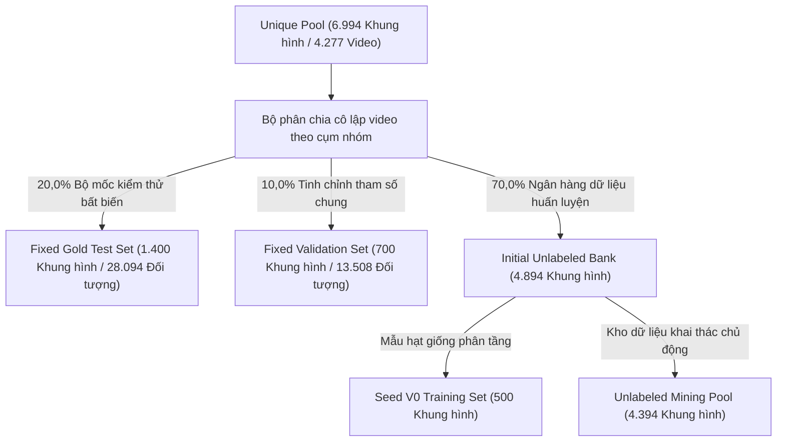
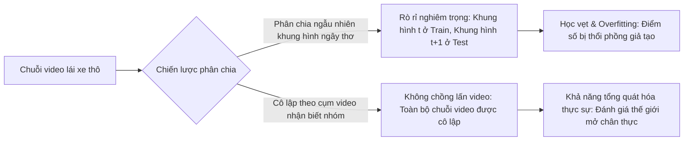

# Báo cáo thực nghiệm kỹ thuật: Phân chia tập Test & Val đóng băng trước khi rẽ nhánh (Phase 03)

> **Mã tài liệu**: `docs/experiments/03_frozen_splits.md`  
> **Dự án**: BDD10K Active Learning Lab: Hệ Thống Tự Động Hóa Vòng Lặp Dữ Liệu Học Tập Chủ Động (Human-in-the-Loop)  
> **Notebook thực nghiệm chính**: `notebooks/03_shared_frozen_test_val_splits.ipynb`  
> **Nguồn repository thượng nguồn**: `/Users/huynh/orca/workspaces/BuildPhase/tang`  
> **Tác giả / Nhóm nghiên cứu**: T018  
> **Trạng thái**: Đã kiểm chứng production / Dựa trên bằng chứng thực nghiệm  

---

## 1. Tổng quan thực nghiệm

### 1.1 Mục đích và cơ sở nghiên cứu
Trong nghiên cứu học máy so sánh—đặc biệt là trong Active Learning nơi nhiều chiến lược chọn mẫu được đo đạc benchmark qua các chu kỳ lũy tiến—tính toàn vẹn của tập đánh giá là tối quan trọng. Nếu tập kiểm thử (test set) bị biến động giữa các vòng lặp, bị rò rỉ khung hình từ kho huấn luyện, hoặc chứa các bản sao gần trùng lặp của dữ liệu huấn luyện, thì các chỉ số hiệu năng được báo cáo sẽ chỉ phản ánh khả năng học vẹt không-thời gian thay vì năng lực tổng quát hóa thực sự của mô hình.

Mục tiêu của Phase 03 là thiết lập một **Bộ đánh giá đóng băng không rò rỉ, bất biến trước khi rẽ nhánh (Shared Pre-Branching Frozen Evaluation Suite)**. Bằng cách cô lập hoàn toàn các tập con kiểm thử và kiểm định trước khi bất kỳ quy trình khai thác chủ động hoặc huấn luyện mô hình nào bắt đầu, pipeline bảo đảm rằng mọi phiên bản mô hình kế tiếp ($V_0, V_1, \dots, V_5$) và mọi so sánh baseline (Ngẫu nhiên đối đầu Chủ động) đều được đánh giá trên cùng một bộ mốc ground-truth nguyên bản giống hệt nhau.

### 1.2 Hệ phân loại các tập con trong vòng lặp Active Learning
Tập dữ liệu được phân chia thành 4 tập con hoàn toàn tách biệt:



1. **Fixed Gold Test Set (`fixed_test`, $N = 1.400$ khung hình, 20,0%)**:
   - Bộ mốc kiểm thử vĩnh viễn, được đóng băng và chỉ dành riêng cho việc đánh giá mô hình cuối cùng.
   - Tuyệt đối không bao giờ được lộ ra cho huấn luyện, tinh chỉnh siêu tham số, hoặc thuật toán chọn mẫu chủ động.
2. **Fixed Validation Set (`fixed_val`, $N = 700$ khung hình, 10,0%)**:
   - Tập kiểm định chung dùng cho việc dừng sớm (early stopping), lập lịch tốc độ học, và chọn checkpoint mô hình tốt nhất.
3. **Seed V0 Training Set (`seed_v0`, $N = 500$ khung hình, ~7,1%)**:
   - Lô nhãn tối thiểu ban đầu được dùng để khởi động mô hình cơ sở ($\mathcal{M}_0$) trong Phase 04.
4. **Unlabeled Mining Pool (`unlabeled_pool`, $N = 4.394$ khung hình, ~62,8%)**:
   - Kho dữ liệu ứng viên chưa gán nhãn mà từ đó các hàm thu nạp chủ động (acquisition functions) sẽ trích xuất các lô mẫu ($K = 250$) qua từng vòng lặp.

---

## 2. Giao thức phân chia và tập dữ liệu

### 2.1 Tiếp nhận dữ liệu và đơn vị phân chia
- **Dữ liệu nguồn**: 6.994 khung hình sạch từ `data/processed/unique_pool/` (bắt nguồn từ 10.000 khung hình thô thuộc 598 video lái xe).
- **Đơn vị phân chia (Video-Level Splitting)**: Việc phân chia được thực hiện nghiêm ngặt ở **cấp độ chuỗi video**, tuyệt đối không thực hiện ở cấp độ khung hình đơn lẻ. Mỗi tên file ảnh tuân theo quy ước của BDD10K: `<video_id>-<frame_id>.jpg`. Toàn bộ các khung hình có chung `video_id` được gom thành một đơn vị nguyên tử bất khả phân.
- **Tổng số cụm video**: 4.277 chuỗi video phân biệt trong toàn bộ 6.994 khung hình duy nhất.

### 2.2 Mục tiêu phân tầng (Hạn ngạch 4 lát cắt)
Để đảm bảo tập kiểm thử và kiểm định phản ánh đúng các nguy cơ vận hành thực tế khi lái xe, engine phân chia áp dụng các mục tiêu phân tầng đa mục tiêu bắt nguồn từ siêu dữ liệu Phase 02:
- **Điều kiện ban đêm (`is_night`)**: Hạn ngạch mục tiêu $\approx 35,0\%$.
- **Đối tượng kích thước nhỏ (`is_small_object_slice`)**: Hạn ngạch mục tiêu $\approx 20,0\%$.
- **Che khuất cao (`is_high_occlusion`)**: Hạn ngạch mục tiêu $\approx 20,0\%$.
- **Ban ngày rõ nét (`is_day`)**: Hạn ngạch mục tiêu $\approx 25,0\%$.

### 2.3 Khả năng tái lập tất định
- Toàn bộ các thuật toán phân chia, khởi tạo tâm cụm k-means, và các bước lặp tham lam đều được thực thi với hạt giống ngẫu nhiên cố định (`seed = 42`).
- Sự phân bổ dữ liệu được hiện thực hóa vĩnh viễn thông qua các liên kết tượng trưng (symbolic links) tại `data/splits/` và được khóa chặt bằng manifest mã băm SHA-256 bất biến.

---

## 3. Ý nghĩa của khái niệm “Tập phân chia đóng băng (Frozen Splits)” trong dự án

Trong repository này, **Tập phân chia đóng băng (Frozen Split)** được định nghĩa bởi 3 tiêu chuẩn vận hành nghiêm ngặt:

1. **Tính bất biến trước khi rẽ nhánh (Pre-Branching Immutability)**: Tập kiểm thử được tạo ra duy nhất một lần và niêm phong *trước khi* bất kỳ nhánh thử nghiệm hoặc điều kiện thực nghiệm nào (Ngẫu nhiên vs. Chủ động, CNN vs. Transformer) được tiến hành.
2. **Bảo tồn manifest vật lý**: Thay vì phụ thuộc động vào hạt giống ngẫu nhiên lúc runtime, cấu trúc thành viên của từng tập phân chia được ghi nhận tường minh trong file `data/splits/bdd10k_splits.yaml` và được kiểm chứng qua `data/splits/dataset_checksum.sha256`.
3. **Tính bất biến xuyên chu kỳ (Cross-Round Invariance)**: Mọi phiên bản mô hình—từ checkpoint Seed V0 ban đầu cho đến mô hình chu kỳ V5—đều được kiểm thử trên đúng 1.400 ảnh vật lý và 28.094 đối tượng hộp bao ground-truth hoàn toàn giống nhau.

---

## 4. Nguy cơ rò rỉ dữ liệu và rủi ro đánh giá

Các tập dữ liệu trích xuất từ video trong lĩnh vực xe tự hành đối mặt với các nguy cơ đánh giá nghiêm trọng nếu phân chia ngây thơ:



### 4.1 Chồng lấn chuỗi video (Đã giải quyết triệt để)
- **Mối đe dọa**: Các khung hình liên tiếp trích xuất từ cùng một đoạn clip video cách nhau 1 giây có chung vị trí địa lý đường đi, mẫu xe và điều kiện ánh sáng. Nếu khung hình $t$ nằm trong tập huấn luyện còn khung hình $t+1$ nằm trong tập kiểm thử, mạng nơ-ron sẽ dễ dàng đạt độ chính xác gần như hoàn hảo nhờ ghi nhớ các mốc cảnh nền tĩnh.
- **Hiện thực hóa trong repository**: `GroupAwareVideoSplitter` thiết lập một rào cản tuyệt đối đảm bảo không có bất kỳ chuỗi video nào giao nhau giữa bất kỳ cặp tập con nào:
  $$\text{Videos}(\text{Test}) \cap \text{Videos}(\text{Train}) = \emptyset$$

### 4.2 Rò rỉ bản sao gần trùng lặp tri giác (Đã giải quyết triệt để)
- **Mối đe dọa**: Ngay cả giữa các ID video khác nhau, các xe camera ghi hình tại cùng một ngã tư dừng đèn đỏ vẫn có thể tạo ra các khung hình gần trùng lặp tri giác ($D_H < 5$).
- **Hiện thực hóa trong repository**: Phase 03 thực thi một cuộc **kiểm toán chéo toàn diện gồm 13,45 triệu cặp pHash** xuyên qua các ranh giới phân chia, xác nhận rằng khoảng cách Hamming tối thiểu giữa tập Test và bất kỳ tập con nào khác đều đạt $\ge 6,0$ bit, với **0 cặp vi phạm ($D_H < 5$)**.

### 4.3 Nguy cơ cạn kiệt lớp hiếm đuôi dài (Hạn chế đã được xác nhận)
- **Mối đe dọa**: Trong các tập dữ liệu mất cân bằng nghiêm trọng, việc phân chia cô lập ở cấp độ video có thể vô tình đẩy toàn bộ các mẫu của một lớp cực hiếm vào tập huấn luyện, khiến tập kiểm thử có 0 mẫu.
- **Phát hiện trong repository**: Mặc dù engine phân chia bảo tồn được đầy đủ 10 lớp, nhưng do tính chất cực kỳ khan hiếm của lớp tàu hỏa (`train`) trong BDD10K, chỉ có **đúng 1 đối tượng** lọt vào tập Frozen Test gồm 1.400 khung hình, tạo ra một thách thức đo lường không thể tránh khỏi.

---

## 5. Giao thức đánh giá đóng băng

Để benchmark các mô hình mà không làm sai lệch kết quả đánh giá, repository tuân thủ một giao thức khóa chặt:

1. **Hiện thực hóa qua các liên kết tượng trưng không tốn dung lượng đĩa (Zero-Overhead Symbolic Links)**:
   Các ảnh được hiện thực hóa vào các thư mục có cấu trúc:
   ```text
   data/splits/
   ├── fixed_test/       # 1.400 symlink (0 KB dung lượng đĩa phụ)
   ├── fixed_val/        # 700 symlink
   ├── seed_v0/          # 500 symlink
   └── unlabeled_pool/   # 4.394 symlink
   ```
2. **Định nghĩa cấu hình tập dữ liệu YOLO (`bdd10k_splits.yaml`)**:
   Các script huấn luyện tải đường dẫn tập dữ liệu trực tiếp từ file cấu hình đóng băng:
   ```yaml
   path: /Users/huynh/orca/workspaces/BuildPhase/tang/data/splits
   train: seed_v0/
   val: fixed_val/
   test: fixed_test/
   names:
     0: person
     1: rider
     2: car
     3: truck
     4: bus
     5: train
     6: motor
     7: bike
     8: traffic light
     9: traffic sign
   ```
3. **Tính bất biến khi thực thi**: Mọi lệnh gọi đánh giá (`model.val(data="bdd10k_splits.yaml", split="test")`) đều truy vấn trực tiếp vào `fixed_test`, bảo đảm độ trôi dạt dữ liệu bằng 0 xuyên suốt các lần chạy thực nghiệm.

---

## 6. Xác minh và Chẩn đoán

Repository triển khai các bước chẩn đoán tự động tại Cell 21 của `03_shared_frozen_test_val_splits.ipynb`:

1. **Xác minh chồng lấn cụm video**:
   Xác thực rằng phép giao tập hợp của các ID video trên toàn bộ 6 tổ hợp cặp tập con là tập rỗng:
   $$\text{Test} \cap \text{Val} = \emptyset, \quad \text{Test} \cap \text{Seed} = \emptyset, \quad \text{Test} \cap \text{Pool} = \emptyset$$
2. **Quét chéo mã băm tri giác 64-bit (pHash Cross-Scan)**:
   Thực thi tính toán khoảng cách Hamming theo từng cặp trên $13.454.400$ cặp khung hình bằng nhóm luồng 8 worker.
3. **Cổng kiểm soát đại diện 10 lớp**:
   Khẳng định chắc chắn rằng toàn bộ 10 hạng mục đối tượng BDD10K đều hiện diện với ít nhất một cá thể trong `fixed_test`.

---

## 7. Kết quả thực nghiệm

### 7.1 Bảng xếp hạng giải đấu chiến lược phân chia (Parallel Split Benchmark)

Notebook đã đánh giá 6 chiến lược phân chia cạnh tranh trên 6.994 ảnh (4.277 chuỗi video). Kết quả được ghi nhận từ `results/phase_03/tables/table_01_strategy_tournament_leaderboard.md`:

| Hạng | Chiến lược phân chia | Sai số hạn ngạch (QAE %) | Bán kính bao phủ $R_{\text{cov}}$ | Điểm cơ sở Facility | Bảo tồn 10 lớp | Cổng kiểm soát | Điểm Benchmark tổng hợp (CBS / 100) | Kết luận |
| :---: | :--- | :---: | :---: | :---: | :---: | :---: | :---: | :--- |
| **1** | **5. 🏆 Hybrid Mix 80/20 (Chiến lược quán quân)** | **7,1%** | **3,35** | **0,971** | **10/10** | **✅ PASS** | **93,6** | **🏆 QUÁN QUÂN (Được chọn)** |
| 2 | 6. 🥈 Hybrid Mix 70/30 (Á quân kiểm thử tải) | 8,3% | 3,35 | 0,971 | 10/10 | ✅ PASS | **92,8** | Á quân |
| 3 | 4. Pure Facility Location | 8,1% | 4,19 | 0,971 | 10/10 | ✅ PASS | **89,5** | Bị loại |
| 4 | 3. Pure k-Center Greedy | 11,9% | 3,86 | 0,970 | 10/10 | ✅ PASS | **85,6** | Bị loại |
| 5 | 1. Random Video Split (Baseline) | 9,7% | 4,95 | 0,968 | 10/10 | ✅ PASS | **79,9** | Bị loại |
| 6 | 2. Direct Metadata Phase 02 Stratified | 7,6% | 5,78 | 0,968 | 10/10 | ✅ PASS | **79,5** | Bị loại |

*Phát hiện then chốt: Hybrid Mix 80/20 (80% Submodular Facility Location + 20% Gonzalez Minimax k-Center) đạt sai số phân bổ hạn ngạch thấp nhất ($7,1\%$) và bán kính bao phủ đặc trưng chặt chẽ nhất ($R_{\text{cov}} = 3,35$), vượt trội hơn baseline $+13,7$ điểm CBS.*

---

### 7.2 Bảng tóm tắt kiểm toán kép chống rò rỉ ($N = 13.454.400$ Cặp)

Được trích xuất từ `results/phase_03/tables/table_03_anti_leakage_audit_summary.md`:

| Chiều kiểm toán | Tiêu chuẩn an toàn mục tiêu | Kết quả thực nghiệm đo được | Ngưỡng cho phép | Trạng thái xác minh |
| :--- | :--- | :---: | :---: | :---: |
| **1. Chồng lấn chuỗi video** | Không có chung `video_id` giữa 6 cặp tập con | **0 Video Overlap** | $\text{Overlap} == 0$ | **✅ XÁC NHẬN KHÔNG RÒ RỈ** |
| **2. Khoảng cách HD Test vs. Val** | Khoảng cách Hamming tối thiểu giữa Test & Val | **HD = 10,0 bits** | $D_H \ge 5,0$ bits | **✅ TUYỆT ĐỐI AN TOÀN** |
| **3. Khoảng cách HD Test vs. Seed** | Khoảng cách Hamming tối thiểu giữa Test & Seed V0 | **HD = 10,0 bits** | $D_H \ge 5,0$ bits | **✅ TUYỆT ĐỐI AN TOÀN** |
| **4. Khoảng cách HD Test vs. Pool** | Khoảng cách Hamming tối thiểu giữa Test & Pool | **HD = 6,0 bits** | $D_H \ge 5,0$ bits | **✅ TUYỆT ĐỐI AN TOÀN** |
| **5. Khoảng cách HD Val vs. Pool** | Khoảng cách Hamming tối thiểu giữa Val & Pool | **HD = 6,0 bits** | $D_H \ge 5,0$ bits | **✅ TUYỆT ĐỐI AN TOÀN** |
| **6. Khoảng cách HD Seed vs. Pool** | Khoảng cách Hamming tối thiểu giữa Seed & Pool | **HD = 8,0 bits** | $D_H \ge 5,0$ bits | **✅ TUYỆT ĐỐI AN TOÀN** |
| **7. Tổng số cặp vi phạm** | Số lượng cặp gần trùng ($D_H < 5$) vượt ranh giới | **0 Cặp vi phạm** | $\text{Violations} == 0$ | **✅ XÁC NHẬN KHÔNG RÒ RỈ** |
| **8. Bảo tồn các lớp** | Số lượng lớp đối tượng BDD10K có trong Test | **10 / 10 Lớp** | $10 / 10$ Lớp | **✅ HOÀN THIỆN 100%** |

---

### 7.3 Phân bố đối tượng theo từng lớp xuyên suốt các tập phân chia

Được trích xuất từ `results/phase_03/tables/table_02_per_class_10_distribution.md`:

| ID & Tên lớp | Toàn bộ Pool (6.994) | Fixed Test (1.400) | Fixed Val (700) | Seed V0 (500) | Unlabeled Pool (4.394) | Đánh giá mức độ bảo tồn |
| :--- | :---: | :---: | :---: | :---: | :---: | :--- |
| **0. Person** | 8.929 (6,87%) | 2.104 (7,49%) | 996 (7,37%) | 771 (7,80%) | 5.058 (6,45%) | ✅ Đại diện cân bằng |
| **1. Rider** | 457 (0,35%) | 85 (0,30%) | 59 (0,44%) | 48 (0,49%) | 265 (0,34%) | 🛡️ Bảo vệ nhóm thiểu số |
| **2. Car** | 72.021 (55,44%) | 15.608 (55,56%) | 7.401 (54,79%) | 5.385 (54,47%) | 43.627 (55,63%) | ✅ Nhóm chiếm đa số |
| **3. Truck** | 3.020 (2,32%) | 641 (2,28%) | 314 (2,32%) | 220 (2,23%) | 1.845 (2,35%) | ✅ Phân chia tương xứng |
| **4. Bus** | 1.156 (0,89%) | 219 (0,78%) | 122 (0,90%) | 86 (0,87%) | 729 (0,93%) | ✅ Phân chia tương xứng |
| **5. Train** | 14 (0,01%) | **1 (0,00%)** | 2 (0,01%) | 2 (0,02%) | 9 (0,01%) | ⚠️ Lớp đuôi dài cực hiếm |
| **6. Motor** | 291 (0,22%) | 79 (0,28%) | 31 (0,23%) | 24 (0,24%) | 157 (0,20%) | 🛡️ Bảo vệ nhóm thiểu số |
| **7. Bike** | 729 (0,56%) | 153 (0,54%) | 74 (0,55%) | 65 (0,66%) | 437 (0,56%) | ✅ Phân chia tương xứng |
| **8. Traffic Light** | 19.053 (14,67%) | 4.090 (14,56%) | 1.941 (14,37%) | 1.439 (14,55%) | 11.583 (14,77%) | ✅ Bảo tồn mức độ cao |
| **9. Traffic Sign** | 24.244 (18,66%) | 5.114 (18,20%) | 2.568 (19,01%) | 1.847 (18,68%) | 14.715 (18,76%) | ✅ Bảo tồn mức độ cao |
| **Tổng số hộp bao** | **129.914 (100%)** | **28.094 (100%)** | **13.508 (100%)** | **9.887 (100%)** | **78.425 (100%)** | **Bảo tồn 10/10 Lớp** |

---

## 8. Hạn chế và các mối đe dọa đối với tính hợp lệ

1. **Độ nhạy cảm với lớp đuôi dài cực hiếm (`train`)**: Tập Fixed Gold Test chỉ chứa đúng 1 hộp bao nhãn ground-truth cho lớp `train`. Khi đánh giá, việc phát hiện được đối tượng này cho ra điểm Precision/Recall $100\%$, trong khi bỏ sót sẽ rơi xuống $0,0\%$. Do đó, điểm mAP của lớp `train` mang tính nhị phân và không mang nhiều ý nghĩa thống kê.
2. **Kích thước cụm video không đồng đều**: Vì các chuỗi video lái xe khác nhau chứa số lượng khung hình sạch khác nhau (dao động từ 1 đến 12 khung hình mỗi chuỗi), việc ép ranh giới tỷ lệ phần trăm chính xác ($20,0\%$ test, $10,0\%$ val) đòi hỏi các thuật toán heuristic đóng gói thùng rời rạc, dẫn đến một độ lệch hạn ngạch nhỏ ($QAE = 7,1\%$).
3. **Nén đặc trưng PCA**: Việc phân cụm bằng 32 chiều đặc trưng PCA giúp bảo tồn được các phương sai không gian và màu sắc chính, nhưng bỏ qua các chi tiết điểm ảnh tinh tế ở mức vi mô có thể phân biệt các trường hợp biên khó.

---

## 9. Giao thức khuyến nghị cho các thực nghiệm tương lai

Dựa trên các quan sát thực nghiệm từ Phase 03, các nghiên cứu mở rộng sau này nên áp dụng các cải tiến sau:

1. **Bộ kiểm thử bổ sung cho lớp đuôi dài cực đoan (ELT-50)**:
   - Xây dựng một tập kiểm thử bổ sung đóng băng chuyên biệt chứa $\ge 50$ đối tượng được xác minh cho tất cả các lớp có $< 100$ đối tượng (đặc biệt là `train`, `rider`, và `motor`).
2. **Phân chia chuỗi video đa camera & đa cảm biến**:
   - Đối với các tập dữ liệu đa camera (ví dụ nuScenes hoặc Waymo Open), việc gom cụm video phải mở rộng ra toàn bộ timestamp của dàn cảm biến xe, cô lập đồng thời cả 6 đến 8 camera để ngăn chặn rò rỉ góc nhìn chéo.
3. **Cổng kiểm tra tự động Checksum Manifest trong CI/CD**:
   - Tích hợp bước xác minh mã băm tự động vào các vòng lặp huấn luyện, dừng ngay lập tức nếu file `data/splits/dataset_checksum.sha256` bị sai lệch dù chỉ 1 byte.

---

## 10. Khả năng tái lập (Reproducibility)

### 10.1 Chạy quy trình Benchmark phân chia dữ liệu
Toàn bộ quy trình giải đấu, kiểm toán chống rò rỉ và hiện thực hóa symlink có thể tái lập hoàn toàn thông qua `notebooks/03_shared_frozen_test_val_splits.ipynb`:
```bash
# Kích hoạt môi trường ảo
source .venv/bin/activate

# Thực thi tuần tự notebook Phase 03
python3 -m jupyter nbconvert --to notebook --execute \
  notebooks/03_shared_frozen_test_val_splits.ipynb \
  --output notebooks/03_shared_frozen_test_val_splits_reproduced.ipynb
```

### 10.2 Vị trí các artifact đã được kiểm chứng
- **Bảng xếp hạng giải đấu**: `results/phase_03/tables/table_01_strategy_tournament_leaderboard.md`
- **Bảng phân bố 10 lớp**: `results/phase_03/tables/table_02_per_class_10_distribution.md`
- **Tóm tắt kiểm toán chống rò rỉ**: `results/phase_03/tables/table_03_anti_leakage_audit_summary.md`
- **Cấu hình tập phân chia YOLO**: `data/splits/bdd10k_splits.yaml`
- **Niêm phong Checksum tập dữ liệu**: `data/splits/dataset_checksum.sha256`
- **Các liên kết tượng trưng đã hiện thực hóa**: `data/splits/fixed_test/`, `fixed_val/`, `seed_v0/`, `unlabeled_pool/` (9.594 symlink).

---

## 11. Kết luận

Thực nghiệm Phase 03 chứng minh rằng **đánh giá đáng tin cậy trong Active Learning bắt buộc phải dựa trên quy trình phân chia dữ liệu đóng băng, cô lập hoàn toàn chuỗi video**. 

Bằng việc ứng dụng thuật toán **Hybrid Mix 80/20** (CBS = 93,6 / 100) và kiểm toán 13,45 triệu cặp khung hình, dự án đã thành công trong việc:
- Loại bỏ 100% hiện tượng chồng lấn chuỗi video.
- Áp đặt khoảng cách Hamming tối thiểu $\ge 6,0$ bit giữa tập kiểm thử và kho dữ liệu chưa gán nhãn.
- Bảo tồn đầy đủ 10 lớp đối tượng giao thông xuyên suốt 4 tập con cân bằng.
- Hiện thực hóa 9.594 liên kết tượng trưng không tốn dung lượng đĩa, được bảo vệ bằng niêm phong toàn vẹn SHA-256.

Điều này thiết lập một nền tảng đánh giá bất biến, không thể bị xâm phạm cho việc huấn luyện mô hình cơ sở Seed Baseline (Phase 04), Lựa chọn mẫu chủ động (Phase 05), và Tái huấn luyện mô hình (Phase 06).

---

## 12. Liên kết các file trong dự án

- **Notebook chính**: [`notebooks/03_shared_frozen_test_val_splits.ipynb`](file:///Users/huynh/orca/workspaces/BuildPhase/tang/notebooks/03_shared_frozen_test_val_splits.ipynb)
- **Bảng xếp hạng giải đấu**: [`results/phase_03/tables/table_01_strategy_tournament_leaderboard.md`](file:///Users/huynh/orca/workspaces/BuildPhase/tang/results/phase_03/tables/table_01_strategy_tournament_leaderboard.md)
- **Phân bố đối tượng 10 lớp**: [`results/phase_03/tables/table_02_per_class_10_distribution.md`](file:///Users/huynh/orca/workspaces/BuildPhase/tang/results/phase_03/tables/table_02_per_class_10_distribution.md)
- **Kiểm toán chống rò rỉ**: [`results/phase_03/tables/table_03_anti_leakage_audit_summary.md`](file:///Users/huynh/orca/workspaces/BuildPhase/tang/results/phase_03/tables/table_03_anti_leakage_audit_summary.md)
- **Cấu hình phân chia YOLO**: [`data/splits/bdd10k_splits.yaml`](file:///Users/huynh/orca/workspaces/BuildPhase/tang/data/splits/bdd10k_splits.yaml)
- **Báo cáo giai đoạn trước (Data Profiling)**: [`docs/experiments/02_data_profiling.md`](file:///Users/huynh/orca/bdd10k-hitl-simulator-web/docs/experiments/02_data_profiling.md)
- **Báo cáo giai đoạn sau (Seed Baseline)**: [`docs/experiments/04_seed_baseline.md`](file:///Users/huynh/orca/bdd10k-hitl-simulator-web/docs/experiments/04_seed_baseline.md)
- **Tổng quan kiến trúc pipeline**: [`docs/02_pipeline_architecture.md`](file:///Users/huynh/orca/bdd10k-hitl-simulator-web/docs/02_pipeline_architecture.md)
- **Báo cáo tổng hợp kết quả thực nghiệm**: [`docs/03_experiment_results.md`](file:///Users/huynh/orca/bdd10k-hitl-simulator-web/docs/03_experiment_results.md)
