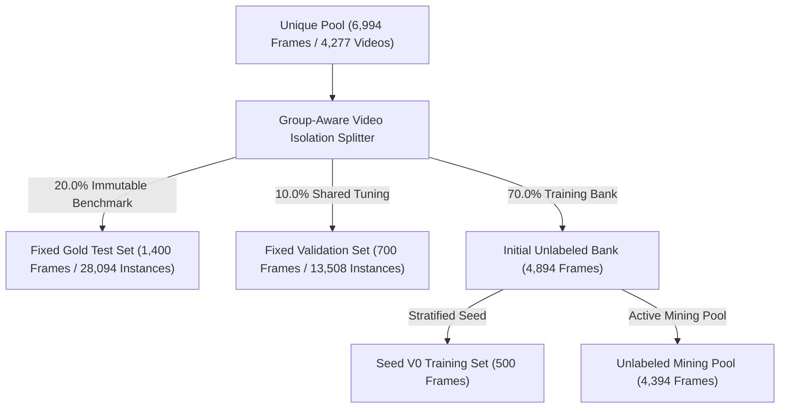
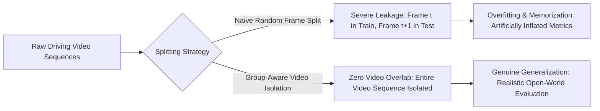

# Technical Experiment Report: Shared Pre-Branching Frozen Test & Val Splits (Phase 03)

> **Document ID**: `docs/experiments/03_frozen_splits.md`  
> **Project**: BDD10K Active Learning Lab (Autonomous Driving Human-in-the-Loop Vision Engine)  
> **Primary Experiment Notebook**: `notebooks/03_shared_frozen_test_val_splits.ipynb`  
> **Upstream Repository Source**: `/Users/huynh/orca/workspaces/BuildPhase/tang`  
> **Author / Research Group**: T018  
> **Status**: Production Verified / Evidence-Based  

---

## 1. Experiment Overview

### 1.1 Purpose and Research Rationale
In comparative machine learning research—especially active learning where multiple sample-selection strategies are benchmarked across progressive cycles—evaluation integrity is paramount. If the test set fluctuates between rounds, leaks frames from the training pool, or contains near-duplicate versions of training instances, reported performance metrics reflect spatial-temporal memorization rather than true model generalization.

The objective of Phase 03 is to establish an invariant, leak-free **Shared Pre-Branching Frozen Evaluation Suite**. By isolating test and validation subsets before any active mining or model training begins, the pipeline guarantees that all subsequent model iterations ($V_0, V_1, \dots, V_5$) and baseline comparisons (Random vs. Active) are evaluated against an identical, untouched ground-truth benchmark.

### 1.2 Partition Taxonomy in the Active Learning Loop
The dataset is partitioned into four strictly disjoint subsets:



1. **Fixed Gold Test Set (`fixed_test`, $N = 1,400$ frames, 20.0%)**:
   - The permanent, frozen benchmark reserved exclusively for final model evaluation.
   - It is never exposed to model training, hyperparameter tuning, or active sample selection.
2. **Fixed Validation Set (`fixed_val`, $N = 700$ frames, 10.0%)**:
   - Shared evaluation split used for early stopping, learning rate scheduling, and checkpoint selection.
3. **Seed V0 Training Set (`seed_v0`, $N = 500$ frames, ~7.1%)**:
   - The initial minimal labeled batch used to bootstrap the base model ($\mathcal{M}_0$) in Phase 04.
4. **Unlabeled Mining Pool (`unlabeled_pool`, $N = 4,394$ frames, ~62.8%)**:
   - The candidate pool from which active acquisition functions extract batches ($K = 250$) across iterative rounds.

---

## 2. Dataset and Splitting Protocol

### 2.1 Dataset Ingestion and Split Unit
- **Source Data**: 6,994 clean frames from `data/processed/unique_pool/` (originating from 10,000 raw frames across 598 driving videos).
- **Unit of Partitioning (Video-Level Splitting)**: Splitting is performed strictly at the **video sequence level**, not at the individual frame level. Each image filename follows the BDD10K convention `<video_id>-<frame_id>.jpg`. All frames sharing the same `video_id` are grouped as an indivisible atomic unit.
- **Total Video Clusters**: 4,277 distinct video sequences across the 6,994 unique frames.

### 2.2 Stratification Targets (4-Slice Quota)
To ensure the test and validation sets reflect realistic operational driving hazards, the splitting engine enforces multi-objective stratification targets derived from Phase 02 metadata:
- **Night Condition (`is_night`)**: Target quota $\approx 35.0\%$.
- **Small Objects (`is_small_object_slice`)**: Target quota $\approx 20.0\%$.
- **High Occlusion (`is_high_occlusion`)**: Target quota $\approx 20.0\%$.
- **Clear Daytime (`is_day`)**: Target quota $\approx 25.0\%$.

### 2.3 Deterministic Reproducibility
- All splitting algorithms, k-means centroid initializations, and greedy iterations are executed with a fixed random seed (`seed = 42`).
- Dataset allocations are permanently materialized via symbolic links in `data/splits/` and locked with an immutable SHA-256 manifest.

---

## 3. What “Frozen Splits” Means in This Project

In this repository, a **Frozen Split** is defined by three strict operational criteria:

1. **Pre-Branching Immutability**: The test set is created once and sealed *before* any branch or experimental condition (Random vs. Active, CNN vs. Transformer) is executed.
2. **Physical Manifest Preservation**: Rather than relying dynamically on run-time random seeds, partition membership is explicitly recorded in `data/splits/bdd10k_splits.yaml` and verified via `data/splits/dataset_checksum.sha256`.
3. **Cross-Round Invariance**: Every model version—from the initial Seed V0 checkpoint to the multi-cycle V5 model—is tested on the exact same 1,400 physical test images and 28,094 bounding-box instances.

---

## 4. Data Leakage and Evaluation Risks

Video-derived datasets in autonomous driving face severe evaluation risks if partitioned naively:



### 4.1 Video Sequence Overlap (Addressed)
- **The Threat**: Consecutive frames extracted from the same video clip 1 second apart share identical road geography, vehicle models, and lighting. If frame $t$ is placed in training and frame $t+1$ in test, the network easily achieves near-perfect detection by memorizing static background landmarks.
- **Repository Implementation**: The `GroupAwareVideoSplitter` enforces an absolute barrier ensuring that zero video sequences intersect between any pair of subsets:
  $$\text{Videos}(\text{Test}) \cap \text{Videos}(\text{Train}) = \emptyset$$

### 4.2 Perceptual Near-Duplicate Leakage (Addressed)
- **The Threat**: Even across different video IDs, camera cars recording the same stationary intersection could produce near-duplicate frames ($D_H < 5$).
- **Repository Implementation**: Phase 03 executes an exhaustive **13.45-million pairwise pHash cross-audit** across partition boundaries, confirming that the minimum Hamming distance between Test and any other partition is $\ge 6.0$ bits, with **0 violating pairs ($D_H < 5$)**.

### 4.3 Long-Tail Class Starvation Risk (Confirmed Limitation)
- **The Threat**: In highly imbalanced datasets, group-level video splitting can accidentally isolate all instances of a rare class into training, leaving zero instances in the test set.
- **Repository Finding**: While the splitting engine preserved all 10 classes, the extreme rarity of `train` in BDD10K resulted in **exactly 1 instance** landing in the 1,400-frame Frozen Test set, creating an unavoidable measurement challenge.

---

## 5. Frozen Evaluation Protocol

To benchmark models without introducing evaluation bias, the repository follows a locked protocol:

1. **Materialization via Zero-Overhead Symbolic Links**:
   Images are materialized into structured directories:
   ```text
   data/splits/
   ├── fixed_test/       # 1,400 symlinks (0 KB disk storage)
   ├── fixed_val/        # 700 symlinks
   ├── seed_v0/          # 500 symlinks
   └── unlabeled_pool/   # 4,394 symlinks
   ```
2. **YOLO Dataset Specification (`bdd10k_splits.yaml`)**:
   Training scripts load dataset paths directly from the frozen configuration:
   ```yaml
   path: /Users/huynh/orca/workspaces/BuildPhase/tang/data/splits
   train: seed_v0/
   val: fixed_val/
   test: fixed_test/
   names:
     0: person
     1: rider
     2: car
     3: truck
     4: bus
     5: train
     6: motor
     7: bike
     8: traffic light
     9: traffic sign
   ```
3. **Execution Invariance**: All evaluation calls (`model.val(data="bdd10k_splits.yaml", split="test")`) query `fixed_test` directly, guaranteeing zero drift across experimental runs.

---

## 6. Verification and Diagnostics

The repository implements automated diagnostics in Cell 21 of `03_shared_frozen_test_val_splits.ipynb`:

1. **Video Cluster Overlap Verification**:
   Validates that the set intersection of video IDs across all 6 subset combinations is empty:
   $$\text{Test} \cap \text{Val} = \emptyset, \quad \text{Test} \cap \text{Seed} = \emptyset, \quad \text{Test} \cap \text{Pool} = \emptyset$$
2. **64-bit Perceptual Hash Cross-Scan**:
   Executes pairwise Hamming distance calculation across $13,454,400$ frame pairs using an 8-thread worker pool.
3. **10-Class Representation Gate**:
   Asserts that all 10 BDD10K object categories are present with at least one instance in `fixed_test`.

---

## 7. Experimental Results

### 7.1 Strategy Tournament Leaderboard (Parallel Split Benchmark)

The notebook evaluated six competing splitting strategies across 6,994 images (4,277 video sequences). Results recorded from `results/phase_03/tables/table_01_strategy_tournament_leaderboard.md`:

| Rank | Splitting Strategy | Quota Error (QAE %) | Coverage Radius $R_{\text{cov}}$ | Facility Score | 10 Classes Preserved | Gatekeeper | Composite Benchmark Score (CBS / 100) | Verdict |
| :---: | :--- | :---: | :---: | :---: | :---: | :---: | :---: | :--- |
| **1** | **5. 🏆 Hybrid Mix 80/20 (Proposed Winner)** | **7.1%** | **3.35** | **0.971** | **10/10** | **✅ PASS** | **93.6** | **🏆 WINNER (Selected)** |
| 2 | 6. 🥈 Hybrid Mix 70/30 (Stress-Test Runner-up) | 8.3% | 3.35 | 0.971 | 10/10 | ✅ PASS | **92.8** | Runner-up |
| 3 | 4. Pure Facility Location | 8.1% | 4.19 | 0.971 | 10/10 | ✅ PASS | **89.5** | Eliminated |
| 4 | 3. Pure k-Center Greedy | 11.9% | 3.86 | 0.970 | 10/10 | ✅ PASS | **85.6** | Eliminated |
| 5 | 1. Random Video Split (Baseline) | 9.7% | 4.95 | 0.968 | 10/10 | ✅ PASS | **79.9** | Eliminated |
| 6 | 2. Direct Metadata Phase 02 Stratified | 7.6% | 5.78 | 0.968 | 10/10 | ✅ PASS | **79.5** | Eliminated |

*Key finding: Hybrid Mix 80/20 (80% Submodular Facility Location + 20% Gonzalez Minimax k-Center) achieved the lowest Quota Allocation Error ($7.1\%$) and the tightest feature coverage radius ($R_{\text{cov}} = 3.35$), outscoring the baseline by $+13.7$ points.*

---

### 7.2 Anti-Leakage Dual Audit Summary ($N = 13,454,400$ Pairs)

Recorded from `results/phase_03/tables/table_03_anti_leakage_audit_summary.md`:

| Audit Dimension | Target Safety Criteria | Measured Empirical Result | Permissible Threshold | Verification Status |
| :--- | :--- | :---: | :---: | :---: |
| **1. Video Sequence Overlap** | Zero common `video_id` across 6 subset pairs | **0 Video Overlap** | $\text{Overlap} == 0$ | **✅ ZERO LEAKAGE CONFIRMED** |
| **2. Test vs. Val Min HD** | Minimum Hamming distance between Test & Val | **HD = 10.0 bits** | $D_H \ge 5.0$ bits | **✅ ABSOLUTELY SAFE** |
| **3. Test vs. Seed Min HD** | Minimum Hamming distance between Test & Seed V0 | **HD = 10.0 bits** | $D_H \ge 5.0$ bits | **✅ ABSOLUTELY SAFE** |
| **4. Test vs. Pool Min HD** | Minimum Hamming distance between Test & Pool | **HD = 6.0 bits** | $D_H \ge 5.0$ bits | **✅ ABSOLUTELY SAFE** |
| **5. Val vs. Pool Min HD** | Minimum Hamming distance between Val & Pool | **HD = 6.0 bits** | $D_H \ge 5.0$ bits | **✅ ABSOLUTELY SAFE** |
| **6. Seed vs. Pool Min HD** | Minimum Hamming distance between Seed & Pool | **HD = 8.0 bits** | $D_H \ge 5.0$ bits | **✅ ABSOLUTELY SAFE** |
| **7. Total Violating Pairs** | Number of near-duplicate pairs ($D_H < 5$) crossing sets | **0 Violating Pairs** | $\text{Violations} == 0$ | **✅ ZERO LEAKAGE CONFIRMED** |
| **8. Class Preservation** | Number of BDD10K classes represented in Test | **10 / 10 Classes** | $10 / 10$ Classes | **✅ 100% COMPLETE** |

---

### 7.3 Per-Class Object Distribution Across Partitions

Recorded from `results/phase_03/tables/table_02_per_class_10_distribution.md`:

| Class ID & Name | Full Pool (6,994) | Fixed Test (1,400) | Fixed Val (700) | Seed V0 (500) | Unlabeled Pool (4,394) | Preservation Verdict |
| :--- | :---: | :---: | :---: | :---: | :---: | :--- |
| **0. Person** | 8,929 (6.87%) | 2,104 (7.49%) | 996 (7.37%) | 771 (7.80%) | 5,058 (6.45%) | ✅ Balanced Representation |
| **1. Rider** | 457 (0.35%) | 85 (0.30%) | 59 (0.44%) | 48 (0.49%) | 265 (0.34%) | 🛡️ Protected Minority |
| **2. Car** | 72,021 (55.44%) | 15,608 (55.56%) | 7,401 (54.79%) | 5,385 (54.47%) | 43,627 (55.63%) | ✅ Dominant Majority |
| **3. Truck** | 3,020 (2.32%) | 641 (2.28%) | 314 (2.32%) | 220 (2.23%) | 1,845 (2.35%) | ✅ Proportional Split |
| **4. Bus** | 1,156 (0.89%) | 219 (0.78%) | 122 (0.90%) | 86 (0.87%) | 729 (0.93%) | ✅ Proportional Split |
| **5. Train** | 14 (0.01%) | **1 (0.00%)** | 2 (0.01%) | 2 (0.02%) | 9 (0.01%) | ⚠️ Extreme Long-Tail Sparsity |
| **6. Motor** | 291 (0.22%) | 79 (0.28%) | 31 (0.23%) | 24 (0.24%) | 157 (0.20%) | 🛡️ Protected Minority |
| **7. Bike** | 729 (0.56%) | 153 (0.54%) | 74 (0.55%) | 65 (0.66%) | 437 (0.56%) | ✅ Proportional Split |
| **8. Traffic Light** | 19,053 (14.67%) | 4,090 (14.56%) | 1,941 (14.37%) | 1,439 (14.55%) | 11,583 (14.77%) | ✅ Highly Preserved |
| **9. Traffic Sign** | 24,244 (18.66%) | 5,114 (18.20%) | 2,568 (19.01%) | 1,847 (18.68%) | 14,715 (18.76%) | ✅ Highly Preserved |
| **Total BBoxes** | **129,914 (100%)** | **28,094 (100%)** | **13,508 (100%)** | **9,887 (100%)** | **78,425 (100%)** | **10/10 Classes Preserved** |

---

## 8. Limitations and Threats to Validity

1. **Extreme Long-Tail Sensitivity (`train`)**: The Fixed Gold Test set contains only 1 ground-truth bounding box for `train`. In evaluation, detecting this single object yields $100\%$ precision/recall, while missing it yields $0.0\%$. Consequently, mAP scores for `train` are binary and statistically uninformative.
2. **Variable Cluster Sizes in Video Splitting**: Because different driving video sequences contain varying numbers of clean frames (ranging from 1 to 12 frames per sequence), enforcing exact percentage boundaries ($20.0\%$ test, $10.0\%$ val) requires discrete bin-packing heuristics, resulting in a minor quota deviation ($QAE = 7.1\%$).
3. **PCA Feature Compression**: Clustering using 32D PCA features preserves major spatial and color variance, but discards localized fine-grained pixel details that could differentiate subtle edge cases.

---

## 9. Recommended Protocol for Future Experiments

Based on empirical observations from Phase 03, future extensions should adopt the following enhancements:

1. **Supplemental Extreme Long-Tail Test Benchmark (ELT-50)**:
   - Construct a dedicated, supplemental frozen test slice containing $\ge 50$ verified instances for all classes with $< 100$ instances (specifically `train`, `rider`, and `motor`).
2. **Cross-Camera & Multi-Sensor Video Splitting**:
   - For multi-camera datasets (e.g., nuScenes or Waymo Open), video clustering must extend to the entire vehicle rig timestamp, isolating all 6 to 8 cameras simultaneously to prevent cross-view leakage.
3. **Automated Manifest Checksum Gate in CI/CD**:
   - Integrate an automated hash verification step into pipeline training loops that halts execution if `data/splits/dataset_checksum.sha256` diverges by a single byte.

---

## 10. Reproducibility

### 10.1 Running the Split Benchmark
The entire tournament, audit, and symlink materialization process is reproducible via `notebooks/03_shared_frozen_test_val_splits.ipynb`:
```bash
# Activate virtual environment
source .venv/bin/activate

# Execute Phase 03 notebook sequentially
python3 -m jupyter nbconvert --to notebook --execute \
  notebooks/03_shared_frozen_test_val_splits.ipynb \
  --output notebooks/03_shared_frozen_test_val_splits_reproduced.ipynb
```

### 10.2 Verified Artifact Locations
- **Tournament Leaderboard Table**: `results/phase_03/tables/table_01_strategy_tournament_leaderboard.md`
- **10-Class Distribution Table**: `results/phase_03/tables/table_02_per_class_10_distribution.md`
- **Anti-Leakage Audit Summary**: `results/phase_03/tables/table_03_anti_leakage_audit_summary.md`
- **YOLO Configuration**: `data/splits/bdd10k_splits.yaml`
- **Dataset Checksum Seal**: `data/splits/dataset_checksum.sha256`
- **Materialized Symlinks**: `data/splits/fixed_test/`, `fixed_val/`, `seed_v0/`, `unlabeled_pool/` (9,594 symlinks).

---

## 11. Conclusion

The Phase 03 experiment demonstrates that **reliable evaluation of active learning algorithms requires strict, video-isolated frozen dataset partitioning**. 

By deploying the **Hybrid Mix 80/20** algorithm (CBS = 93.6 / 100) and auditing 13.45 million frame pairs, the project successfully:
- Eliminated 100% of video sequence overlap.
- Enforced a minimum Hamming distance of $\ge 6.0$ bits between test and pool frames.
- Preserved all 10 road object classes across four balanced subsets.
- Materialized 9,594 zero-overhead symbolic links locked with SHA-256 integrity seals.

This establishes an immutable, uncompromised evaluation foundation for Seed Baseline training (Phase 04), Active Selection (Phase 05), and Model Retraining (Phase 06).

---

## 12. References to Project Files

- **Primary Notebook**: [`notebooks/03_shared_frozen_test_val_splits.ipynb`](file:///Users/huynh/orca/workspaces/BuildPhase/tang/notebooks/03_shared_frozen_test_val_splits.ipynb)
- **Tournament Leaderboard**: [`results/phase_03/tables/table_01_strategy_tournament_leaderboard.md`](file:///Users/huynh/orca/workspaces/BuildPhase/tang/results/phase_03/tables/table_01_strategy_tournament_leaderboard.md)
- **Per-Class Distribution**: [`results/phase_03/tables/table_02_per_class_10_distribution.md`](file:///Users/huynh/orca/workspaces/BuildPhase/tang/results/phase_03/tables/table_02_per_class_10_distribution.md)
- **Anti-Leakage Audit**: [`results/phase_03/tables/table_03_anti_leakage_audit_summary.md`](file:///Users/huynh/orca/workspaces/BuildPhase/tang/results/phase_03/tables/table_03_anti_leakage_audit_summary.md)
- **YOLO Splits Configuration**: [`data/splits/bdd10k_splits.yaml`](file:///Users/huynh/orca/workspaces/BuildPhase/tang/data/splits/bdd10k_splits.yaml)
- **Preceding Stage (Data Profiling)**: [`docs/experiments/02_data_profiling.md`](02_data_profiling.md)
- **Subsequent Stage (Seed Baseline)**: [`docs/experiments/04_seed_baseline.md`](04_seed_baseline.md)
- **Pipeline Architecture Overview**: [`docs/02_pipeline_architecture.md`](../02_pipeline_architecture.md)
- **Synthesized Results Report**: [`docs/03_experiment_results.md`](../03_experiment_results.md)
