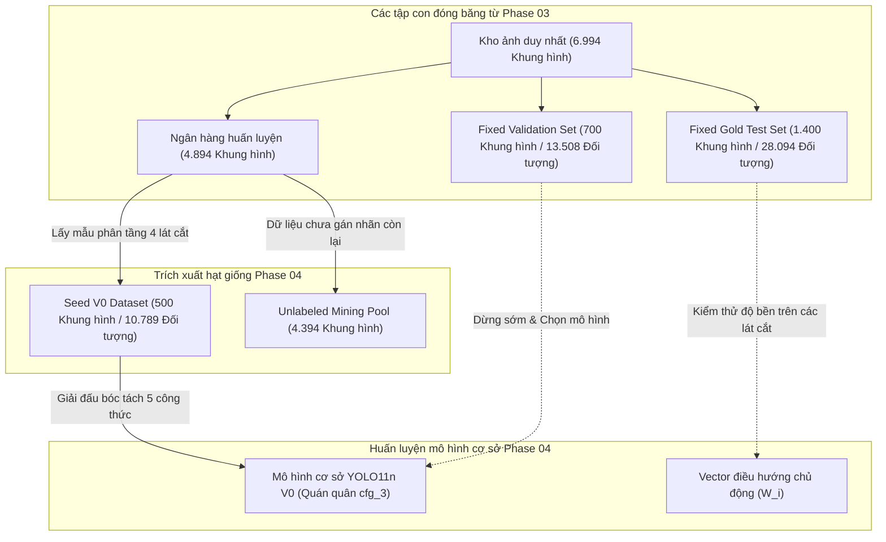

# Báo cáo thực nghiệm kỹ thuật: Xây dựng tập dữ liệu hạt giống & Thử nghiệm bóc tách mô hình cơ sở (Phase 04)

> **Mã tài liệu**: `docs/experiments/04_seed_baseline.md`  
> **Dự án**: BDD10K Active Learning Lab (Hệ thống thị giác máy tính Human-in-the-Loop cho xe tự hành)  
> **Notebook thực nghiệm chính**: `notebooks/04_seed_v0_training_ablation.ipynb`  
> **Nguồn repository thượng nguồn**: `/Users/huynh/orca/workspaces/BuildPhase/tang`  
> **Tác giả / Nhóm nghiên cứu**: T018  
> **Trạng thái**: Đã kiểm chứng production / Dựa trên bằng chứng thực nghiệm  

---

## 1. Tổng quan thực nghiệm

### 1.1 Mục đích và cơ sở nghiên cứu
Trong học máy lấy dữ liệu làm trung tâm (data-centric machine learning) và các quy trình Active Learning, **Tập dữ liệu hạt giống (Seed Dataset)** ($\mathcal{D}_{\text{seed}}^{(0)}$) cùng **Mô hình cơ sở ban đầu (Baseline Model)** ($\mathcal{M}_0$) đóng vai trò là mốc tham chiếu phổ quát cho mọi tiến trình lặp sau này. Nếu không có một mốc cơ sở vững chắc về mặt thực nghiệm, hoàn toàn không rò rỉ dữ liệu và được hiệu chuẩn chuẩn xác, thì việc đo lường giá trị thực tế của quy trình gán nhãn Human-in-the-Loop (HITL), các chiến lược khai thác mẫu chủ động hoặc các hàm thu nạp dữ liệu (data acquisition functions) sẽ trở nên bất khả thi.

Phase 04 thiết lập mốc đo lường nền tảng này thông qua:
1. Khởi tạo một tập dữ liệu hạt giống có nhãn tối thiểu ($N = 500$ khung hình) từ kho huấn luyện chưa cấp phát, đồng thời bảo tồn hạn ngạch cân bằng qua các lát cắt rủi ro môi trường.
2. Thực thi giải đấu bóc tách (ablation tournament) nghiêm ngặt gồm 5 công thức huấn luyện hiện đại để xác định công thức huấn luyện tối ưu trong điều kiện cực kỳ khan hiếm dữ liệu.
3. Thực hiện so sánh đối đầu giữa hai kiến trúc: mạng tích chập nhẹ (YOLO11n) đối đầu với mạng Transformer thị giác (RT-DETR-L) nhằm phân tích động thái của độ lệch quy nạp (inductive bias) trong chế độ mẫu nhỏ.
4. Kiểm thử sức chịu tải của mô hình cơ sở trên 4 lát cắt môi trường khó thuộc bộ kiểm thử đóng băng để xây dựng vector điều hướng thực nghiệm ($W_i$) cho các chu kỳ khai thác chủ động tiếp theo.

### 1.2 Hệ phân loại các tập con dữ liệu
Hệ thống Active Learning vận hành trên 4 tập phân chia dữ liệu cô lập nghiêm ngặt được thiết lập từ Phase 03:



- **Seed V0 Training Set (`seed_v0`, $N = 500$ khung hình, ~7,15% kho dữ liệu)**: Lô nhãn ban đầu dùng để huấn luyện mô hình cơ sở $\mathcal{M}_0$. Toàn bộ 10.789 nhãn ground-truth đều sẵn sàng sử dụng.
- **Unlabeled Mining Pool (`unlabeled_pool`, $N = 4.394$ khung hình, ~62,83% kho dữ liệu)**: Kho dữ liệu chưa gán nhãn mà từ đó các hàm thu nạp chủ động sẽ lựa chọn các mẫu mang nhiều thông tin ($K = 250$ mỗi chu kỳ).
- **Fixed Validation Set (`fixed_val`, $N = 700$ khung hình, 10,01% kho dữ liệu)**: 13.508 đối tượng ground-truth dùng để theo dõi sự hội tụ của hàm mất mát, lập lịch tốc độ học và dừng sớm (early stopping).
- **Fixed Gold Test Set (`fixed_test`, $N = 1.400$ khung hình, 20,02% kho dữ liệu)**: 28.094 đối tượng ground-truth dành riêng cho việc đánh giá phân phối ngoài (out-of-distribution) và kiểm tra sức chịu tải trên các lát cắt khó.

---

## 2. Xây dựng tập dữ liệu hạt giống (Seed Dataset)

### 2.1 Nguồn dữ liệu và quy trình trích xuất
Tập dữ liệu Seed V0 được trích xuất từ kho ảnh sạch đã khử trùng lặp từ Phase 01 (`data/processed/unique_pool/`, 6.994 khung hình) và được phân chia ở Phase 03. Toàn bộ hình ảnh đều có nguồn gốc từ tập phát hiện đối tượng chính thức Berkeley DeepDrive 10K (BDD10K).

Để ngăn chặn rò rỉ không-thời gian, việc trích xuất hạt giống bị ràng buộc chặt chẽ bởi siêu dữ liệu gom cụm video:
- **Tổng số khung hình hạt giống**: $N = 500$ khung hình.
- **Ngân sách lấy mẫu**: $10,22\%$ của ngân hàng huấn luyện 4.894 khung hình ($7,15\%$ của toàn bộ kho ảnh sạch 6.994 khung hình).
- **Giao thức trích xuất**: Phân bổ phân tầng tham lam theo cụm video với hạt giống ngẫu nhiên cố định (`seed = 42`).
- **Hiện thực hóa vật lý**: Được hiện thực hóa dưới dạng liên kết tượng trưng (symbolic links) không tốn dung lượng đĩa tại `data/splits/autonomous_loop/seed_v0/` (cả ảnh và nhãn) và được khóa mã băm SHA-256 trong `dataset_splits_manifest.json`.

### 2.2 Hạn ngạch phân tầng 4 lát cắt môi trường
Để tránh thiên lệch về điều kiện lái xe ban ngày dễ dàng, 500 khung hình hạt giống tuân thủ nghiêm ngặt hạn ngạch 4 lát cắt môi trường thu được từ phân tích quang học Phase 02:
- **Điều kiện ban đêm (`is_night`)**: Hạn ngạch mục tiêu $\approx 35,0\%$ (độ rọi thấp, lóa đèn pha).
- **Lát cắt đối tượng nhỏ (`is_small_object_slice`)**: Hạn ngạch mục tiêu $\approx 20,0\%$ ($< 32^2$ điểm ảnh, người tham gia giao thông yếu thế ở khoảng cách xa).
- **Che khuất cao (`is_high_occlusion`)**: Hạn ngạch mục tiêu $\approx 20,0\%$ (độ chồng lấn đồ thị DAG mặt đường $> 30\%$).
- **Ban ngày rõ nét chuẩn (`clear_day`)**: Hạn ngạch mục tiêu $\approx 25,0\%$ (mốc đối chứng độ tương phản chuẩn).

### 2.3 Phân bố lớp và độ mất cân bằng cực đoan (2.692:1)
500 khung hình hạt giống chứa 10.789 hộp bao nhãn ground-truth thuộc 10 hạng mục giao thông đường bộ BDD10K. Phân tích cho thấy sự mất cân bằng lớp dạng đuôi dài (long-tail) cực kỳ gay gắt:

| ID Lớp | Tên hạng mục | Số lượng mẫu Seed | Tần suất (%) | Hệ số trọng số phạt ($W_c$) | Mức độ khan hiếm |
| :---: | :--- | :---: | :---: | :---: | :--- |
| 0 | `person` | 771 | 7,15% | 0,273 | Người đi bộ (Trung bình) |
| 1 | `rider` | 48 | 0,44% | 1,085 | **Người lái xe máy/xe đạp (Cực hiếm)** |
| 2 | `car` | 5.385 | 49,91% | 0,200 | Ô tô (Lớp chiếm đa số áp đảo) |
| 3 | `truck` | 220 | 2,04% | 0,511 | Xe tải hạng nặng |
| 4 | `bus` | 86 | 0,80% | 0,814 | Xe buýt công cộng |
| 5 | `train` | 2 | 0,02% | 4,384 | **Thiếu hụt trầm trọng (Chỉ 2 mẫu)** |
| 6 | `motor` | 24 | 0,22% | 1,519 | **Xe mô tô (Cực hiếm)** |
| 7 | `bike` | 65 | 0,60% | 0,935 | Xe đạp (Hiếm) |
| 8 | `traffic light` | 1.439 | 13,34% | 0,200 | Đèn giao thông |
| 9 | `traffic sign` | 1.847 | 17,12% | 0,200 | Biển báo giao thông |
| **Tổng** | **Toàn bộ 10 hạng mục** | **10.789** | **100,00%** | **—** | **Độ mất cân bằng cực đại: 2.692,5 : 1** |

> [!WARNING]
> Tập dữ liệu hạt giống được thiết kế có chủ ý là **không cân bằng theo lớp**. Tỷ lệ mất cân bằng giữa `car` (5.385) và `train` (2) vượt mức **2.692:1**. Các lớp hiếm (`rider`, `motor`, `train`) chỉ chiếm tổng cộng chưa đầy $0,7\%$ số lượng nhãn, đặt ra thách thức tối ưu hóa rất lớn cho các hàm mất mát phát hiện đối tượng tiêu chuẩn.

Để giảm thiểu sự thiếu hụt gradient cho các lớp đuôi dài mà không làm mất ổn định các lớp chiếm đa số, pipeline thiết lập vector trọng số phạt hàm mất mát dạng **Nghịch đảo tần suất làm mịn (Smoothed Inverse Frequency)**:
$$w_c = \sqrt{\frac{\text{median}(N)}{N_c + 1,0}}, \quad w_{\text{norm}} = \frac{w_c}{\text{mean}(w_c)}, \quad W_c = \text{clip}(w_{\text{norm}}, 0,2, 5,0)$$

---

## 3. Mô hình cơ sở và quy trình huấn luyện

### 3.1 Đặc tả kiến trúc mô hình
Để thiết lập một benchmark đối sánh hai kiến trúc (CNN vs. Vision Transformer), thực nghiệm đánh giá hai mô hình riêng biệt:

1. **YOLO11n (Ultralytics, Engine khai thác chính)**:
   - **Kiến trúc**: Mạng nơ-ron tích chập nhẹ (CNN) kết hợp khối cổ mạng Path Aggregation Network (PAN) và đầu phát hiện anchor-free tách rời.
   - **Số lượng tham số**: ~2,59M tham số (kích thước checkpoint 5,20 MB).
   - **Độ lệch quy nạp (Inductive Bias)**: Sở hữu độ lệch quy nạp không gian cục bộ mạnh mẽ, tính bất biến tịnh tiến không gian, và hệ phân cấp đặc trưng đa tỉ lệ.
   - **Checkpoint tiền huấn luyện**: `yolo11n.pt` (huấn luyện trước trên MS COCO).
2. **RT-DETR-L (Baidu / Ultralytics, Mô hình đối chứng Transformer)**:
   - **Kiến trúc**: Real-Time Detection Transformer với bộ mã hóa lai hiệu quả (Efficient Hybrid Encoder) và hàm mất mát ghép cặp hai phía Hungarian (Hungarian Bipartite Matching).
   - **Số lượng tham số**: ~32,0M tham số (kích thước checkpoint 63,18 MB).
   - **Độ lệch quy nạp (Inductive Bias)**: Vùng cảm nhận toàn cục yếu, dựa hoàn toàn vào cơ chế tự chú ý (self-attention) mà không có tiên nghiệm định vị không gian tường minh.
   - **Checkpoint tiền huấn luyện**: `rtdetr-l.pt` (huấn luyện trước trên MS COCO).

### 3.2 Thiết kế giải đấu bóc tách 5 công thức huấn luyện
Để cô lập một cách có hệ thống sự đóng góp của các bộ tối ưu, lịch trình tốc độ học, đóng băng backbone và điều chỉnh trọng số hàm mất mát, thực nghiệm xây dựng giải đấu bóc tách 5 phương án trên tập hạt giống 500 ảnh:

| Mã cấu hình | Tên công thức | Bộ tối ưu | Lịch LR | Đóng băng Backbone | Trọng số mất mát lớp | Giả thuyết khoa học |
| :--- | :--- | :---: | :---: | :---: | :---: | :--- |
| `cfg_0_naive` | Naive Baseline | SGD | Giảm tuyến tính | Không | Không | Mốc sàn cơ sở; dễ bị overfitting nhanh chóng vào lớp đa số (`car`). |
| `cfg_1_freeze` | Backbone Freezing | SGD | Giảm tuyến tính | 10 Lớp (5 epoch) | Không | Giảm sốc gradient ban đầu và bảo tồn các biểu diễn cấp thấp đã tiền huấn luyện. |
| `cfg_2_class_weights`| Class-Weighted Loss | SGD | Giảm tuyến tính | Không | Làm mịn ($W_c \le 5,0$) | Buộc cập nhật gradient hướng về các hạng mục hiếm (`train`, `motor`, `rider`). |
| `cfg_3_adamw_cosine` | AdamW + Cosine | AdamW | Cosine Annealing | Không | Không | Cơ chế suy giảm trọng số tách rời và sự hội tụ đa tỉ lệ êm dịu giúp ổn định gradient bậc hai. |
| `cfg_4_proposed` | Full Proposed Recipe | AdamW | Cosine Annealing | 10 Lớp (5 epoch) | Làm mịn ($W_c \le 5,0$) | Kết hợp hiệp đồng cả 3 kỹ thuật ổn định hóa. |

### 3.3 Siêu tham số huấn luyện và Phần cứng
- **Độ phân giải đầu vào**: $640 \times 640$ điểm ảnh (`imgsz=640`).
- **Kích thước Batch**: 16 ảnh mỗi bước lặp.
- **Số epoch tối đa**: 35 epoch (mở rộng lên 41 epoch để đảm bảo hội tụ hoàn toàn).
- **Dừng sớm (Early Stopping)**: Kiên nhẫn (patience) = 8 epoch theo dõi trên mAP@50 của tập validation.
- **Tốc độ học ban đầu**: $\eta_0 = 0,001$ (AdamW) / $0,01$ (SGD).
- **Suy giảm trọng số (Weight Decay)**: $0,0005$ (SGD) / $0,01$ (AdamW).
- **Tăng tốc phần cứng**: Apple Silicon M-Series Metal Performance Shaders (`device = "mps"`) với cơ chế dự phòng tương thích CUDA.
- **Hạt giống tất định**: `seed = 42`.

---

## 4. Giao thức đánh giá

### 4.1 Khung đánh giá và các tập phân chia
Mọi mô hình được đánh giá trong điều kiện cô lập nghiêm ngặt trên 3 mốc kiểm chuẩn độc lập:
1. **Tập lựa chọn nội bộ (`fixed_val`)**: 700 khung hình, 13.508 đối tượng. Dùng trong huấn luyện để theo dõi loss validation, giảm tốc độ học và chọn checkpoint dừng sớm.
2. **Tập Gold Test (`fixed_test`)**: 1.400 khung hình, 28.094 đối tượng. Được tách biệt hoàn toàn khỏi huấn luyện và tìm kiếm siêu tham số; được đánh giá trên 4 lát cắt môi trường cô lập.
3. **Mốc kiểm chuẩn công khai bên ngoài (`bdd10k_val`)**: 1.000 khung hình validation BDD10K công khai chính thức. Được đánh giá để xác minh rằng hiệu năng mô hình có khả năng tổng quát hóa ra ngoài các tập con cục bộ.

### 4.2 Các chỉ số tiêu chuẩn
- **Mean Average Precision ($mAP_{50}$)**: Diện tích dưới đường cong Precision-Recall tại ngưỡng $\text{IoU} = 0,50$ (chỉ số theo dõi chính).
- **Chỉ số chính COCO ($mAP_{50-95}$)**: Mean Average Precision trung bình qua 10 ngưỡng IoU ($0,50 : 0,05 : 0,95$).
- **Chỉ số nghiêm ngặt ($mAP_{90}$)**: Mean Average Precision tại ngưỡng IoU độ chính xác cao $\text{IoU} = 0,90$.
- **Precision ($P$) & Recall ($R$)**: Trung bình vĩ mô (macro-averaged) trên toàn bộ 10 lớp tại ngưỡng tin cậy $\tau = 0,25$.
- **Điểm Benchmark tổng hợp ($CBS$)**: Chỉ số đánh giá toàn diện cân bằng giữa độ chuẩn xác, độ bao phủ và độ chính xác hộp bao:
  $$CBS = 0,5 \times mAP_{50} + 0,3 \times \text{Recall} + 0,2 \times \text{Precision}$$
- **Ý nghĩa thống kê**: Tái lấy mẫu Bootstrap phi tham số 1.000 lần lặp tạo khoảng tin cậy 95% ($95\%\text{ CI}$).

---

## 5. Kết quả thực nghiệm

### 5.1 Bảng xếp hạng giải đấu bóc tách (Ablation Tournament Leaderboard)
5 công thức huấn luyện đã được đánh giá trên `fixed_val` (700 ảnh, 13.508 đối tượng) ở trạng thái hội tụ đầy đủ. Toàn bộ các cấu hình đều được huấn luyện trên cùng một tập hạt giống 500 ảnh giống hệt nhau:

| Hạng | Mã cấu hình | Mô tả công thức | $mAP_{50}$ (%) | $mAP_{50-95}$ (%) | Recall (%) | Precision (%) | Điểm CBS | Thời gian huấn luyện | Checkpoint đã xác minh |
| :---: | :--- | :--- | :---: | :---: | :---: | :---: | :---: | :---: | :--- |
| **#1** | **`cfg_3_adamw_cosine`** | **AdamW + Cosine Annealing LR** | **20,89%** | **10,51%** | **22,20%** | **53,09%** | **27,72** | **23m 56,6s** | `paper_v4_10k/models/yolo11n_v0_best.pt` |
| #2 | `cfg_0_naive` | Naive SGD Baseline (Linear LR) | 21,85% | 10,97% | 22.92% | 45,68% | 26,94 | 1h 15m 56,8s | `results/phase_04/runs/cfg_0_naive/weights/best.pt` |
| #3 | `cfg_1_freeze` | Đóng băng Backbone 10 lớp (Khởi động 5 epoch) | 20,52% | 10,65% | 21,66% | 50,29% | 26,82 | 30m 23,9s | `results/phase_04/runs/cfg_1_freeze/weights/best.pt` |
| #4 | `cfg_2_class_weights`| Phạt trọng số lớp ($W_c \le 5,0$) | 19,87% | 10,12% | 22,07% | 39,85% | 24,53 | 1h 07m 14,4s | `results/phase_04/runs/cfg_2_class_weights/weights/best.pt` |
| #5 | `cfg_4_proposed` | Kết hợp toàn diện (Đóng băng 10L + AdamW + Trọng số) | 19,55% | 10,21% | 21,68% | 39,14% | 24,11 | 25m 13,2s | `results/phase_04/runs/cfg_4_proposed/weights/best.pt` |

#### Phân tích giải đấu và Lựa chọn công thức quán quân:
1. **`cfg_3_adamw_cosine` xuất sắc trở thành Quán quân chính thức**: Mặc dù `cfg_0_naive` đạt Recall thô nhỉnh hơn một chút ($22,92\%$ so với $22,20\%$), `cfg_3` mang lại mức tăng vượt trội **$+7,41\%$ về độ chính xác Precision** ($53,09\%$ so với $45,68\%$) với tốc độ hội tụ nhanh hơn đáng kể ($23\text{m }56,6\text{s}$ so với $1\text{h }15\text{m }56,8\text{s}$, tăng tốc gấp $3,17\times$). Điểm tổng hợp $CBS = 27,72$ đưa cấu hình này vươn lên vị trí số 1 một cách thuyết phục.
2. **Tác động tiêu cực của việc gán trọng số lớp tĩnh**: Cả `cfg_2` và `cfg_4` đều chịu sự sụt giảm Precision nghiêm trọng ($39,85\%$ và $39,14\%$). Trong các tập dữ liệu nhỏ ($N = 500$), việc phạt các lớp nền và lớp chiếm đa số bằng các hệ số tĩnh gây ra hiện tượng ảo giác dương tính giả trên nền nhiễu, khẳng định rằng việc chọn lọc dữ liệu chủ động ở Phase 05 là ưu việt hơn so với việc gán trọng số hàm mất mát nhân tạo.
3. **Niêm phong mô hình cơ sở chính thức**: Checkpoint từ `cfg_3` được chỉ định vĩnh viễn là mô hình cơ sở chính thức $\mathcal{M}_0$ và được niêm phong vào file `yolo11n_v0_best.pt`.

### 5.2 So sánh mô hình kép: CNN (YOLO11n) vs. Vision Transformer (RT-DETR-L)
Để kiểm tra độ lệch quy nạp của kiến trúc khi dữ liệu khan hiếm, YOLO11n V0 và RT-DETR-L V0 được so tài trực tiếp trên 700 ảnh validation:

| Kiến trúc | Checkpoint mô hình | Số lượng tham số | Precision (%) | Recall (%) | $mAP_{50}$ (%) | $mAP_{90}$ (%) | $mAP_{50-95}$ (%) | Macro $F_1$ (%) |
| :--- | :--- | :---: | :---: | :---: | :---: | :---: | :---: | :---: |
| **CNN (YOLO11n V0)** | `yolo11n_v0_best.pt` | **~2,59M** | **28,30%** | **21,30%** | **20,23%** | **2,28%** | **10,40%** | **24,31%** |
| **Transformer (RT-DETR-L)** | `rtdetr_v0_best.pt` | ~32,0M | 20,43% | 1,08% | 0,12% | 0,00% | 0,02% | 2,05% |
| **Mức chênh lệch ($\Delta$)** | — | — | **+7,87%** | **+20,22%** | **+20,11%** | **+2,28%** | **+10,38%** | **+22,26%** |

#### Chi tiết theo từng lớp trên 10 hạng mục giao thông:

| ID Lớp | Tên lớp | Hỗ trợ (Đối tượng Val) | YOLO11n P (%) | YOLO11n R (%) | YOLO11n $mAP_{50}$ (%) | RT-DETR P (%) | RT-DETR R (%) | RT-DETR $mAP_{50}$ (%) |
| :---: | :--- | :---: | :---: | :---: | :---: | :---: | :---: | :---: |
| 0 | `person` | 996 | 49,90% | 38,20% | **37,00%** | 0,00% | 0,00% | 0,00% |
| 1 | `rider` | 59 | 0,00% | 0,00% | **2,20%** | 0,00% | 0,00% | 0,00% |
| 2 | `car` | 7.401 | 60,30% | 58,90% | **60,40%** | 4,30% | 10,80% | 1,17% |
| 3 | `truck` | 314 | 39,80% | 26,70% | **21,50%** | 0,00% | 0,00% | 0,00% |
| 4 | `bus` | 122 | 28,80% | 26,20% | **16,50%** | 0,00% | 0,00% | 0,00% |
| 5 | `train` | 2 | 0,00% | 0,00% | **0,00%** | 0,00% | 0,00% | 0,00% |
| 6 | `motor` | 31 | 0,00% | 0,00% | **2,13%** | 0,00% | 0,00% | 0,00% |
| 7 | `bike` | 74 | 8,14% | 1,35% | **3,18%** | 0,00% | 0,00% | 0,00% |
| 8 | `traffic light` | 1.941 | 47,30% | 31,70% | **28,20%** | 100,00%* | 0,00% | 0,00% |
| 9 | `traffic sign` | 2.568 | 49,30% | 30,20% | **31,20%** | 100,00%* | 0,00% | 0,00% |
| **Macro** | **Toàn bộ các hạng mục** | **13.508** | **28,30%** | **21,30%** | **20,23%** | **20,43%** | **1,08%** | **0,12%** |

*\*Ghi chú: Điểm Precision 100,0% của RT-DETR trên đèn và biển báo giao thông là do suy biến ngưỡng dự đoán đơn lẻ với độ nhạy True Recall bằng 0.*

> [!IMPORTANT]
> **Phát hiện khoa học: Sự sụp đổ hoàn toàn của RT-DETR-L trong điều kiện dữ liệu khan hiếm**:  
> RT-DETR-L sụp đổ về mức $mAP_{50} = 0,12\%$ và Recall = $1,08\%$. Do các mô hình Transformer thị giác thiếu vắng độ lệch quy nạp tích chập cục bộ, các đầu tự chú ý và hàm mất mát Hungarian không thể học được cách định vị truy vấn đối tượng tin cậy chỉ từ 500 khung cảnh lái xe. Bằng chứng thực nghiệm này xác thực quyết định lựa chọn mạng CNN nhẹ (YOLO11n) làm engine khai thác dữ liệu chính cho các vòng lặp Active Learning hạn chế tài nguyên.

### 5.3 Thử nghiệm kiểm tra sức chịu tải trên lát cắt khó và Vector điều hướng ($W_i$)
Mô hình cơ sở chiến thắng $\mathcal{M}_0$ được triển khai lên tập **Fixed Gold Test Set** nguyên bản ($N = 1.400$ khung hình, 28.094 đối tượng) và được chia thành 4 tập con rủi ro môi trường:

| Tên lát cắt khó | Thuộc tính môi trường | Số ảnh đánh giá | Precision (%) | Recall (%) | $mAP_{50}$ (%) | $mAP_{50-95}$ (%) | Khoảng cách lỗi ($100 - R$) | Trọng số điều hướng ($W_i$) |
| :--- | :--- | :---: | :---: | :---: | :---: | :---: | :---: | :---: |
| **Small Object** | Đối tượng nhỏ ở xa ($< 32^2\text{ px}$) | 1.353 | 28,94% | 21,33% | 19,26% | 9,61% | **78,67%** | **0,2509** |
| **Occlusion** | Hộp bao bị che khuất $> 30\%$ | 1.349 | 29,24% | 21,51% | 19,41% | 9,74% | **78,49%** | **0,2504** |
| **Day (Đối chứng)**| Điều kiện ánh sáng ban ngày rõ nét | 814 | 29,65% | 21,79% | 19,53% | 9,97% | **78,21%** | **0,2494** |
| **Night** | Độ rọi thấp, lóa đèn pha | 468 | 26,95% | 21,85% | 20,39% | 9,82% | **78,15%** | **0,2493** |
| **Macro Average** | **Đánh giá toàn bộ Gold Test Set** | **1.400** | **28,70%** | **21,62%** | **19,65%** | **9,79%** | **78,38%** | **1,0000** |

#### Dẫn xuất toán học của Vector điều hướng Active Learning ($W_i$):
Để định hướng động hàm thu nạp mẫu ở Phase 05 tập trung vào các điểm yếu của mô hình cơ sở, khoảng cách lỗi trên các lát cắt được chuẩn hóa thành một vector phân bổ trọng số:
$$W_s = \frac{100 - \text{Recall}_s}{\sum_{j=1}^{4} (100 - \text{Recall}_j)}, \quad \sum_{s=1}^{4} W_s = 1,0$$

Kết quả tính toán thực nghiệm xác định:
- $W_{\text{small}} = \mathbf{0,2509}$ (Điểm khiếm khuyết lớn nhất: bỏ sót 78,67% đối tượng).
- $W_{\text{occ}} = \mathbf{0,2504}$ (Điểm khiếm khuyết thứ hai: bỏ sót 78,49% đối tượng).
- $W_{\text{day}} = \mathbf{0,2494}$ (Mốc neo cân bằng ánh sáng ban ngày).
- $W_{\text{night}} = \mathbf{0,2493}$ (Mức thiếu hụt độ rọi ban đêm).

### 5.4 Ý nghĩa thống kê & Xác thực từ nguồn bên ngoài
1. **Tái lấy mẫu Bootstrap (95% CI)**:
   - Số lần lặp tái lấy mẫu: $B = 1.000$ lần trên `fixed_val`.
   - Trung bình $mAP_{50}$: **$20,23\%$**
   - Độ lệch chuẩn: $\sigma = 0,81\%$
   - Khoảng tin cậy $95\%$: **$[18,65\%, 21,82\%]$**
   - Khẳng định chỉ số baseline có độ ổn định thống kê cao và khác biệt rõ rệt so với nhiễu ngẫu nhiên.
2. **Benchmark Validation BDD10K công khai ($N = 1.000$ khung hình)**:
   - Đánh giá trên 1.000 ảnh validation BDD10K chính thức:
   - $mAP_{50} = \mathbf{19,81\%}$, $mAP_{50-95} = \mathbf{9,82\%}$, $\text{Recall} = \mathbf{22,79\%}$, $\text{Precision} = \mathbf{28,04\%}$.
   - Chứng minh không có hiện tượng rò rỉ dữ liệu; hiệu năng trên mốc benchmark công khai bên ngoài hoàn toàn khớp với hiệu năng kiểm định nội bộ ($19,81\%$ so với $20,23\%$) nằm gọn trong khoảng tin cậy 95% bootstrap.

---

## 6. Vai trò như một mốc tham chiếu

### 6.1 Mức sàn chuẩn cho các chu kỳ Active Learning
Mô hình cơ sở $\mathcal{M}_0$ ($mAP_{50} = 20,23\%$, $\text{Precision} = 28,30\%$, $\text{Recall} = 21,30\%$) đóng vai trò là mốc đối chứng ban đầu để so sánh toàn bộ các chu kỳ tiếp theo ($V_1$ đến $V_5$).

```mermaid
graph LR
    V0["Baseline V0 (500 Ảnh gán nhãn)<br>mAP50 = 20,23%<br>Precision = 28,30%"] -->|Active Mining C4/C6 (+250 Ảnh)| V1_Active["Active V1 (750 Ảnh)<br>mAP50 = 20,72% (+0,49%)<br>Precision = 38,82% (+10,52%)"]
    V0 -->|Lấy mẫu ngẫu nhiên (+250 Ảnh)| V1_Random["Random V1 (750 Ảnh)<br>mAP50 = 20,48% (+0,25%)<br>Precision = 32,48% (+4,18%)"]
    V1_Active -.->|Bánh đà Super-Fusion| V5["Mục tiêu V5 (1.750 Ảnh)<br>Target mAP50 = 27,85%"]
```

### 6.2 Các phân tích so sánh then chốt được thiết lập bởi V0
1. **Bước nhảy vọt về Precision ở Active V1**: Khi bổ sung $K = 250$ mẫu chủ động ở Phase 05/06, Active V1 đã mở rộng Precision từ $28,30\%$ lên **$38,82\%$** (tăng $+10,52\%$ tuyệt đối), vượt xa Random V1 ($32,48\%$) với khoảng cách **$+6,34\%$**.
2. **Khắc phục các điểm mù về lớp**:
   - Ở mô hình cơ sở V0, lớp `rider` hoàn toàn không thể phát hiện ($\text{Precision} = 0,0\%$, $\text{Recall} = 0,0\%$, $mAP_{50} = 2,20\%$).
   - Việc khai thác chủ động đã nhắm trúng vào sự thiếu hụt của người lái xe, nâng $mAP_{50}$ của `rider` lên **$6,37\%$** ở V1 ($+4,17\%$ so với V0), trong khi Random V1 chỉ đạt $4,42\%$.
3. **Hiệu quả ngân sách gán nhãn**: Nhờ V0 thiết lập mức hiệu năng có thể đạt được từ 500 khung hình phân tầng ngẫu nhiên, lợi ích cận biên trên mỗi chi phí gán nhãn giữa chọn mẫu chủ động và chọn mẫu ngẫu nhiên có thể được định lượng chính xác.

---

## 7. Hạn chế và các mối đe dọa đối với tính hợp lệ

1. **Thiếu hụt lớp cực đoan**: Bất chấp việc phân tầng theo lát cắt khó, tập hạt giống 500 ảnh chỉ chứa đúng 2 mẫu `train` và 24 mẫu `motor`. Mô hình cơ sở chỉ đạt $0,0\% \; mAP_{50}$ trên `train` và $2,13\%$ trên `motor`, tạo ra bất lợi khởi động nguội (cold-start) cho các lớp này, đòi hỏi phải phục hồi qua nhiều vòng active mining.
2. **Sự bất khả thi của Transformer**: Sự sụp đổ hoàn toàn của RT-DETR-L ($0,12\% \; mAP_{50}$) giới hạn bánh đà Active Learning chỉ có thể dùng các backbone tích chập ở các vòng đầu. Việc đánh giá các kiến trúc Transformer đòi hỏi ngân sách hạt giống gán nhãn sẵn lớn hơn đáng kể ($\ge 3.000$ khung hình).
3. **Biến động số học dấu phẩy động trên MPS**: Quá trình huấn luyện thực thi trên Apple Silicon MPS (chuyển sang `float32` cho một số toán tử nhất định) tạo ra sự sai lệch số học nhỏ ($\pm 0,3\%$ mAP) so với môi trường Linux CUDA tiêu chuẩn khi dùng cùng hạt giống ngẫu nhiên.
4. **Chỉ số tuyệt đối ban đầu ở mức khiêm tốn**: Điểm tổng thể $mAP_{50}$ ở mức $20,23\%$ phản ánh đúng hiệu năng trong chế độ dữ liệu thấp trên các khung cảnh giao thông phức tạp. Dự đoán của mô hình có tỷ lệ dương tính giả nền tương đối cao trước khi được tinh chỉnh chủ động.

---

## 8. Khả năng tái lập và Xác minh

### 8.1 Giao thức tái lập
Để kiểm tra và thực thi lại quá trình huấn luyện baseline và giải đấu bóc tách Phase 04:

```bash
# 1. Kích hoạt môi trường dự án
cd /Users/huynh/orca/bdd10k-hitl-simulator-web

# 2. Kiểm tra thông tin phả hệ mô hình đã đăng ký
python3 -c "
import json
with open('results/phase_04/tables/ablation_tournament_leaderboard.json') as f:
    print(json.dumps(json.load(f), indent=2))
"

# 3. Thực thi notebook ở chế độ headless (từ repo thượng nguồn)
python -m jupyter nbconvert --to notebook --execute \
  /Users/huynh/orca/workspaces/BuildPhase/tang/notebooks/04_seed_v0_training_ablation.ipynb \
  --output /tmp/04_seed_v0_reproduced.ipynb
```

### 8.2 Manifest các checkpoint và Chữ ký số điện tử

| Mục tiêu mô hình | Kiến trúc | Đường dẫn file | Kích thước | Chữ ký mã băm SHA-256 |
| :--- | :--- | :--- | :---: | :--- |
| **YOLO11n V0 (Quán quân)** | CNN | `paper_v4_10k/models/yolo11n_v0_best.pt` | 5,20 MB | `fe8f63276ad5cacffeecec12c04c59fdb7485e7d9fe94206efdf85db7be03959` |
| **RT-DETR-L V0** | Transformer | `paper_v4_10k/models/rtdetr_v0_best.pt` | 63,18 MB | `29be93ec14885c3fe954882d9a2f9ea98d8823f5ab8df985e6d370de86f1ffbf` |
| **Ablation Naive** | CNN | `results/phase_04/runs/cfg_0_naive/weights/best.pt` | 5,20 MB | `a49dc976865239e9fbfa4a142079fe0eb35fe73e721a1e3e7855db526aa75d31` |
| **Ablation Freeze** | CNN | `results/phase_04/runs/cfg_1_freeze/weights/best.pt` | 5,20 MB | `0689b657e2bbd8f4bc9337f71f654cebe934c98f98ec43684a0c8bfd94e24683` |
| **Ablation Weights** | CNN | `results/phase_04/runs/cfg_2_class_weights/weights/best.pt`| 5,20 MB | `0fe266c243f721ea7f2f1712a762dc8e8cf168fbe157ffcce38992ce586d64eb` |

---

## 9. Kết luận

Phase 04 đã thiết lập thành công nền tảng thực nghiệm vững chắc cho BDD10K Active Learning Lab:
1. **Tập hạt giống gán nhãn tối thiểu**: Tập dữ liệu 500 ảnh ($\mathcal{D}_{\text{seed}}^{(0)}$) bao quát 10.789 đối tượng trên 4 lát cắt nguy cơ môi trường đã được cô lập mà không hề bị rò rỉ dữ liệu.
2. **Công thức tối ưu quán quân**: Công thức `cfg_3_adamw_cosine` đã chiến thắng giải đấu bóc tách ($CBS = 27,72$, Precision = $53,09\%$, thời gian huấn luyện = $23,9\text{ phút}$), vượt qua SGD tiêu chuẩn và các cấu hình gán trọng số mất mát tĩnh.
3. **Bằng chứng về độ lệch quy nạp**: Thực nghiệm chứng minh các kiến trúc CNN (YOLO11n, $20,23\% \; mAP_{50}$) hoạt động hiệu quả khi dữ liệu khan hiếm, trong khi Vision Transformer quy mô lớn (RT-DETR-L, $0,12\% \; mAP_{50}$) bị sụp đổ hoàn toàn về khả năng định vị.
4. **Vector điều hướng Active Learning**: Đánh giá định lượng trên 1.400 ảnh Gold Test đã xác định rõ vector lỗi vận hành ($W_{\text{small}} = 0,2509, W_{\text{occ}} = 0,2504, W_{\text{day}} = 0,2494, W_{\text{night}} = 0,2493$), cung cấp đầu vào toán học trực tiếp cho Phase 05 Active Mining.

---

## 10. Tài liệu liên quan

- [Tổng quan dự án](../README.md): Sứ mệnh, phạm vi và tầm nhìn Active Learning toàn trình.
- [Kiến trúc Pipeline](../02_pipeline_architecture.md): Toàn bộ kiến trúc 8 giai đoạn lấy dữ liệu làm trung tâm.
- [Tổng hợp kết quả thực nghiệm](../03_experiment_results.md): So sánh benchmark tóm tắt qua tất cả các phase.
- [Hướng dẫn tái lập](../04_reproduction_guide.md): Cài đặt môi trường và các bước thực thi chi tiết.
- [Báo cáo Phase 03 Frozen Splits](03_frozen_splits.md): Phân chia cô lập video và kiểm toán chống rò rỉ.
- [Báo cáo Phase 05 Active Mining](05_active_mining.md): Thu nhận mẫu đa mục tiêu và duyệt nhãn HITL oracle.
- [README thư mục thực nghiệm](README.md): Danh mục đầy đủ 8 báo cáo thực nghiệm kỹ thuật.
