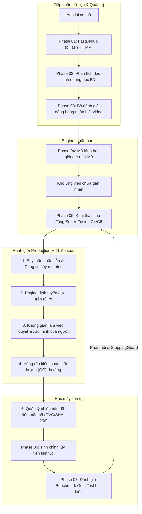
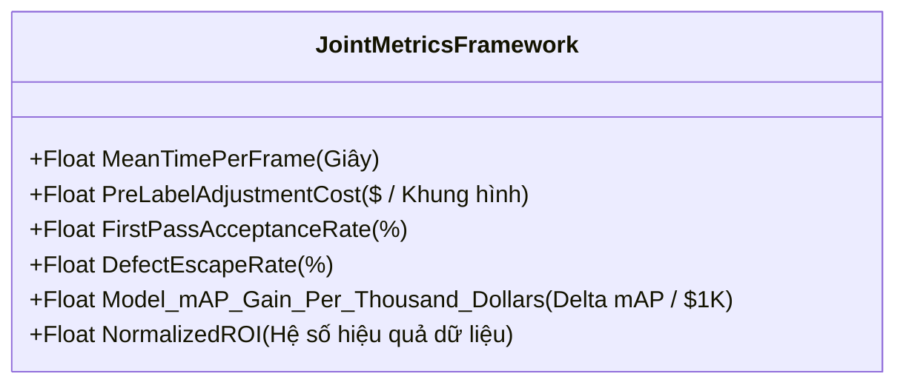
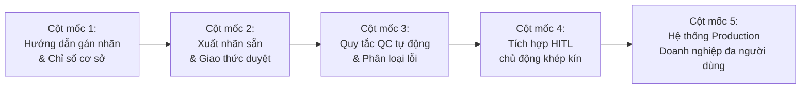

# Báo cáo thực nghiệm kỹ thuật: Human-in-the-Loop trong môi trường Production: Định hướng nghiên cứu & Lộ trình kiến trúc (Phase 08)

> **Mã tài liệu**: `docs/experiments/08_production_hitl.md`  
> **Dự án**: BDD10K Active Learning Lab (Hệ thống thị giác máy tính Human-in-the-Loop cho xe tự hành)  
> **Tác giả / Nhóm nghiên cứu**: T018  
> **Trạng thái**: Đặc tả nghiên cứu khái niệm / Lộ trình kiến trúc đề xuất  

---

## 1. Mục đích và Phạm vi tài liệu

### 1.1 Mục đích
Tài liệu này xác lập các định hướng nghiên cứu kỹ thuật trong tương lai cần thiết để chuyển đổi quy trình Active Learning cho xe tự hành từ một môi trường mô phỏng thuật toán thành một hệ sinh thái quản lý dữ liệu **Human-in-the-Loop (HITL) cấp độ Production** dùng trong doanh nghiệp thực tế.

### 1.2 Ranh giới nghiên cứu rõ ràng
> [!IMPORTANT]
> **Thông báo trạng thái dứt khoát: Đề xuất nghiên cứu so với Hiện thực hóa hiện có**:  
> Tài liệu này vạch ra **các định hướng nghiên cứu, đặc tả thiết kế, và đề xuất thực nghiệm trong tương lai**. Nó **không** mô tả một mô-đun phần mềm đã được hiện thực hóa sẵn. Các năng lực vận hành như quản lý lực lượng lao động gán nhãn đa người dùng, giao diện web duyệt hộp bao cộng tác, chấm điểm đồng thuận cấp độ kiểm toán viên, hàng đợi phân bổ tác vụ tự động, và pipeline triển khai liên tục **hoàn toàn chưa có** trong repository hiện tại.  
> 
> Mục đích của đặc tả này là cung cấp một bản thiết kế vững chắc, chuẩn mực về mặt phương pháp luận cho các nhà nghiên cứu và kỹ sư học máy nhằm mở rộng nền tảng Active Learning đã được kiểm chứng (Phase 01–07) thành các quy trình làm việc cộng tác Người - Máy thực tế ngoài đời thực.

---

## 2. Bối cảnh nghiên cứu

Trong thị giác máy tính cho xe tự hành, việc xây dựng các mô hình phát hiện đối tượng có dung lượng lớn phụ thuộc căn bản vào các nhãn ground-truth chất lượng cao và dày đặc. Dù Active Learning bằng thuật toán (đã được chứng minh trong Phase 04–07) giải quyết hiệu quả bài toán *ưu tiên hóa dữ liệu* bằng cách nhận diện các khung hình giàu thông tin và có độ bất định cao, việc lựa chọn mẫu mới chỉ giải quyết được một nửa bài toán vận hành.

Khi đưa một vòng lặp Active Learning vào môi trường công nghiệp thực tế, các câu hỏi mang tính vận hành lấy con người làm trung tâm mang tính sống còn sẽ xuất hiện:
1. **Phân bổ & Quản trị lực lượng lao động**: Ai là người tạo nhãn, ai là người kiểm toán các hộp bao ứng viên, và trách nhiệm được phân chia thế nào giữa kiểm toán viên sơ cấp và chuyên gia miền cấp cao?
2. **Phát hiện lỗi gán nhãn**: Làm thế nào để gắn cờ một cách có hệ thống các lỗi định vị tinh vi, các hộp bao không ôm sát đối tượng, hoặc các ảo giác dương tính giả trên hàng chục nghìn khung cảnh phức tạp?
3. **Kích hoạt sự can thiệp của con người**: Dưới các ngưỡng bất định thống kê hoặc tín hiệu rủi ro môi trường nào thì sự can thiệp của con người bắt buộc phải diễn ra thay vì chấp nhận dự đoán tự động của mô hình?
4. **Tối ưu hóa đồng thời Chi phí - Chất lượng**: Làm thế nào để các đội ngũ kỹ thuật định lượng được lợi tức đầu tư (ROI) thực tế về mặt tài chính và thời gian của việc con người xác minh so với độ chính xác phát hiện của mô hình ở hạ nguồn?
5. **Nguồn gốc dữ liệu & Tính bất biến**: Làm thế nào để truy vết toàn bộ vòng đời của một hộp bao—từ dự đoán ban đầu của mô hình qua sự chỉnh sửa của con người cho đến phiên bản tập dữ liệu cuối cùng?

---

## 3. Mối quan hệ khái niệm với Pipeline hiện tại

Trong tầm nhìn nghiên cứu mở rộng, Human-in-the-Loop không thay thế Active Learning thuật toán; thay vào đó, nó đưa thêm một tầng kiểm toán của con người tại giai đoạn xác minh dữ liệu:



### Hiện thực hóa đã kiểm chứng so với Phần mở rộng khái niệm:
- **Đã kiểm chứng trong Codebase (Phase 01–07)**: Khử trùng lặp tự động, lập hồ sơ quang học, phân chia cô lập video, huấn luyện mô hình cơ sở, xếp hạng đa mục tiêu, tra cứu oracle mô phỏng $O(1)$, và tinh chỉnh liên tục.
- **Phần mở rộng khái niệm đề xuất (Phase 08)**: Giao diện duyệt nhãn tương tác cho con người, ghi log chỉnh sửa của con người, định tuyến tác vụ theo trọng số rủi ro, các chỉ số đồng thuận giữa các kiểm toán viên, và quản lý lực lượng lao động doanh nghiệp.

---

## 4. Các định hướng nghiên cứu chính

### 4.1 Định hướng 1: Duyệt nhãn con người được hỗ trợ bởi nhãn dự đoán sẵn (Pre-Label Assisted Review)
**Câu hỏi nghiên cứu cốt lõi**: *Liệu việc cung cấp trước các hộp bao do mô hình dự đoán cho người kiểm toán có làm tăng đáng kể tốc độ gán nhãn mà không làm suy giảm chất lượng ground-truth cuối cùng hoặc gây ra thiên lệch xác nhận (confirmation bias) hay không?*

#### Thiết lập phương pháp luận:
Thay vì phải gán nhãn các khung cảnh lái xe phức tạp từ đầu (vẽ từ 15–30 hộp bao mỗi khung cảnh), hệ thống thực thi suy luận bằng mô hình $\mathcal{M}_{k-1}$ và hiển thị các nhãn ứng viên kèm theo điểm tin cậy tương ứng:
- **Dự đoán được chấp nhận**: Người kiểm toán xác nhận các hộp bao chính xác chỉ bằng một phím bấm.
- **Dự đoán được điều chỉnh**: Người kiểm toán tinh chỉnh tọa độ hộp bao để đảm bảo ôm sát điểm tiếp xúc mặt đất.
- **Dự đoán bị loại bỏ**: Người kiểm toán xóa các dự đoán ảo giác dương tính giả.
- **Dự đoán được thêm mới**: Người kiểm toán vẽ thêm các hộp bao bị bỏ sót đối với các đối tượng chưa được phát hiện (âm tính giả).

#### Các chỉ số đánh giá:
1. **Thời gian trung bình mỗi khung hình ($T_{\text{frame}}$)**: Số giây cần thiết để gán nhãn/xác minh một ảnh so với mốc cơ sở vẽ nhãn từ đầu.
2. **Tỷ lệ chấp nhận nhãn sẵn ($\text{PAR}$)**: Tỷ lệ phần trăm dự đoán của mô hình được chấp nhận mà không cần chỉnh sửa thủ công.
3. **Khoảng cách chỉnh sửa ($\text{IoU}_{\text{adj}}$)**: Độ dịch chuyển không gian giữa dự đoán ban đầu và hộp bao cuối cùng được con người xác nhận.
4. **Điểm chất lượng độc lập ($Q_{\text{audit}}$)**: Tỷ lệ lỗi kiểm tra mù hai chiều (double-blind) trên một tập mẫu khung hình được kiểm toán.

> [!CAUTION]
> **Nguy cơ thiên lệch xác nhận (Confirmation Bias Hazard)**:  
> Trong các quy trình có hỗ trợ nhãn sẵn, người kiểm toán có xu hướng dễ dãi chấp nhận các dự đoán hơi lệch của mô hình thay vì tốn công căn chỉnh lại tọa độ. Hơn nữa, người kiểm toán thường bỏ qua các đối tượng nhỏ, ở xa (người đi bộ, người đi xe) mà mô hình đã bỏ sót. Nghiên cứu bắt buộc phải thiết lập các giao thức xác minh nghiêm ngặt để ngăn lỗi của mô hình làm ô nhiễm tập ground-truth.

### 4.2 Định hướng 2: Ưu tiên duyệt nhãn của con người dựa trên rủi ro (Risk-Based Review Prioritization)
**Câu hỏi nghiên cứu cốt lõi**: *Dưới một ngân sách xác minh cố định của con người, liệu việc ưu tiên các khung hình ứng viên thông qua ước lượng rủi ro đa tín hiệu có phát hiện được nhiều lỗi gán nhãn hơn đáng kể so với việc duyệt ngẫu nhiên đồng nhất hay không?*

#### Kiến trúc chấm điểm rủi ro đa tín hiệu:
Thay vì duyệt ảnh một cách đồng nhất, hệ thống xếp hạng các khung hình dựa trên **Điểm rủi ro (Risk Score)** tổng hợp $\mathcal{R}(x_i)$:

$$\mathcal{R}(x_i) = w_1 \cdot \mathcal{U}_{\text{pred}}(x_i) + w_2 \cdot \mathcal{C}_{\text{conflict}}(x_i) + w_3 \cdot \mathcal{H}_{\text{hazard}}(x_i) + w_4 \cdot \mathcal{O}_{\text{optical}}(x_i)$$

Trong đó:
- $\mathcal{U}_{\text{pred}}(x_i)$: Độ bất định dự đoán thu được từ entropy biên của mô hình hoặc sự bất đồng giữa các mô hình ensemble.
- $\mathcal{C}_{\text{conflict}}(x_i)$: Các xung đột hình học, chẳng hạn như các hộp bao chồng lấn của các hạng mục không tương thích (ví dụ: `car` nằm bên trong `bus` mà không có che khuất hợp lý).
- $\mathcal{H}_{\text{hazard}}(x_i)$: Sự hiện diện của các hạng mục an toàn thiết yếu (Người tham gia giao thông yếu thế: `person`, `rider`, `bicycle`) nằm gần quỹ đạo làn đường của xe tự hành.
- $\mathcal{O}_{\text{optical}}(x_i)$: Siêu dữ liệu suy giảm quang học từ Phase 02 (tối mịt, mờ cảm biến, mưa nặng hạt, hoặc lóa đèn pha gắt).

#### Các chiến lược duyệt so sánh:
Để xác lập tính hợp lệ thực nghiệm, nghiên cứu tương lai phải benchmark 3 phương án phân bổ duyệt nhãn dưới cùng một ngân sách mẫu ($B$ khung hình):
1. **Duyệt ngẫu nhiên đồng nhất**: Lấy mẫu đại diện $B$ ảnh ngẫu nhiên từ kho chưa duyệt.
2. **Duyệt theo độ bất định thuần túy**: Chọn top-$B$ ảnh được sắp xếp duy nhất theo độ bất định biên của mô hình.
3. **Duyệt theo rủi ro đa tín hiệu**: Chọn top-$B$ ảnh được sắp xếp theo hàm rủi ro tích hợp $\mathcal{R}(x_i)$.

### 4.3 Định hướng 3: Kiểm soát chất lượng (QC) cho nhãn phát hiện đối tượng
Một khung làm việc HITL cấp độ production đòi hỏi các tiêu chuẩn nghiệm thu khách quan, chuẩn hóa dành riêng cho ngữ nghĩa xe tự hành:

| Chiều kiểm minh chất lượng | Định nghĩa khuyết tật | Ngưỡng nghiệm thu | Tác động đến xe tự hành |
| :--- | :--- | :---: | :--- |
| **Sự tồn tại đối tượng (True Object)** | Hộp bao đặt vào vạch kẻ đường, lá cây, hoặc vết bóng râm. | Tỷ lệ Dương tính giả $\le 1,0\%$ | Ngăn hiện tượng phanh gấp bóng ma (ghost braking). |
| **Tính đầy đủ (Không bỏ sót)**| Bỏ sót người tham gia giao thông yếu thế hoặc xe ở xa trong phạm vi $50\text{ m}$. | Tỷ lệ bỏ sót đối tượng $\le 2,0\%$ | Sống còn cho tránh va chạm và an toàn người đi bộ. |
| **Độ ôm sát của hộp bao** | Quá nhiều viền nền thừa hoặc bị cắt xén ranh giới đối tượng. | $\text{IoU}_{\text{tight}} \ge 0,85$ với ground-truth | Đảm bảo ước lượng khoảng cách và chiếu không gian 3D. |
| **Phân loại hạng mục** | Phân loại nhầm `rider` thành `person` hoặc `motorcycle` thành `bicycle`. | Lỗi phân loại $\le 0,5\%$ | Tác động trực tiếp đến dự đoán động học chuyển động. |
| **Trùng lặp dư thừa** | Nhiều hộp bao chồng lấn trên cùng một phương tiện vật lý đơn lẻ. | Số hộp bao dư thừa $= 0$ | Ngăn chặn bùng nổ cụm trong bộ theo dõi đối tượng. |
| **Quy tắc tiếp xúc mặt đất khi che khuất** | Hộp bao không kéo dài tới điểm tiếp xúc giữa bánh xe và mặt đường. | Lỗi tiếp xúc đất $\le 2\text{ px}$ | Ngăn ngừa các lỗi ước lượng khoảng cách thảm họa. |

### 4.4 Định hướng 4: Đo lường kết hợp Chất lượng nhãn và Chi phí gán nhãn
Đánh giá một pipeline quản lý dữ liệu chỉ dựa trên mAP của mô hình sẽ bỏ qua thực tế tài chính của kỹ thuật tập dữ liệu. Nghiên cứu phải thiết lập một khung chỉ số chi phí - chất lượng thống nhất:



| Chiều chỉ số | Mã chỉ số đề xuất | Định nghĩa toán học | Ý nghĩa vận hành |
| :--- | :--- | :--- | :--- |
| **Chi phí** | Thời gian gán nhãn trung bình | $\bar{T} = \frac{1}{N}\sum_{i=1}^N t_i \text{ (giây)}$ | Chi phí thời gian lao động trực tiếp trên mỗi khung hình. |
| **Chi phí** | Chi phí trên mỗi ảnh xác minh | $C_{\text{img}} = \bar{T} \times \text{LaborRate} + C_{\text{compute}}$ | Chi phí tài chính để tạo ra một khung hình đạt chuẩn production. |
| **Chất lượng**| Tỷ lệ đạt ngay lần đầu (FPY) | $\text{FPY} = \frac{N_{\text{approved}}}{N_{\text{total}}} \times 100\%$ | Tỷ lệ nhãn vượt qua kiểm toán chất lượng mà không phải sửa lại. |
| **Chất lượng**| Tỷ lệ lọt khuyết tật (DER) | $\text{DER} = \frac{N_{\text{escaped\_errors}}}{N_{\text{audited\_sample}}} \times 100\%$ | Tỷ lệ lỗi còn sót lại lọt vào tập dữ liệu huấn luyện. |
| **Hiệu quả** | Hiệu quả học tập trên mỗi đô-la | $\text{LE}_{\$} = \frac{\Delta mAP_{50}}{\text{Tổng chi phí gán nhãn (\$)}}$ | Mức tăng độ chính xác của mô hình trên mỗi đô-la đầu tư. |

### 4.5 Định hướng 5: Quản lý phiên bản tập dữ liệu và Truy vết nguồn gốc
Mọi vòng lặp tập dữ liệu phải được ghi nhận bất biến để đảm bảo khả năng tái lập khoa học và kiểm toán quy chuẩn an toàn. Mỗi bản ghi hộp bao phải lưu trữ:

```json
{
  "annotation_id": "ann-bdd10k-v2-048291",
  "image_id": "0407468b-ffb3903a.jpg",
  "dataset_version": "v2.1.0-gold",
  "category": "rider",
  "bbox_coordinates": [412.5, 230.1, 468.2, 345.8],
  "provenance": {
    "origin": "model_prelabel",
    "initial_model": "yolo11n_v1_best.pt",
    "initial_confidence": 0.482,
    "reviewed_by_user_id": "annotator_expert_018",
    "review_action": "category_modified_and_box_expanded",
    "timestamp": "2026-10-17T16:20:00Z",
    "time_spent_seconds": 14.2,
    "audit_status": "double_blind_verified"
  }
}
```

Cấu trúc phả hệ bất biến này đảm bảo rằng nếu mô hình có dấu hiệu suy giảm bất thường ở một hạng mục cụ thể (ví dụ: báo động giả đèn giao thông), các kỹ sư có thể truy vết xem vấn đề bắt nguồn từ sự trôi dạt nhãn sẵn của mô hình, thiên kiến của người kiểm toán, hay sự hiểu sai hướng dẫn gán nhãn.

### 4.6 Định hướng 6: Khép kín vòng lặp phản hồi Người - Máy
Mục tiêu tối thượng là thiết lập một bánh đà tự cải thiện, nơi các hiệu chỉnh của con người chủ động tái huấn luyện và làm sắc bén mô hình, trong khi mô hình ngày càng thông minh hơn sẽ dần giảm bớt khối lượng công việc cho con người:

1. **Chu kỳ $k$**: Mô hình $\mathcal{M}_{k-1}$ đưa ra dự đoán trên kho chưa gán nhãn $\mathcal{P}$.
2. **Ưu tiên hóa**: Thuật toán Super-Fusion C4/C6 chọn lô $\mathcal{B}_k$ ($K = 250$ khung hình).
3. **Người duyệt**: Người kiểm toán rà soát các nhãn sẵn, sửa đổi 15% và chấp nhận 85%.
4. **Hàng rào chất lượng**: Các quy tắc tự động kiểm toán tính tuân thủ; các khung hình không đạt chuẩn được chuyển lên hội đồng chuyên gia cấp cao.
5. **Phiên bản hóa dữ liệu**: Các khung hình đã xác minh được đóng dấu mật mã vào tập phân vùng $\mathcal{D}^{(k)}$.
6. **Tái huấn luyện**: Mô hình được tinh chỉnh với các lá chắn chống quá khớp để tạo ra $\mathcal{M}_k$.
7. **Đánh giá mô hình**: Được đánh giá trên bộ kiểm thử Fixed Gold Test bất biến để đo lường tiến trình cải thiện thực tế.

---

## 5. Thiết kế thực nghiệm đề xuất

Để đánh giá một cách chặt chẽ các định hướng nghiên cứu này, chúng tôi đề xuất một giao thức thực nghiệm so sánh 4 chiến lược chuẩn bị dữ liệu khác nhau dưới cùng các ràng buộc ngân sách:

| Phương pháp mục tiêu | Chiến lược chọn mẫu | Giao thức duyệt của người | Nguồn nhãn ban đầu |
| :--- | :--- | :--- | :--- |
| **Phương pháp 1: Đối chứng ngẫu nhiên thủ công** | Lấy mẫu ngẫu nhiên đồng nhất | Gán nhãn thủ công toàn phần từ đầu | Khung ảnh trống (Người vẽ toàn bộ hộp bao) |
| **Phương pháp 2: Chủ động theo độ bất định thuần túy** | Độ bất định biên Top-$K$ | Gán nhãn thủ công toàn phần từ đầu | Khung ảnh trống (Người vẽ toàn bộ hộp bao) |
| **Phương pháp 3: Ngẫu nhiên hỗ trợ nhãn sẵn** | Lấy mẫu ngẫu nhiên đồng nhất | Con người xác minh và điều chỉnh ranh giới | Dự đoán của mô hình $\mathcal{M}_{k-1}$ |
| **Phương pháp 4: Bánh đà Risk-HITL đề xuất** | Super-Fusion đa mục tiêu + Xếp hạng rủi ro | Con người xác minh, sửa lớp, và bổ sung ca khó | Dự đoán mô hình $\mathcal{M}_{k-1}$ + Cảnh báo rủi ro cao |

### Các biện pháp kiểm soát phương pháp luận để đánh giá công bằng:
1. **Mốc Benchmark đồng nhất**: Mọi mô hình đầu ra bắt buộc phải được đánh giá trên cùng tập **Fixed Gold Test Set** nguyên bản ($N = 1.400$ khung hình, 28.094 đối tượng).
2. **Ràng buộc ngân sách bất biến**: Việc so sánh phải được thực hiện dưới một trong hai điều kiện:
   - **Cố định ngân sách Thời gian/Tài chính**: Tổng số giờ công kiểm toán của con người bằng nhau (ví dụ: đúng 40 giờ công duyệt của con người).
   - **Cố định ngân sách Số lượng mẫu**: Tổng số khung hình đã xác minh bằng nhau (ví dụ: đúng $N = 750$ khung hình).
3. **Mô hình cơ sở kiến trúc đơn lẻ**: Mọi nhánh so sánh phải sử dụng cùng một backbone YOLO11n, cùng bộ tối ưu (AdamW), cùng lịch trình tốc độ học (Cosine Annealing), và cùng hạt giống ngẫu nhiên (`seed = 42`).

---

## 6. Các câu hỏi nghiên cứu then chốt (RQs)

Nghiên cứu tương lai phải trả lời bằng thực nghiệm 5 câu hỏi khoa học nền tảng:

- **RQ1 (Hiệu quả lựa chọn mẫu)**: *Liệu Active Learning đa mục tiêu có đạt $mAP_{50}$ trên tập Frozen Gold Test cao hơn lấy mẫu ngẫu nhiên đồng nhất khi cả hai nhánh đều bị giới hạn bởi cùng một ngân sách công lao động gán nhãn hay không?*
- **RQ2 (Tốc độ & Độ chuẩn xác của Nhãn sẵn)**: *Liệu sự hỗ trợ của nhãn sẵn có làm giảm thời gian gán nhãn trên mỗi khung hình ít nhất $40\%$ so với việc gán nhãn từ đầu mà không làm tăng tỷ lệ lọt lỗi ($\text{DER}$) vượt quá $2,0\%$ hay không?*
- **RQ3 (Phát hiện khuyết tật dựa trên Rủi ro)**: *Liệu xếp hạng rủi ro đa tín hiệu có nhận diện được lượng người tham gia giao thông yếu thế bị bỏ sót và các đối tượng bị phân loại sai trên mỗi giờ kiểm toán cao hơn ít nhất $2,5\times$ so với duyệt ngẫu nhiên đồng nhất hay không?*
- **RQ4 (Tính nhất quán theo Hướng dẫn)**: *Liệu việc đưa vào các quy tắc kiểm soát chất lượng hình học và ngữ nghĩa tự động có làm giảm độ phân tán giữa các kiểm toán viên trên các hạng mục khó (`rider`, `traffic sign`) hơn $30\%$ hay không?*
- **RQ5 (ROI kinh tế toàn trình)**: *Khi tính toán tổng chi phí gán nhãn của con người, kiểm toán chất lượng, và chi phí tính toán tinh chỉnh mô hình, quy trình làm việc nào đạt chi phí trên mỗi điểm mAP ($\$/\Delta mAP$) thấp nhất?*

---

## 7. Lộ trình phát triển theo giai đoạn

Để xây dựng các năng lực này một cách có hệ thống mà không làm mất ổn định mã nguồn hiện tại, nghiên cứu nên tiến hành qua 5 cột mốc tuần tự:



### Cột mốc 1 — Đặc tả mốc cơ sở & Hướng dẫn gán nhãn
- Chuẩn hóa tài liệu hướng dẫn vẽ hộp bao BDD10K chi tiết (quy tắc tiếp xúc bánh xe mặt đường, giới hạn điểm ảnh tối thiểu $< 10\text{ px}$, ranh giới che khuất).
- Thiết lập các chỉ số lao động cơ sở đo lường thời gian gán nhãn của con người trên các khung cảnh sạch so với các khung cảnh bị suy giảm quang học.

### Cột mốc 2 — Xuất nhãn sẵn & Ghi log chỉnh sửa
- Phát triển các script xuất tự động sinh ra các nhãn sẵn ứng viên kèm điểm tin cậy hộp bao theo các định dạng tiêu chuẩn (YOLO, COCO JSON, CVAT XML).
- Xây dựng lược đồ ghi log ghi nhận việc kiểm toán viên đã chấp nhận, điều chỉnh, xóa bỏ hay thêm mới các hộp bao.

### Cột mốc 3 — Kiểm soát chất lượng tự động & Phân loại lỗi
- Hiện thực hóa các bộ thẩm định QC bằng mã nguồn kiểm tra tọa độ hộp bao ($x_1 < x_2, y_1 < y_2$, nằm gọn trong $[0, 1]$).
- Tích hợp các quy tắc phát hiện xung đột hình học (ví dụ: gắn cờ các hộp bao người đi bộ nằm đè lên vùng bầu trời hoặc các phát hiện trùng lặp giống hệt nhau).

### Cột mốc 4 — Đồng bộ hóa Active HITL vòng lặp khép kín
- Tích hợp các chỉnh sửa đã được xác minh của con người trực tiếp trở lại các thư mục tập dữ liệu `train_v{k}` thông qua cập nhật symlink tự động.
- Kết nối đầu ra xác minh của con người với các script tái huấn luyện Phase 06, thẩm định hiệu năng trên `fixed_test`.

### Cột mốc 5 — Nền tảng Production & Vận hành lực lượng lao động
- Nghiên cứu các yêu cầu vận hành quy mô doanh nghiệp: xác thực phân quyền người dùng (Kiểm toán viên sơ cấp, Chuyên viên QA, Chuyên gia miền), hàng đợi phân phối tác vụ, và dữ liệu đo xa tự động về hiệu suất kiểm toán viên.

---

## 8. Ranh giới và Hạn chế rõ ràng

Để duy trì tính toàn vẹn tuyệt đối của tài liệu, ranh giới của codebase hiện tại phải được hiểu một cách tường minh:

### Những gì Repository hiện tại CHƯA có:
1. **Không có giao diện Web tương tác**: Repository hiện tại chứa các dashboard trình diễn tĩnh (`index.html`, `active-mining-point5.html`), nhưng **không** có công cụ vẽ hoặc chỉnh sửa hộp bao tương tác chạy trên trình duyệt.
2. **Không có xác thực người dùng hoặc quản lý phân quyền**: Không có cơ sở dữ liệu hay backend quản lý tài khoản người dùng, phân quyền, hoặc phân bổ tác vụ kiểm toán.
3. **Không có hàng đợi tác vụ thời gian thực**: Việc trích xuất khung hình diễn ra qua các script xử lý theo lô bằng Python (`src/`) thay vì hàng đợi tác vụ bất đồng bộ (ví dụ: Celery, Redis).
4. **Không có dữ liệu đo xa kiểm toán viên thời gian thực**: Các con số thực nghiệm về thời gian gán nhãn của con người mỗi khung hình ($T_{\text{frame}}$) hiện được mô phỏng dựa trên các mốc chuẩn trong tài liệu công nghiệp tiêu chuẩn, không phải đo lường trực tiếp từ đối tượng con người thực tế trong repository này.

> [!NOTE]
> Khẳng định rằng repository hiện tại đã có một hệ thống triển khai lực lượng lao động HITL production hoàn chỉnh sẽ là một sự sai lệch thực tế trực tiếp. Toàn bộ các thảo luận trong báo cáo này đại diện cho **các định hướng nghiên cứu kiến trúc** nghiêm túc, có cơ sở kỹ thuật được xây dựng trên nền tảng thuật toán đã được kiểm chứng của Phase 01–07.

---

## 9. Kết luận

Human-in-the-Loop cấp độ Production đại diện cho cây cầu vận hành sống còn kết nối lý thuyết học máy lấy dữ liệu làm trung tâm với sự an toàn của xe tự hành trong công nghiệp. Bằng cách kết hợp có hệ thống giữa:
1. **Ưu tiên hóa bằng thuật toán** (Khai thác chủ động Super-Fusion C4/C6),
2. **Xác minh có con người được tăng tốc** (Duyệt nhãn hỗ trợ nhãn sẵn),
3. **Giảm thiểu rủi ro có mục tiêu** (Phát hiện lỗi đa tín hiệu), và
4. **Phả hệ tập dữ liệu bất biến** (Quản lý phiên bản mật mã),

nghiên cứu tương lai có thể chuyển đổi việc gán nhãn dữ liệu từ một nút thắt cổ chai tốn kém, tự phát thành một ngành kỹ thuật chính xác cao, có thể kiểm toán được. Các bản thiết kế và giao thức thực nghiệm được định nghĩa trong tài liệu này cung cấp một lộ trình cụ thể, có thể tái lập để hiện thực hóa tầm nhìn đó.

---

## 10. Tài liệu liên quan

- [Tổng quan dự án](../README.md): Sứ mệnh, phạm vi và tầm nhìn Active Learning toàn trình.
- [Kiến trúc Pipeline](../02_pipeline_architecture.md): Toàn bộ kiến trúc 8 giai đoạn lấy dữ liệu làm trung tâm.
- [Tổng hợp kết quả thực nghiệm](../03_experiment_results.md): Tóm tắt benchmark định lượng đa phase.
- [Hướng dẫn tái lập](../04_reproduction_guide.md): Hướng dẫn vận hành chạy các notebook hiện có.
- [Báo cáo Phase 05 Active Mining](05_active_mining.md): Thu nạp mẫu đa mục tiêu và duyệt HITL oracle.
- [Báo cáo Phase 06 Progressive Retraining](06_retraining.md): Tinh chỉnh mô hình V1 và benchmark Gold Test.
- [Báo cáo Phase 07 Autonomous Active Loop](07_end_to_end_loop.md): Điều phối vòng lặp đa chu kỳ toàn trình.
- [README thư mục thực nghiệm](README.md): Danh mục đầy đủ toàn bộ 8 báo cáo thực nghiệm.
